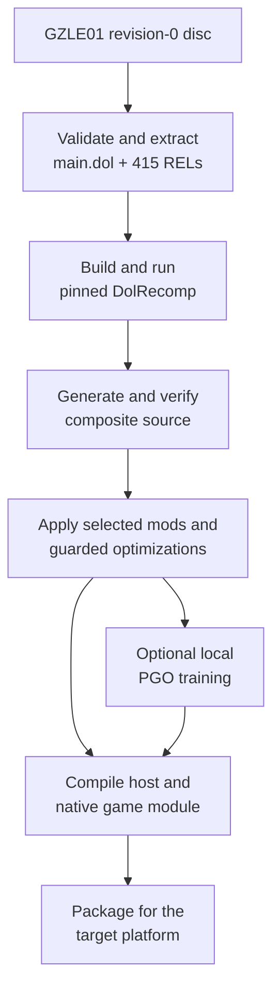

# BlueWake build process

## Contents

- [End-to-end overview](#end-to-end-overview)
- [Build toolchain overview](#build-toolchain-overview)
- [1. Coordinate](#1-coordinate)
  - [Select the builder and profile](#select-the-builder-and-profile)
- [2. Fetch](#2-fetch)
  - [Pin and retrieve dependencies](#pin-and-retrieve-dependencies)
- [3. Extract](#3-extract)
  - [Validate and extract the disc](#validate-and-extract-the-disc)
- [4. Translate](#4-translate)
  - [Generate C from PowerPC code](#generate-c-from-powerpc-code)
- [5. Compose and prepare](#5-compose-and-prepare)
  - [Generate the composite source](#generate-the-composite-source)
  - [Apply mods and optimizations](#apply-mods-and-optimizations)
- [6. Train](#6-train)
  - [Profile-guided optimization](#profile-guided-optimization)
- [7. Compile and package](#7-compile-and-package)
  - [Build the native outputs](#build-the-native-outputs)
  - [Linux](#linux-x86-64)
  - [Windows](#windows-x86-64)
  - [macOS](#macos-apple-silicon)
  - [iPhone and iPad](#iphone-and-ipad-iosipados-arm64)
  - [Apple TV](#apple-tv-tvos-arm64-experimental)
  - [Android](#android-in-progress)

This chapter expands the build-time half of the
[architecture overview](Overview.md). It follows the player's disc through
validation, translation, preparation, native compilation, and packaging.

## End-to-end overview

The direct path skips profile-guided training. Both paths produce a platform
host and a separate native module containing the translated game code.

## Build toolchain overview

| Stage | Main code or tool | What it does | Result |
| --- | --- | --- | --- |
| [Coordinate](#1-coordinate) | Platform builders and [`bluewake.sh`](../../scripts/builder/profiles/bluewake.sh) | Selects the target, inputs, options, and ordered build stages. | Reproducible build plan and provenance |
| [Fetch](#2-fetch) | Git and [`dependencies.lock.json`](../../config/dependencies.lock.json) | Retrieves the exact runtime and translator revisions. | Verified RecompCore and DolRecomp source |
| [Extract](#3-extract) | Platform builders | Confirms the supported disc and separates the code inputs needed for translation. | Validated DOL, RELs, and runtime disc |
| [Translate](#4-translate) | [Pinned DolRecomp](https://github.com/elliotttate/DolRecomp/commit/b8b534591cba8ca7cd43943a655ee6e2591cf5de) | Converts the game's PowerPC machine code into compilable C. | Generated DOL and REL C source |
| [Compose and prepare](#5-compose-and-prepare) | [`generate_composite.py`](../../scripts/generate_composite.py) and [mod scripts](../../scripts/mods) | Joins translated units and applies selected, guarded source variants. | Verified composite source |
| [Train](#6-train) | Platform PGO paths and `llvm-profdata` | Records representative execution frequencies for compiler optimization. | Optional local optimization profile |
| [Compile and package](#7-compile-and-package) | CMake, Ninja, compilers, and platform packagers | Produces native binaries and arranges them for the target platform. | Native game module and platform application |

## 1. Coordinate

### Select the builder and profile

The target selects [`scripts/linux/build.py`](../../scripts/linux/build.py),
[`scripts/windows/build.py`](../../scripts/windows/build.py), or
[`scripts/builder/build.sh`](../../scripts/builder/build.sh). Each builder
checks its tools, runs the stages, reuses safe intermediates, and records
provenance.

All builders read BlueWake's revisions from
[`scripts/builder/profiles/bluewake.sh`](../../scripts/builder/profiles/bluewake.sh).
Platform options change compilation and packaging, not the supported game.

## 2. Fetch

### Pin and retrieve dependencies

The builder checks out exact RecompCore and DolRecomp revisions under
`ref/recompcore`. It rejects modified dependency source so generated output
can be traced to the recorded inputs.

RecompCore supplies the compatibility runtime, GXRuntime, Aurora, DSP sources,
and DolRecomp. Origins and roles are recorded in
[`config/dependencies.lock.json`](../../config/dependencies.lock.json).

## 3. Extract

### Validate and extract the disc

The builder verifies the USA revision-0 `GZLE01` disc before the long build.
It extracts `main.dol` and 415 REL modules for translation; the disc continues
to supply runtime assets.

Linux accepts `.iso` and `.gcm`. Windows also supports its pinned `nodtool`
conversion path. Apple builds use an uncompressed ISO. See the commands in
[`docs/BUILD_YOUR_OWN.md`](../BUILD_YOUR_OWN.md).

## 4. Translate

### Generate C from PowerPC code

The builder compiles pinned DolRecomp, then runs its GameCube C backend over
the DOL and each REL. The result preserves PowerPC operations and guest
addresses; it is not reconstructed Nintendo source code.

The builder checks out the
[pinned DolRecomp revision](https://github.com/elliotttate/DolRecomp/commit/b8b534591cba8ca7cd43943a655ee6e2591cf5de)
under `ref/recompcore/DolRecomp`. Each platform builder records its invocation
in the build log.

## 5. Compose and prepare

### Generate the composite source

[`scripts/generate_composite.py`](../../scripts/generate_composite.py) combines
the DOL and REL translations with shared dispatch and module metadata. The
result can address code across the original executable and REL boundaries.

[`scripts/audit_composite_provenance.py`](../../scripts/audit_composite_provenance.py)
and the profile digest verify the generated base. Unexpected input stops the
normal build instead of silently producing a different module.

### Apply mods and optimizations

[`scripts/mods/build_mod_variants.py`](../../scripts/mods/build_mod_variants.py)
adds selected widescreen and Better Wind Waker variants. The builder applies
selected guarded preparations through
[`scripts/builder/module_optimizations.py`](../../scripts/builder/module_optimizations.py).

Preparations verify the source shape or digest they expect. If a guard fails,
the original translated implementation remains in place.

## 6. Train

### Profile-guided optimization

When enabled, the [Linux builder](../../scripts/linux/build.py) and
[Windows builder](../../scripts/windows/build.py) run their platform training
flows directly; the Apple builder uses
[`train_local_pgo.py`](../../scripts/builder/train_local_pgo.py). Each builds
an instrumented module, runs headless playbacks, and merges the results with
`llvm-profdata` for the final compile.

Fingerprints prevent reuse with incompatible inputs. Training output stays in
the private build directory and is not a public artifact.

## 7. Compile and package

### Build the native outputs

CMake and Ninja compile the prepared composite into a native game module. A
separate build produces the shared host, runtime, renderer, audio, input,
storage, and platform entry code.

Packaging arranges those outputs and support files for the target. Platform
SDKs, signing, and final artifact formats diverge here.

### Linux (x86-64)

[`scripts/linux/build.py`](../../scripts/linux/build.py) uses Clang, LLD,
CMake, and Ninja. [`linux/CMakeLists.txt`](../../linux/CMakeLists.txt) builds
the host; [`scripts/linux/make_appimage.sh`](../../scripts/linux/make_appimage.sh)
optionally creates the AppImage.

| Artifact | Default location |
| --- | --- |
| Host | `build/linux/BlueWake/bluewake` |
| Game module | `build/linux/BlueWake/gGZLE01_recomp.so` |
| App folder | `build/linux/BlueWake/` |
| Optional AppImage | `build/linux/BlueWake-x86_64.AppImage` |

`--ci-container` uses the shared
[`scripts/linux/Dockerfile`](../../scripts/linux/Dockerfile) environment.

### Windows (x86-64)

[`scripts/windows/build.py`](../../scripts/windows/build.py) uses Visual Studio
LLVM/Clang, CMake, and Ninja. [`windows/CMakeLists.txt`](../../windows/CMakeLists.txt)
adds the Windows entry, settings, crash handling, resources, and compatibility
layer.

| Artifact | Default location |
| --- | --- |
| Host | `build/windows/BlueWake/BlueWake.exe` |
| Game module | `build/windows/BlueWake/gGZLE01_recomp.dll` |
| App folder | `build/windows/BlueWake/` |

[`scripts/windows/package_release.py`](../../scripts/windows/package_release.py)
assembles the distributable folder and runtime DLLs.

### macOS (Apple silicon)

[`scripts/builder/build.sh`](../../scripts/builder/build.sh) with `--platform
macos` uses Apple Clang and the macOS SDK.
[`scripts/builder/package_macos.py`](../../scripts/builder/package_macos.py)
creates and signs the app bundle.

| Artifact | Default location |
| --- | --- |
| App | `build/macos/packaged/BlueWake.app` |
| Game module | `BlueWake.app/Contents/Frameworks/gGZLE01_recomp.dylib` |
| Personal game inputs | `BlueWake.app/Contents/Resources/Game/` |

### iPhone and iPad (iOS/iPadOS, arm64)

The default [`scripts/builder/build.sh`](../../scripts/builder/build.sh) target
uses Apple Clang and the iPhoneOS SDK.
[`apple/ios/CMakeLists.txt`](../../apple/ios/CMakeLists.txt) adds UIKit, touch,
controller, and mobile services.

| Artifact | Role |
| --- | --- |
| `BlueWake.app` | Signed or ad-hoc app bundle |
| `Frameworks/gGZLE01_recomp.dylib` | Translated game module |
| Optional IPA | Unsigned package for sideloading |

The IPA path excludes disc and extracted game data. PadMint can add the
player's module to an app-only build.

### Apple TV (tvOS, arm64; experimental)

[`scripts/tvos/build_device.sh`](../../scripts/tvos/build_device.sh) selects
the tvOS branch of the Apple builder. It creates a controller-first app and
can install, transfer the disc, and launch through `devicectl`.

The current Dawn archive bridge remains experimental. See the
[tvOS build guide](../status/TVOS_BUILD.md).

### Android (in progress)

Android arm64 support is under development in
[PR #93](https://github.com/chrissotraidis/bluewake/pull/93). It is not yet a
current build path, so its proposed artifacts are not included above.
