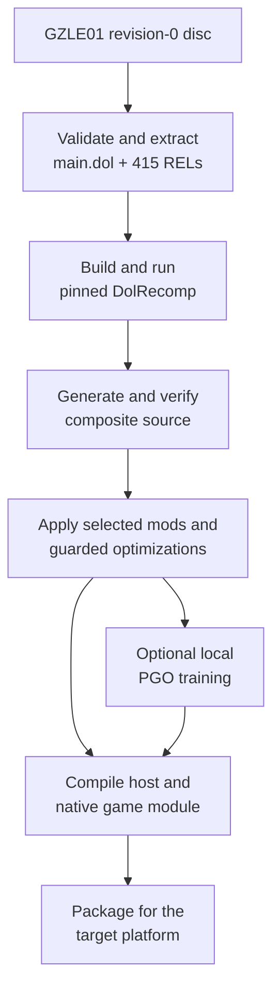
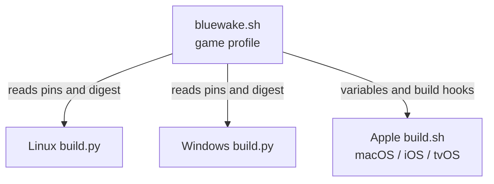

# BlueWake build process

## Contents

- [End-to-end overview](#end-to-end-overview)
- [Build toolchain overview](#build-toolchain-overview)
  - [Concepts](#concepts)
- [1. Coordinate](#1-coordinate)
  - [`bluewake.sh` game profile](#bluewakesh-game-profile)
  - [Linux builder](#linux-builder)
  - [Windows builder](#windows-builder)
  - [Apple builder](#apple-builder)
- [2. Fetch](#2-fetch)
- [3. Extract](#3-extract)
- [4. Translate](#4-translate)
- [5. Compose and prepare](#5-compose-and-prepare)
  - [Generate the composite source](#generate-the-composite-source)
  - [Apply mods and optimizations](#apply-mods-and-optimizations)
- [6. Train](#6-train)
- [7. Compile and package](#7-compile-and-package)
  - [Linux](#linux-x86-64)
  - [Windows](#windows-x86-64)
  - [macOS](#macos-apple-silicon)
  - [iPhone and iPad](#iphone-and-ipad-iosipados-arm64)
  - [Apple TV](#apple-tv-tvos-arm64-experimental)
  - [Android](#android-in-progress)

This chapter expands the build-time half of the
[architecture overview](Overview.md). It follows the player's disc through
validation, translation, preparation, native compilation, and packaging.

## End-to-end overview

The direct path skips profile-guided training. Both paths produce a platform
host and a separate native module containing the translated game code.

## Build toolchain overview

### Concepts

- [RecompCore](https://github.com/chrissotraidis/RecompCore) — the lower-level static-recompilation foundation inherited from the Wind Waker Recomp lineage. BlueWake fetches a tested RecompCore revision into `ref/recompcore` and uses its GXRuntime, Aurora renderer, DSP support, CPU/runtime interfaces, and DolRecomp submodule. BlueWake adds the `GZLE01` build profile, composite preparation, mods, platform applications, packaging, and game-specific host integration; runtime changes are developed in RecompCore and then adopted by updating BlueWake's pin.

- [Build profile](../../scripts/builder/profiles/bluewake.sh) — game-specific configuration and hooks, not performance data. `bluewake.sh` defines the supported game, dependency pins, expected generated-source digest, output names, and Apple build hooks.

- [DOL](https://wiibrew.org/wiki/DOL) — the GameCube's main executable format. BlueWake extracts `main.dol` alongside 415 loadable REL modules before translating either kind of code.

- [REL](https://wiibrew.org/wiki/REL) — a relocatable GameCube executable module, similar in purpose to a dynamic library. Wind Waker loads and unloads these modules as their code and data are needed; BlueWake extracts all 415 RELs, translates each one, and combines them with the DOL translation while retaining their module metadata.

- [DolRecomp](https://github.com/elliotttate/DolRecomp) — the ahead-of-time translator. It converts PowerPC instructions from the DOL and RELs into C while preserving guest CPU and address semantics; it does not reconstruct Nintendo's original source.

- [Profile-guided optimization](../../scripts/linux/build.py#L771-L906) — the final compiler uses recorded execution counts to optimize frequently executed translated paths. The resulting `.profdata` is a compiler input, separate from the build profile above.

- [Training](../../scripts/linux/build.py#L979-L1105) — deterministic headless game playbacks used to produce PGO counters, not machine learning. Builders merge the raw counters with `llvm-profdata` and keep game-derived profiles in the private build directory.

`OUT` below is the output directory selected for the build.

| Stage | Main code or tool | What it does | Result | Artifact |
| --- | --- | --- | --- | --- |
| Coordinate | [Platform builders](#1-coordinate) and [`bluewake.sh`](../../scripts/builder/profiles/bluewake.sh) | Selects the target, inputs, options, and ordered build stages. | Ordered build with pinned inputs and provenance | Build logs under `OUT/logs/` |
| Fetch | Git and [`dependencies.lock.json`](../../config/dependencies.lock.json) | Retrieves and verifies the exact runtime and translator revisions. | Exact RecompCore and DolRecomp source | Checkout under `ref/recompcore/` |
| Extract | [Platform builders](#3-extract) | Confirms the supported disc and separates the code inputs needed for translation. | Validated DOL, RELs, and runtime disc | `OUT/game/main.dol` and `OUT/game/rels/` |
| Translate | [Pinned DolRecomp](https://github.com/elliotttate/DolRecomp/commit/b8b534591cba8ca7cd43943a655ee6e2591cf5de) | Converts the game's PowerPC machine code into compilable C. | Generated C for PowerPC code | Generated tree under `OUT/translated/` |
| Compose and prepare | [`generate_composite.py`](../../scripts/generate_composite.py) and [mod scripts](../../scripts/mods) | Joins translated units and applies selected, guarded source variants. | Verified composite source and selected variants | `OUT/composite-src/` and its digest files |
| Train | [Platform PGO paths](#6-train) and `llvm-profdata` | Records representative execution frequencies for compiler optimization. | Optional local optimization profile | `OUT/pgo-local/composite.profdata` or `OUT/composite.profdata` |
| Compile and package | [CMake targets and platform packagers](#7-compile-and-package) | Produces native binaries and arranges them for the target platform. | Native module and platform application | [Platform artifact paths](#7-compile-and-package) |

## 1. Coordinate

### `bluewake.sh` game profile

[`scripts/builder/profiles/bluewake.sh`](../../scripts/builder/profiles/bluewake.sh)
is sourced configuration and shell functions, not a standalone builder.

| Stage | What it does | Result | Artifact/output | Code reference |
| --- | --- | --- | --- | --- |
| Describe the game | Defines the game ID, bundle ID, module name, default output, and PGO inputs. | One shared game and application identity | `PROFILE_*` variables | [Profile variables](../../scripts/builder/profiles/bluewake.sh#L20-L35) |
| Pin dependencies | Selects exact RecompCore and DolRecomp revisions and verifies the Dawn archive by checksum. | Reproducible dependency inputs | `RECOMPCORE_SHA`, `DOLRECOMP_SHA`, `DAWN_SHA256` | [Dependency pins](../../scripts/builder/profiles/bluewake.sh#L37-L44) |
| Guard generation | Records the accepted digest for the unmodified generated composite. | Builders reject unexpected translator or disc output. | `COMPOSITE_DIGEST` | [Digest and verification](../../scripts/builder/profiles/bluewake.sh#L45-L190) |
| Define Apple hooks | Implements dependency, extraction, translation, generation, mod, compile, and app functions. | The generic Apple pipeline can build BlueWake without game-specific logic. | `profile_*` shell functions | [Profile hooks](../../scripts/builder/profiles/bluewake.sh#L49-L319) |

Linux and Windows parse the shared pin and digest values directly. The Apple
builder sources the file and invokes its hook functions.

### Linux builder

[`scripts/linux/build.py`](../../scripts/linux/build.py) owns the Linux x86-64
pipeline.

| Stage | What it does | Result | Artifact/output | Code reference |
| --- | --- | --- | --- | --- |
| Check environment | Verifies Clang, LLD, `llvm-profdata`, CMake, Ninja, Git, and Python. `--ci-container` builds the shared image and reinvokes the builder inside it. | Native or containerized Linux toolchain ready | Stage logs under `OUT/logs/` | [`run_in_ci_container`](../../scripts/linux/build.py#L236-L284), [`check_tools`](../../scripts/linux/build.py#L348-L438) |
| Prepare inputs | Fetches pinned dependencies, validates the disc, and extracts `main.dol` plus 415 RELs. | Verified source inputs | `ref/recompcore/` and `OUT/game/` | [`dependencies`](../../scripts/linux/build.py#L439-L475), [`disc` and `extract`](../../scripts/linux/build.py#L476-L541) |
| Generate source | Builds DolRecomp, translates DOL/REL code, verifies the composite digest, and applies selected mods and guarded preparations. | Compilable prepared composite | `OUT/translated/` and `OUT/composite-src/` | [`build_dolrecomp` through `generate`](../../scripts/linux/build.py#L496-L632), [`build_mods` and preparation](../../scripts/linux/build.py#L633-L770) |
| Train | Builds an instrumented module, runs headless playbacks, and merges profiles unless training is skipped or reused. | Local optimization profile | `OUT/pgo-local/composite.profdata` | [`train`](../../scripts/linux/build.py#L979-L1105) |
| Compile and assemble | Compiles the game module and host, then copies game inputs, DSP data, and provenance into the app folder. | Runnable Linux folder | `OUT/BlueWake/bluewake` and `OUT/BlueWake/gGZLE01_recomp.so` | [`compile_module`](../../scripts/linux/build.py#L771-L906), [`build_app` and `package`](../../scripts/linux/build.py#L1115-L1178) |
| Package AppImage | With `--appimage`, packages and audits the assembled outputs. | Portable Linux package | `OUT/BlueWake-x86_64.AppImage` | [`package_appimage`](../../scripts/linux/build.py#L1179-L1205) |

### Windows builder

[`scripts/windows/build.py`](../../scripts/windows/build.py) provides the
Windows x86-64 pipeline.

| Stage | What it does | Result | Artifact/output | Code reference |
| --- | --- | --- | --- | --- |
| Check environment | Verifies Visual Studio's LLVM/Clang, the Windows SDK, CMake, Ninja, and Git. | Windows toolchain ready | Stage logs under `OUT/logs/` | [`check_tools` and Visual Studio environment](../../scripts/windows/build.py#L271-L374) |
| Prepare inputs | Converts supported Dolphin formats through pinned `nodtool`, validates the disc, and extracts the DOL and 415 RELs. | Verified source inputs | Converted ISO when needed and `OUT/game/` | [`dependencies` and `disc`](../../scripts/windows/build.py#L375-L471), [`extract`](../../scripts/windows/build.py#L547-L561) |
| Generate source | Builds DolRecomp, translates the DOL/REL code, verifies the composite, and applies requested mod variants. | Compilable prepared composite | `OUT/translated/` and `OUT/composite-src/` | [`build_dolrecomp` through `generate`](../../scripts/windows/build.py#L472-L676), [`build_mods` and preparation](../../scripts/windows/build.py#L677-L871) |
| Train | Builds an instrumented module, runs headless playbacks, and merges or reuses the local profile. | Local optimization profile | `OUT/pgo-local/composite.profdata` | [`train`](../../scripts/windows/build.py#L1046-L1173) |
| Compile | Compiles the translated module and Windows host with the selected profile. | Native Windows binaries | `gGZLE01_recomp.dll` and `BlueWake.exe` | [`compile_module`](../../scripts/windows/build.py#L872-L1006), [`build_app`](../../scripts/windows/build.py#L1216-L1224) |
| Assemble | Copies Dawn, SDL, DSP, game inputs, runtime DLLs, and provenance into one folder. | Directly runnable Windows build | `OUT/BlueWake/` | [`package`](../../scripts/windows/build.py#L1225-L1294) |

### Apple builder

[`scripts/builder/build.sh`](../../scripts/builder/build.sh) is the generic
pipeline for macOS, iOS/iPadOS, and tvOS.

| Stage | What it does | Result | Artifact/output | Code reference |
| --- | --- | --- | --- | --- |
| Select target | Parses signing, PGO, optimization, packaging, and device options; selects `macosx`, `iphoneos`, or `appletvos`. | Configured Apple build | Selected Xcode SDK and `OUT/logs/` | [Argument and SDK selection](../../scripts/builder/build.sh#L68-L207) |
| Load profile | Sources `bluewake.sh`, checks Xcode/CMake/Ninja, and calls its dependency, extraction, translation, generation, and mod hooks. | Verified prepared composite | `ref/recompcore/`, `OUT/game/`, and `OUT/composite-src/` | [Profile loading](../../scripts/builder/build.sh#L150-L173), [pipeline hooks](../../scripts/builder/build.sh#L225-L271) |
| Train | Optionally invokes the profile's local training hook and merges the recorded profile. | Local optimization profile | `OUT/composite.profdata` | [Training dispatch](../../scripts/builder/build.sh#L272-L283), [`profile_train`](../../scripts/builder/profiles/bluewake.sh#L204-L215) |
| Compile module | Calls the profile compile hook for the selected SDK and architecture. | Native translated module | `gGZLE01_recomp.dylib` | [Compile stage](../../scripts/builder/build.sh#L284-L290), [`profile_compile`](../../scripts/builder/profiles/bluewake.sh#L216-L258) |
| Build and sign app | Builds or imports the app, embeds the module, records module optimizations, and signs the module and bundle. | Installable target app | Platform `.app` bundle | [Build, embed, and sign](../../scripts/builder/build.sh#L291-L340) |
| Package | Creates macOS `BlueWake.app` or an optional unsigned IPA. IPA staging removes signing material and rejects private game/save/key files. | Distributable package | `OUT/packaged/BlueWake.app` or requested IPA | [Packaging and privacy checks](../../scripts/builder/build.sh#L341-L390) |
| Install | When requested, transfers and launches the supported device build. | Running device installation | Installed app and device launch | [Device installation](../../scripts/builder/build.sh#L391-L410) |

All three builders validate their tools, reuse safe intermediates, and record
provenance. Platform options change compilation and packaging, not the
supported game revision.

## 2. Fetch

The builder checks out exact RecompCore and DolRecomp revisions under
`ref/recompcore`. It rejects modified dependency source so generated output
can be traced to the recorded inputs.

RecompCore supplies the compatibility runtime, GXRuntime, Aurora, DSP sources,
and DolRecomp. Origins and roles are recorded in
[`config/dependencies.lock.json`](../../config/dependencies.lock.json).

## 3. Extract

The builder verifies the USA revision-0 `GZLE01` disc before the long build.
It extracts `main.dol` and 415 REL modules for translation; the disc continues
to supply runtime assets.

Linux accepts `.iso` and `.gcm`. Windows also supports its pinned `nodtool`
conversion path. Apple builds use an uncompressed ISO. See the commands in
[`docs/BUILD_YOUR_OWN.md`](../BUILD_YOUR_OWN.md).

## 4. Translate

The builder compiles pinned DolRecomp, then runs its GameCube C backend over
the DOL and each REL. The result preserves PowerPC operations and guest
addresses; it is not reconstructed Nintendo source code.

The builder checks out the
[pinned DolRecomp revision](https://github.com/elliotttate/DolRecomp/commit/b8b534591cba8ca7cd43943a655ee6e2591cf5de)
under `ref/recompcore/DolRecomp`. Each platform builder records its invocation
in the build log.

## 5. Compose and prepare

### Generate the composite source

[`scripts/generate_composite.py`](../../scripts/generate_composite.py) combines
the DOL and REL translations with shared dispatch and module metadata. The
result can address code across the original executable and REL boundaries.

[`scripts/audit_composite_provenance.py`](../../scripts/audit_composite_provenance.py)
and the profile digest verify the generated base. Unexpected input stops the
normal build instead of silently producing a different module.

### Apply mods and optimizations

[`scripts/mods/build_mod_variants.py`](../../scripts/mods/build_mod_variants.py)
adds selected widescreen and Better Wind Waker variants. The builder applies
selected guarded preparations through
[`scripts/builder/module_optimizations.py`](../../scripts/builder/module_optimizations.py).

Preparations verify the source shape or digest they expect. If a guard fails,
the original translated implementation remains in place.

## 6. Train

When enabled, the [Linux builder](../../scripts/linux/build.py) and
[Windows builder](../../scripts/windows/build.py) run their platform training
flows directly; the Apple builder uses
[`train_local_pgo.py`](../../scripts/builder/train_local_pgo.py). Each builds
an instrumented module, runs headless playbacks, and merges the results with
`llvm-profdata` for the final compile.

Fingerprints prevent reuse with incompatible inputs. Training output stays in
the private build directory and is not a public artifact.

## 7. Compile and package

CMake and Ninja compile the prepared composite into a native game module. A
separate build produces the shared host, runtime, renderer, audio, input,
storage, and platform entry code.

Packaging arranges those outputs and support files for the target. Platform
SDKs, signing, and final artifact formats diverge here.

### Linux (x86-64)

[`scripts/linux/build.py`](../../scripts/linux/build.py) uses Clang, LLD,
CMake, and Ninja. [`linux/CMakeLists.txt`](../../linux/CMakeLists.txt) builds
the host; [`scripts/linux/make_appimage.sh`](../../scripts/linux/make_appimage.sh)
optionally creates the AppImage.

| Artifact | Default location |
| --- | --- |
| Host | `build/linux/BlueWake/bluewake` |
| Game module | `build/linux/BlueWake/gGZLE01_recomp.so` |
| App folder | `build/linux/BlueWake/` |
| Optional AppImage | `build/linux/BlueWake-x86_64.AppImage` |

`--ci-container` uses the shared
[`scripts/linux/Dockerfile`](../../scripts/linux/Dockerfile) environment.

### Windows (x86-64)

[`scripts/windows/build.py`](../../scripts/windows/build.py) uses Visual Studio
LLVM/Clang, CMake, and Ninja. [`windows/CMakeLists.txt`](../../windows/CMakeLists.txt)
adds the Windows entry, settings, crash handling, resources, and compatibility
layer.

| Artifact | Default location |
| --- | --- |
| Host | `build/windows/BlueWake/BlueWake.exe` |
| Game module | `build/windows/BlueWake/gGZLE01_recomp.dll` |
| App folder | `build/windows/BlueWake/` |

[`scripts/windows/package_release.py`](../../scripts/windows/package_release.py)
assembles the distributable folder and runtime DLLs.

### macOS (Apple silicon)

[`scripts/builder/build.sh`](../../scripts/builder/build.sh) with `--platform
macos` uses Apple Clang and the macOS SDK.
[`scripts/builder/package_macos.py`](../../scripts/builder/package_macos.py)
creates and signs the app bundle.

| Artifact | Default location |
| --- | --- |
| App | `build/macos/packaged/BlueWake.app` |
| Game module | `BlueWake.app/Contents/Frameworks/gGZLE01_recomp.dylib` |
| Personal game inputs | `BlueWake.app/Contents/Resources/Game/` |

### iPhone and iPad (iOS/iPadOS, arm64)

The default [`scripts/builder/build.sh`](../../scripts/builder/build.sh) target
uses Apple Clang and the iPhoneOS SDK.
[`apple/ios/CMakeLists.txt`](../../apple/ios/CMakeLists.txt) adds UIKit, touch,
controller, and mobile services.

| Artifact | Role |
| --- | --- |
| `BlueWake.app` | Signed or ad-hoc app bundle |
| `Frameworks/gGZLE01_recomp.dylib` | Translated game module |
| Optional IPA | Unsigned package for sideloading |

The IPA path excludes disc and extracted game data. PadMint can add the
player's module to an app-only build.

### Apple TV (tvOS, arm64; experimental)

[`scripts/tvos/build_device.sh`](../../scripts/tvos/build_device.sh) selects
the tvOS branch of the Apple builder. It creates a controller-first app and
can install, transfer the disc, and launch through `devicectl`.

The current Dawn archive bridge remains experimental. See the
[tvOS build guide](../status/TVOS_BUILD.md).

### Android (in progress)

Android arm64 support is under development in
[PR #93](https://github.com/chrissotraidis/bluewake/pull/93). It is not yet a
current build path, so its proposed artifacts are not included above.
