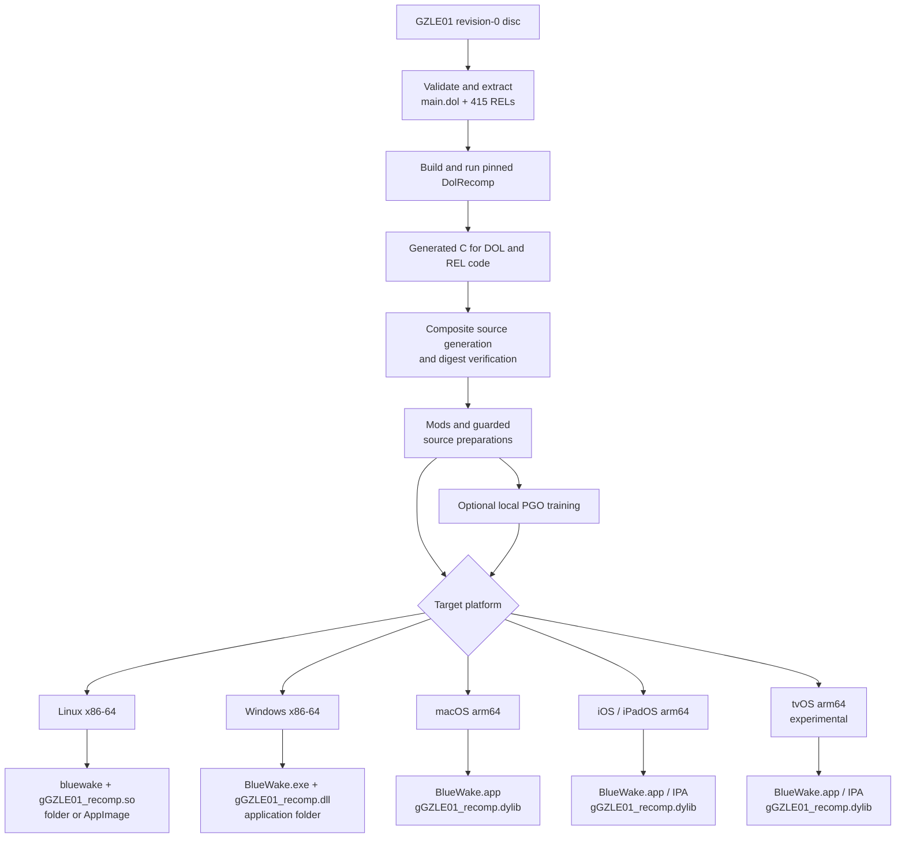

# BlueWake build toolchain

## Contents

- [End-to-end build](#end-to-end-build)
- [Shared pipeline](#shared-pipeline)
  - [1. Builders and build profile](#1-builders-and-build-profile)
  - [2. Runtime and translator inputs](#2-runtime-and-translator-inputs)
  - [3. Disc validation and extraction](#3-disc-validation-and-extraction)
  - [4. PowerPC translation](#4-powerpc-translation)
  - [5. Composite generation](#5-composite-generation)
  - [6. Mods and source preparation](#6-mods-and-source-preparation)
  - [7. Profile-guided optimization](#7-profile-guided-optimization)
  - [8. Target compilation](#8-target-compilation)
- [Platform branches](#platform-branches)
  - [Linux](#linux-x86-64)
  - [Windows](#windows-x86-64)
  - [macOS](#macos-apple-silicon)
  - [iPhone and iPad](#iphone-and-ipad-iosipados-arm64)
  - [Apple TV](#apple-tv-tvos-arm64-experimental)

This chapter expands the build-time half of the
[architecture overview](Overview.md). It follows the current builders from the
player's disc to the native application and translated game module, then shows
where each supported platform diverges.

## End-to-end build

The direct `Prepare` → `Target` path represents builds without local training.
Both paths compile the translated game module and the platform host separately.

## Shared pipeline

### 1. Builders and build profile

Three entry points coordinate the current builds:

| Targets | Builder |
| --- | --- |
| Linux | [`scripts/linux/build.py`](../../scripts/linux/build.py) |
| Windows | [`scripts/windows/build.py`](../../scripts/windows/build.py) |
| macOS, iOS/iPadOS, tvOS | [`scripts/builder/build.sh`](../../scripts/builder/build.sh) |

The builders validate their host tools, execute stages in order, retain reusable
work, record logs, and write provenance. They read the same BlueWake revisions
from [`scripts/builder/profiles/bluewake.sh`](../../scripts/builder/profiles/bluewake.sh).
[`config/dependencies.lock.json`](../../config/dependencies.lock.json) records
the dependency origins and roles.

### 2. Runtime and translator inputs

The profile pins RecompCore and DolRecomp to exact revisions. RecompCore
provides the compatibility runtime, GXRuntime, Aurora, DSP sources, and its
DolRecomp submodule. Each builder checks out those revisions under
`ref/recompcore` and refuses to continue with modified dependency source.

The pinned [DolRecomp](../../ref/recompcore/DolRecomp) executable is itself
built with CMake and Ninja before translation begins.

### 3. Disc validation and extraction

The supported input is the USA revision-0 GameCube release identified as
`GZLE01`. The builders reject another game or revision before the long build.
Linux accepts uncompressed `.iso` or `.gcm` images, while the Apple guide uses
an uncompressed `.iso`. Windows can also convert supported compressed Dolphin
formats through its pinned `nodtool` workflow.

The extraction step produces:

- `main.dol`, the game's main PowerPC executable;
- 415 REL files, the game's loadable PowerPC modules.

The original disc remains the source of models, textures, audio, stage data,
and other runtime assets.

### 4. PowerPC translation

DolRecomp runs with its GameCube/Gekko C backend over the DOL and every REL.
Its generated C mechanically represents the original instructions and guest
CPU operations. It does not reconstruct Nintendo's original source-level
types, class structure, expressions, or comments.

### 5. Composite generation

[`scripts/generate_composite.py`](../../scripts/generate_composite.py) combines
the separate DOL and REL translations into one source tree. It adds the module
metadata and dispatch structures required to address translated code across the
original executable-module boundaries.

Each builder compares the base tree with the composite digest recorded in the
BlueWake profile. A mismatch normally indicates a different disc, translator,
or generation path and stops the build unless explicitly accepted for
development.

### 6. Mods and source preparation

The builders can add widescreen and Better Wind Waker variants to the composite
source. Platform builders also expose selected preparation passes and certified
native helpers. These changes are maintained as repeatable scripts and inputs,
not as manual edits to generated files.

A guarded optimization verifies the source shape or hash it was designed for.
If the expected input does not match, that optimization leaves the translated
implementation in place.

### 7. Profile-guided optimization

The personal-build paths can compile an instrumented game module and run
isolated headless playbacks. `llvm-profdata` merges the recorded counts into a
profile used by the final module compilation. Profile fingerprints include the
inputs that affect code generation, preventing reuse across incompatible
builds.

Training data and game-derived profiles remain in the private build directory.
Disabling training changes optimization input, not the architecture or module
interface.

### 8. Target compilation

CMake and Ninja compile two distinct outputs:

- the prepared composite source becomes a native dynamic game module;
- the shared BlueWake host, RecompCore/GXRuntime, Aurora, platform entry code,
  audio support, and operating-system integration become the platform app.

The platform application loads the translated module into its own process. The
module remains native code while using guest CPU state, guest addresses, and
GameCube-compatible runtime services.

## Platform branches

### Linux (x86-64)

[`scripts/linux/build.py`](../../scripts/linux/build.py) drives Clang, CMake,
Ninja, and LLD. [`linux/CMakeLists.txt`](../../linux/CMakeLists.txt) combines
the shared host with the Linux entry, setup UI, disc chooser, and crash
reporting. Aurora uses Dawn with Vulkan or OpenGL, and SDL supplies desktop
window/input integration.

| Artifact | Default location or role |
| --- | --- |
| Host | `build/linux/BlueWake/bluewake` |
| Game module | `build/linux/BlueWake/gGZLE01_recomp.so` |
| Personal app folder | `build/linux/BlueWake/` |
| Optional AppImage | `build/linux/BlueWake-x86_64.AppImage` |

The personal folder contains the prepared DOL/REL files and the player's disc.
The optional [`make_appimage.sh`](../../scripts/linux/make_appimage.sh) package
excludes them; its first-run setup imports them from the player's disc. The
`--ci-container` option runs the same builder inside the shared
[`scripts/linux/Dockerfile`](../../scripts/linux/Dockerfile) environment.

### Windows (x86-64)

[`scripts/windows/build.py`](../../scripts/windows/build.py) drives the Visual
Studio LLVM/Clang toolchain, CMake, and Ninja.
[`windows/CMakeLists.txt`](../../windows/CMakeLists.txt) adds the Windows entry,
settings, crash handling, resources, and POSIX compatibility layer. Aurora's
Dawn integration targets Direct3D 12 or Vulkan.

| Artifact | Default location or role |
| --- | --- |
| Host | `build/windows/BlueWake/BlueWake.exe` |
| Game module | `build/windows/BlueWake/gGZLE01_recomp.dll` |
| Personal app folder | `build/windows/BlueWake/` |

The builder places the required runtime DLLs and personal game inputs beside
the two principal binaries so the folder is directly runnable.

### macOS (Apple silicon)

[`scripts/builder/build.sh`](../../scripts/builder/build.sh) with
`--platform macos` uses the macOS SDK and Apple Clang for arm64. It builds the
shared desktop host and translated dylib, then
[`package_macos.py`](../../scripts/builder/package_macos.py) creates and signs
the movable application bundle.

| Artifact | Default location or role |
| --- | --- |
| Host bundle | `build/macos/packaged/BlueWake.app` |
| Game module | `BlueWake.app/Contents/Frameworks/gGZLE01_recomp.dylib` |
| Personal game inputs | `BlueWake.app/Contents/Resources/Game/` |

The personal app contains the disc and extracted DOL/REL files. Saves and
preferences remain outside the bundle under the user's Application Support
directory.

### iPhone and iPad (iOS/iPadOS, arm64)

The default [`scripts/builder/build.sh`](../../scripts/builder/build.sh) target
uses the iPhoneOS SDK and Apple Clang.
[`apple/ios/CMakeLists.txt`](../../apple/ios/CMakeLists.txt) adds the UIKit
lifecycle, touch controls, controller support, first-run import, and mobile
services to the shared host.

| Artifact | Role |
| --- | --- |
| `BlueWake.app` | Signed or ad-hoc application bundle |
| `Frameworks/gGZLE01_recomp.dylib` | Embedded translated game module |
| Optional IPA | Unsigned package for a sideloading tool |

The IPA packaging step excludes the disc and extracted DOL/REL files. The
player supplies the disc to the installed app, which validates and prepares it
inside the app container. The builder can also create an app-only IPA without
translated game code for the PadMint workflow.

### Apple TV (tvOS, arm64; experimental)

[`scripts/tvos/build_device.sh`](../../scripts/tvos/build_device.sh) selects
the tvOS branch of the Apple builder.
[`apple/ios/CMakeLists.txt`](../../apple/ios/CMakeLists.txt) then uses its
controller-first tvOS entry path instead of the iPhone/iPad touch shell.

The build currently retags the pinned Dawn iOS archive for tvOS as a development
bridge. It produces a tvOS `.app` containing the translated dylib and can sign,
install, transfer the player's disc into the application container, and launch
the app through `devicectl`. The target remains experimental; see the
[tvOS build guide](../status/TVOS_BUILD.md) for its current limitations.
