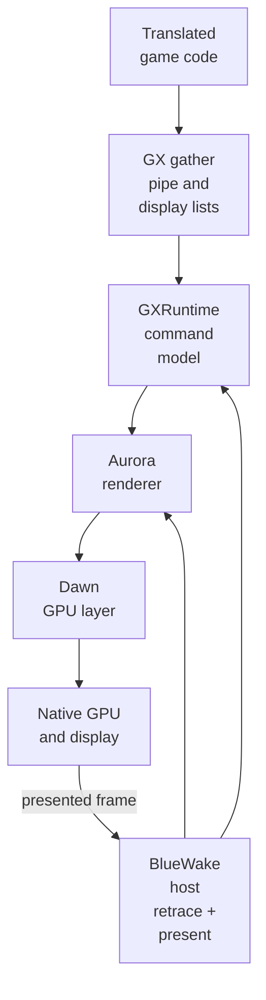
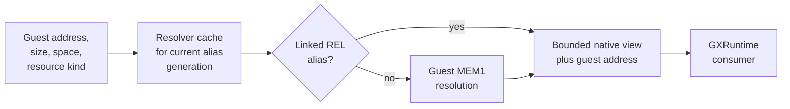

# Graphics stack

## Contents

- [Responsibility](#responsibility)
- [Mechanical contents](#mechanical-contents)
  - [Component ownership](#component-ownership)
  - [Guest-visible GX state](#guest-visible-gx-state)
  - [Guest resource resolution](#guest-resource-resolution)
- [GX command path](#gx-command-path)
  - [Gather-pipe transport](#gather-pipe-transport)
  - [FIFO and display-list parsing](#fifo-and-display-list-parsing)
- [Synchronization and completion](#synchronization-and-completion)
- [Rendering and presentation](#rendering-and-presentation)
- [State, fallback, and shutdown](#state-fallback-and-shutdown)

## Responsibility

The graphics stack preserves the game's GX-facing command model while
producing native GPU work. Translated code supplies the original FIFO and
display-list data; GXRuntime interprets it, Aurora builds renderer work, and
Dawn connects that work to the platform graphics API. Guest addresses remain
guest addresses throughout this path; the host resolves bounded native views
only when a graphics operation needs their backing bytes.

## Mechanical contents

### Component ownership

The diagram is a component view, not a thread or call-order diagram. FIFO
translation, render work, and presentation can cross worker boundaries; guest
barriers determine when their effects must become observable.

| Entity | Owns | Produces | Code reference |
| --- | --- | --- | --- |
| Translated game | Original GX control flow, command writes, and guest addresses | FIFO bytes and display-list calls | [Runtime entities](Runtime.md#runtime-entities) |
| Gather-pipe bridge | Ordered module-to-host transport | GX byte stream | [Bridge ABI](../../runtime/host/src/gather_pipe_bridge.h), [writer](../../cmake/composite/gather_pipe.h) |
| GXRuntime | FIFO, CP, XF, BP, PE, texture, and copy state | Normalized draws, resources, copies, and completion state | [GX front end](https://github.com/chrissotraidis/RecompCore/blob/ee99bbc13c948351f6974c745cad2593a25eacbf/GXRuntime/include/gxruntime/gx_recomp.h) |
| Aurora | Renderer resources, translation, and frame work | Native render passes and resources | [Aurora integration](https://github.com/chrissotraidis/RecompCore/tree/ee99bbc13c948351f6974c745cad2593a25eacbf/GXRuntime/graphics/aurora) |
| Dawn | API-neutral device, queue, shader, and surface interfaces | Work for an enabled native GPU API | [Backend ABI](https://github.com/chrissotraidis/RecompCore/blob/ee99bbc13c948351f6974c745cad2593a25eacbf/GXRuntime/include/gxruntime/aurora_backend.h) |
| BlueWake host | Initialization, address resolution, barriers, retrace, and shutdown order | Resolved ranges, flushes, PE events, and presents | [Renderer setup](../../runtime/host/src/main.c#L7550-L7628) |

BlueWake does not replace the game's draw logic. It supplies the environment in
which translated GX writes retain their ordering and meaning.

### Guest-visible GX state

GXRuntime converts command bytes into explicit front-end state. That state is
separate from native GPU objects that Aurora and Dawn create to implement it.

| State family | Examples | Guest-visible purpose |
| --- | --- | --- |
| FIFO and command processor | Cursors, command stream, array bases and strides | Orders commands and locates vertex data |
| Vertex description | VCD/VAT formats, indexed attributes, vertex layout | Defines draw-payload decoding |
| Transform unit | Matrices, viewport, projection, lights, XF registers | Supplies geometry and lighting inputs |
| Raster and pixel engine | BP, TEV, blend, depth, token, and finish state | Controls pixels and completion events |
| Textures and TLUTs | Image descriptors, palettes, invalidation, source ranges | Connects guest image data to sampled resources |
| Copy state | EFB copy parameters and destinations | Publishes rendered results to memory or presentation |

### Guest resource resolution

GX commands carry 32-bit guest addresses, not native pointers. Before reading a
display list, vertex array, texture, TLUT, or copy destination, GXRuntime asks
BlueWake for a bounded native view of the corresponding bytes.

The cache key includes address, size, address-space mode, and alias generation.
Linked REL aliases take precedence over ordinary MEM1 backing. The result is a
temporary native view; it does not replace the address stored in guest state.

References: [BlueWake resolver](../../runtime/host/src/main.c#L5040-L5147),
[guest-memory contract](https://github.com/chrissotraidis/RecompCore/blob/ee99bbc13c948351f6974c745cad2593a25eacbf/GXRuntime/include/gxruntime/guest_memory.h),
and [guest address resolution](GuestState.md#guest-to-host-address-resolution).

## GX command path

### Gather-pipe transport

The game writes commands and data to the emulated GX FIFO. The gather-pipe
bridge batches those writes, and GXRuntime parses FIFO commands and display
lists. Flush and synchronization operations expose completed work to Aurora at
the points required by guest semantics.

| Step | Runtime result | Code reference |
| --- | --- | --- |
| Collect gather-pipe writes | Ordered GX byte batches cross the module/host boundary | [Gather-pipe setup](../../runtime/host/src/main.c#L8269-L8274), [bridge ABI](../../runtime/host/src/gather_pipe_bridge.h) |
| Parse FIFO and display lists | GX registers, resources, and draw commands reflect the game's command stream | [RecompCore GX interface](https://github.com/chrissotraidis/RecompCore/blob/ee99bbc13c948351f6974c745cad2593a25eacbf/GXRuntime/include/gxruntime/gx_recomp.h) |
| Flush required work | Complete render operations become available to Aurora | [Host GX synchronization](../../runtime/host/src/main.c#L10214-L10281) |

The retail gather pipe is at guest address `0xCC008000`. BlueWake can use a
direct writer, a 256-byte guest-order batch, or generic MMIO fallback.

| Mode | Purpose | Ordering rule | Code reference |
| --- | --- | --- | --- |
| Direct | Avoid generic MMIO dispatch for safe writes | Each write crosses the host ABI immediately | [Direct writer](../../cmake/composite/gather_pipe.h) |
| Batched | Amortize crossings | Drain before reads, host calls, hardware accesses, or other observable boundaries | [Batch writer](../../cmake/composite/gather_pipe_batch.h), [implementation](../../cmake/composite/gather_pipe.c) |
| Generic MMIO | Compatibility and diagnostics | Follow external-memory routing | [Bridge selection](../../runtime/host/src/gather_pipe_bridge.h) |

The bridge disables old writers before selecting a mode. Modules without the
new exports retain the MMIO path, and diagnostic MMIO forces that fallback.

### FIFO and display-list parsing

GXRuntime parses the ordered bytes into command-processor, transform,
pixel-engine, resource, and draw operations. A display-list call resolves a
guest range, parses its nested commands, then returns to the surrounding FIFO.

| Command category | Front-end effect | Downstream result |
| --- | --- | --- |
| CP writes | Update arrays, strides, VCD/VAT, and FIFO state | Later vertices use the new layout |
| XF loads | Update matrices, projection, viewport, and lights | Draws receive transform inputs |
| BP writes | Update raster, texture, TEV, copy, token, and finish state | Draws and completion events use new pixel state |
| Indexed loads | Resolve guest array data through CP configuration | Selected inputs are populated |
| Draws | Decode vertices under active state | Aurora receives normalized geometry |
| Display-list calls | Resolve and parse another guest command range | Nested commands preserve GX order |

Parsing may feed renderer workers; native submission is not guaranteed to
finish synchronously with each FIFO write.

## Synchronization and completion

Guest software observes GX progress through draw-done status, draw-sync tokens,
PE interrupts, copies, and later reads. The runtime flushes at these semantic
barriers so asynchronous native work cannot appear complete too early.

| Boundary | Required observation | Code reference |
| --- | --- | --- |
| Gather-pipe drain | Earlier batched bytes reached the FIFO parser | [Gather-pipe bridge](../../runtime/host/src/gather_pipe_bridge.h) |
| Draw done | Earlier work completed before finish status | [GX synchronization](../../runtime/host/src/main.c#L10214-L10281) |
| Draw-sync token | The visible token follows prior work | [GX synchronization](../../runtime/host/src/main.c#L10214-L10281) |
| PE event | Finish or token state reaches the interrupt controller | [Interrupt delivery](Services.md#interrupt-delivery) |
| Save/load or shutdown | Front-end and worker state reaches a coherent lifecycle boundary | [Backend ABI](https://github.com/chrissotraidis/RecompCore/blob/ee99bbc13c948351f6974c745cad2593a25eacbf/GXRuntime/include/gxruntime/aurora_backend.h) |

These host barriers expose expected completion semantics; they do not imply
that every hook replaces an original game routine.

## Rendering and presentation

Aurora turns parsed GX state into render passes and GPU resources. Dawn
provides the platform-facing graphics layer. At completed video retraces, the
host services the renderer, presents finished work, and polls the next input
sample against the same guest-time boundary.

| Step | Runtime result | Code reference |
| --- | --- | --- |
| Initialize | A native graphics device and renderer state are available before guest execution | [Renderer initialization](../../runtime/host/src/main.c#L7550-L7628) |
| Record and submit | Parsed GX state becomes GPU resources, passes, and commands | [Aurora backend](https://github.com/chrissotraidis/RecompCore/tree/ee99bbc13c948351f6974c745cad2593a25eacbf/GXRuntime/graphics/aurora) |
| Present | A completed frame reaches the display with guest-timed cadence | [Retrace and presentation](../../runtime/host/src/main.c#L5381-L5453) |

At each completed guest retrace, the host advances VI-visible state and services
a pending Aurora presentation. A render worker may finish while translated code
is idle, but guest VI time still controls when presentation is serviced.

## State, fallback, and shutdown

GX front-end state belongs to the guest machine model. Native caches, pipelines,
and surfaces are implementation resources that can be rebuilt from front-end
and guest data.

| Situation | Behavior | Reason |
| --- | --- | --- |
| Save or load | Drain asynchronous work and preserve supported front-end state | Avoid mixing two guest timelines |
| Explicit renderer failure | Report failure instead of silently changing the requested backend | Preserve an explicit choice |
| Automatic selection failure | Use the supported headless fallback where configured | Permit non-presenting execution |
| Desktop OpenGL fallback | Warn about the selected compatibility path | Expose capability or performance limits |
| Shutdown | Disable gather-pipe writers before destroying Aurora | Prevent late writes into torn-down resources |

Lifecycle entry points are defined by the [Aurora backend ABI](https://github.com/chrissotraidis/RecompCore/blob/ee99bbc13c948351f6974c745cad2593a25eacbf/GXRuntime/include/gxruntime/aurora_backend.h)
and coordinated by the [BlueWake host](../../runtime/host/src/main.c).

Return to the runtime [high-level view](Runtime.md#high-level-view).
