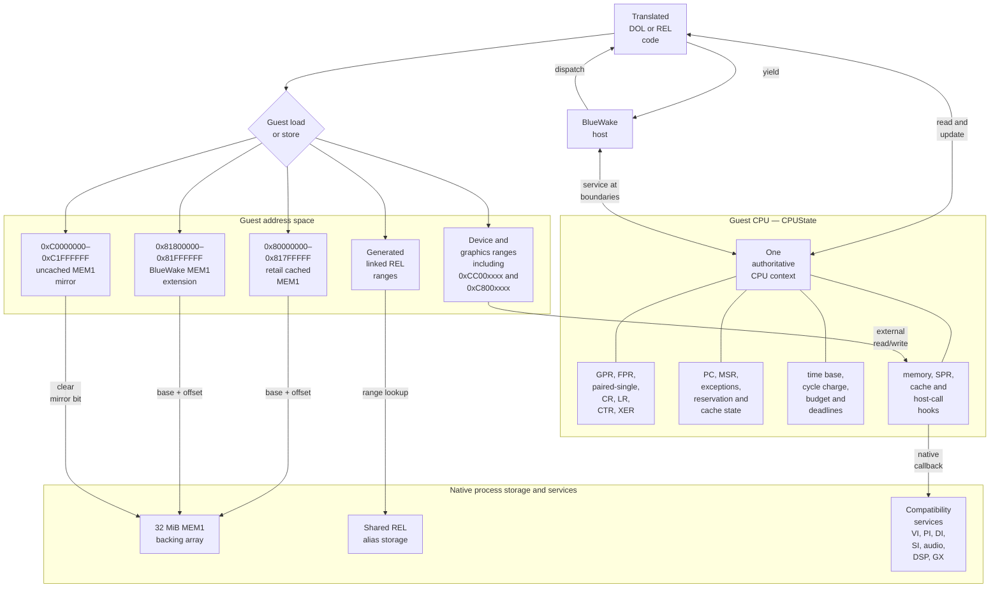
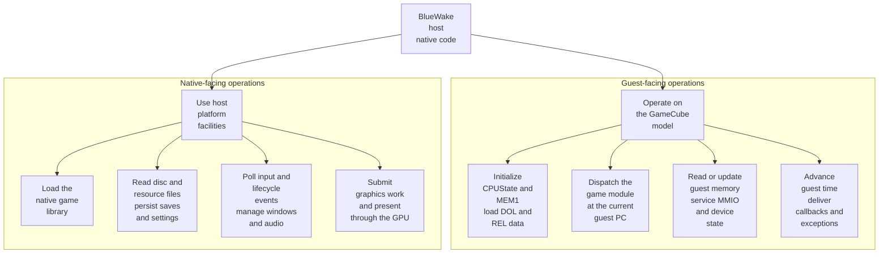
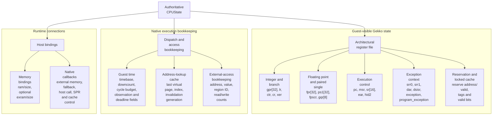
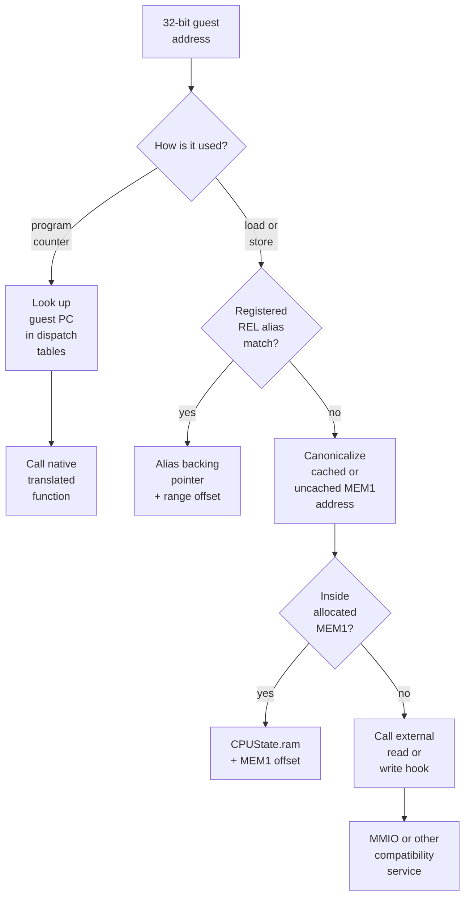
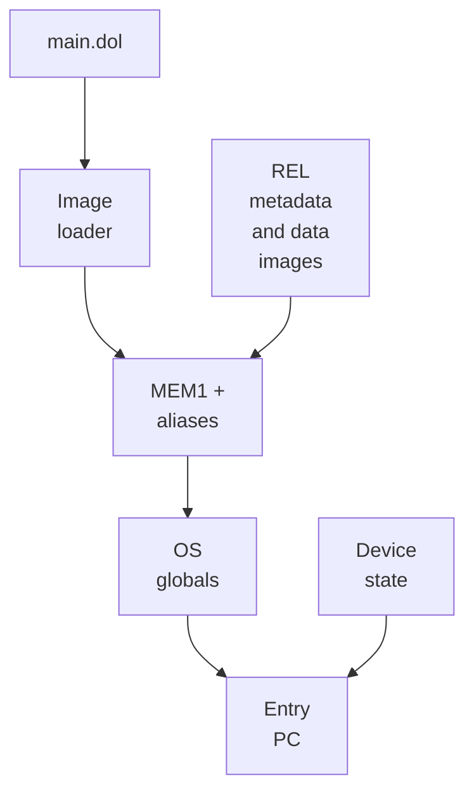

# Guest machine state

## Contents

- [Responsibility](#responsibility)
- [Mechanical contents](#mechanical-contents)
  - [CPU, memory space, and I/O](#cpu-memory-space-and-io)
  - [Host work across the guest/native boundary](#host-work-across-the-guestnative-boundary)
  - [CPUState layout](#cpustate-layout)
- [DOL and REL roles](#dol-and-rel-roles)
- [Ownership and address model](#ownership-and-address-model)
  - [Guest-to-host address resolution](#guest-to-host-address-resolution)
- [Boot state](#boot-state)
- [Guest time and exceptions](#guest-time-and-exceptions)

## Responsibility

Guest state is the GameCube-visible machine model shared by the host and the
translated module. It holds CPU registers, memory, addresses, timing counters,
exceptions, and the program counter at which translated execution resumes.

## Mechanical contents

Mechanically, guest state is an authoritative `CPUState` structure plus the
storage reachable through the guest address space. Generated code expresses
guest-register reads and updates through that structure, while the native
compiler may temporarily keep working values in native registers. When
execution reaches a boundary at which the host or runtime can observe guest
state, the updates required by the generated C program are visible in
`CPUState`; this is not a blanket flush of every field at every boundary. A
translated block also performs loads and stores through the runtime memory
helpers, charges guest cycles and leaves the next guest address in `pc`. The
host receives the same authoritative state when the block yields rather than
reconstructing the CPU from native registers. [Generated-state optimization](https://github.com/chrissotraidis/RecompCore/blob/ee99bbc13c948351f6974c745cad2593a25eacbf/GXRuntime/include/core/cpu.h#L185-L196)

For example, if a guest register contains `0x80300000`, an ordinary MEM1 load
with no overriding alias resolves it to backing pointer `B + 0x00300000`, where
`B` is the native address of MEM1. The memory helper reads the bytes using the
guest's byte order, and the loaded value becomes the destination guest
register's value. The original register still contains a 32-bit guest address;
resolution does not replace it with a native pointer.

### CPU, memory space, and I/O

The CPU context carries guest-visible registers and execution control. Memory
instructions keep their 32-bit guest addresses until the access helpers route
them to native backing storage or an I/O callback.

Cached and uncached MEM1 addresses converge on the same backing bytes. REL
aliases preserve generated linked addresses while pointing both the host and
translated module at shared storage. Device ranges do not become host memory
pointers; they invoke compatibility services through the access hooks.

### Host work across the guest/native boundary

The BlueWake host is always native code. “Guest-facing” and “native-facing”
describe what that code operates on: guest-facing work changes or observes the
GameCube machine model, while native-facing work calls process, file, window,
audio, input, or GPU facilities. Dispatch is the handoff between host code and
translated game code; it is not a switch into an emulated CPU process.

| Runtime phase | Guest-facing host work | Native-facing host work |
| --- | --- | --- |
| Startup | Selects the authoritative `CPUState` and MEM1 storage, installs access hooks, copies DOL data, establishes REL aliases, initializes guest-visible devices, and sets the entry `pc`. | Opens the native game library, resolves its ABI export, opens configured files, and creates renderer, audio, input, and platform resources. [Host initialization](../../runtime/host/src/main.c#L7316-L8115) |
| Guest-time turn | Sets a cycle budget, calls `mod->dispatch(&cpu, cpu.pc)`, then examines the returned PC, cycle charge, exception, and stop state. | Checks platform quit state and performs host scheduling around the native module call. [Main loop](Host.md#main-loop-execution) |
| I/O and services | Resolves guest addresses, models MMIO registers, advances device deadlines, writes DMA or callback results into guest memory, and publishes interrupts. | Reads disc and player-data files, samples controllers, sends audio to the platform queue, and passes graphics work toward the GPU. [Compatibility services](Services.md) and [graphics stack](Graphics.md) |
| Persistence and shutdown | Serializes or restores CPU, MEM1, alias, and device state only at a safe host boundary. | Writes save-state, card, SRAM, settings, and log files and releases native resources. [Runtime inputs and persistence](Host.md#runtime-inputs-and-persistence) and [shutdown](Host.md#shutdown) |

### CPUState layout

This is an inventory of the `CPUState` used by the current BlueWake build, not
a general specification of every register in a GameCube emulator. BlueWake
pins RecompCore at `ee99bbc13c948351f6974c745cad2593a25eacbf`; the groups
below come directly from that revision's structure. `CPUState` combines the
architectural fields used by translated PowerPC instructions with the runtime
fields that connect them to BlueWake's scheduler, memory, and services.

| Register or field group | Concrete layout | Mechanical role |
| --- | --- | --- |
| Integer and branch state | `gpr[32]`, `lr`, `ctr`, `cr`, and `xer` are 32-bit fields | Holds integer operands and results, branch targets, condition bits, and fixed-point status. |
| Floating-point and paired-single state | `fpr[32]` and `ps1[32]` hold the two 64-bit lanes; `fpscr` records floating-point status and `gqr[8]` controls paired-single quantization | Preserves the Gekko floating-point and paired-single register file used by translated instructions. |
| Program and machine control | `pc`, `msr`, `sr[16]`, `ear`, and `hid2` | Selects the next guest instruction and retains processor mode, segment, external-access, and Gekko-specific control state. |
| Exception context | `srr0`, `srr1`, `dar`, `dsisr`, `exception`, and `program_exception` | Records the interrupted PC and machine state, fault address and cause, and the exception awaiting delivery. |
| Reservation and locked cache | Reservation address/valid flag plus 512 locked-cache tags and validity bits | Preserves `lwarx`/`stwcx.` semantics and the Gekko locked-cache model across translated blocks. |
| Guest time | `timebase`, `downcount`, `cycle_budget`, `cycle_observation_suffix`, `cycle_deadline_active`, and `cycle_deadline_budget` | Charges translated work and forces a yield before a device, callback, or interrupt deadline. |
| Address and external-access bookkeeping | Cached translation-lookup fields plus the last external address, value, region ID, and access counts | Avoids repeated address work and carries special-access state between generated code and the runtime. |
| Memory and runtime bindings | RAM/EXRAM pointers and sizes plus function pointers for external memory, instruction fallback, host calls, SPR access, and cache control | Connects the guest CPU context to process memory and compatibility services without storing native pointers in guest registers. |

The field order and widths form the generated-code ABI. The host rejects a
module when its CPU ABI version or `sizeof(CPUState)` does not match, preventing
translated code from interpreting a different layout. BlueWake's diagnostic
checkpoint independently enumerates the same fields, which also keeps this
documentation grounded in the state the current host observes. [Pinned
revision](../../scripts/builder/profiles/bluewake.sh#L37-L44), [CPU
layout](https://github.com/chrissotraidis/RecompCore/blob/ee99bbc13c948351f6974c745cad2593a25eacbf/GXRuntime/include/core/cpu.h#L127-L183),
[ABI validation](../../cmake/composite/module_cpu_contract.h#L35-L79), and
[checkpoint field list](../../runtime/host/src/guest_checkpoint.h#L9-L38).

The translated native instructions themselves are not guest state, and the
original DOL and REL files are inputs rather than live state. Compatibility
services also retain their own device-specific state. Their guest-visible
effects enter this machine state through MMIO results, memory writes, timing
updates, callbacks, and pending exceptions.

## DOL and REL roles

Ahead-of-time translation replaces executable instructions with native
functions, but the original executable formats still define runtime data and
addresses.

- **DOL** — provides the initial section layout and initialized data copied into
  guest memory. Its translated functions live in the native game module.
- **REL** — provides relocatable module layout, data, BSS, and linked guest
  addresses. Its translated functions also live in the native game module.
- **Dispatch metadata** — maps DOL and REL guest code addresses to their native
  translations. See [composite generation](../../scripts/generate_composite.py#L562-L707).

## Ownership and address model

The module can export aligned `CPUState` and MEM1 storage. The host selects
those exports when present, initializes them, and passes the same CPU pointer
through dispatch, memory, device, and callback paths. No state copy is required
when execution crosses the host/module ABI.

### Guest-to-host address resolution

A guest address is a 32-bit value in the emulated Gekko address space. It is
not normally a host pointer, and BlueWake does not require the operating system
to map memory at that numeric address. The memory helpers translate it to a
pointer inside the BlueWake process on each access. Consequently, the host
virtual address can change between launches because the module loader and OS
choose where native allocations and code reside.

The diagram shows the logical resolution rules rather than the literal order
of every access. The pinned `get_ram_ptr()` first tries a direct MEM1 fast path
when no aliases overlap MEM1 and the address passes its range checks. It can
therefore skip alias lookup when doing so preserves the same result; ordinary
guest-memory accesses do not necessarily search the alias table. [Pinned
resolver](https://github.com/chrissotraidis/RecompCore/blob/ee99bbc13c948351f6974c745cad2593a25eacbf/GXRuntime/include/core/cpu.h#L197-L239)

Address intervals below are half-open: the first address is included and the
end address is excluded.

Address resolution locates the native bytes; interpreting those bytes is a
separate step. Multi-byte guest values use PowerPC big-endian representation,
so the memory helpers use `read_be16`/`32`/`64` and
`write_be16`/`32`/`64` when reading or writing native backing storage. A
one-byte access needs no byte-order conversion. [Byte-order helpers](https://github.com/chrissotraidis/RecompCore/blob/ee99bbc13c948351f6974c745cad2593a25eacbf/GXRuntime/include/core/types.h#L58-L90),
[memory accessors](https://github.com/chrissotraidis/RecompCore/blob/ee99bbc13c948351f6974c745cad2593a25eacbf/GXRuntime/include/core/cpu.h#L271-L363)

| Guest range or address kind | Resolution | Host representation |
| --- | --- | --- |
| `0x80000000–0x81800000` | Retail 24 MiB cached MEM1. Subtract `0x80000000` to obtain the byte offset. | If the MEM1 allocation begins at host pointer `B`, guest `0x80300000` becomes `B + 0x00300000`. `B` is chosen at runtime and is not required to equal `0x80000000`. |
| `0x81800000–0x82000000` | BlueWake's extension from retail MEM1 to the 32 MiB backing allocation. It provides space for raw or deterministically linked REL storage. Registered alias ranges take precedence over the contiguous fallback. | Either `B + (address - 0x80000000)` or the matching alias pointer plus its range offset. [Allocation and extension](../../runtime/host/src/main.c#L7688-L7696) |
| `0xC0000000–0xC2000000` | Uncached mirror of the same 32 MiB guest-memory window. Clearing bit `0x40000000` produces the corresponding `0x80000000–0x82000000` address before normal alias/MEM1 resolution. | The same host byte as the cached form; for example, `0xC0300000` and `0x80300000` both resolve to `B + 0x00300000`. [Memory resolver](https://github.com/chrissotraidis/RecompCore/blob/ee99bbc13c948351f6974c745cad2593a25eacbf/GXRuntime/include/core/cpu.h#L197-L255) |
| Generated REL data and BSS ranges | The composite metadata supplies exact linked ranges. The resolver checks the alias registry using the original address and then its bit-`0x40000000`-cleared form. These ranges are generated per module rather than assigned one universal interval. | `alias.storage + (address - alias.linked_start)`. Host services and translated code register the same backing pointer, so both observe the same bytes. [Alias API](https://github.com/chrissotraidis/RecompCore/blob/ee99bbc13c948351f6974c745cad2593a25eacbf/GXRuntime/include/core/cpu.h#L111-L121), [shared registration](../../runtime/host/src/main.c#L141-L192) |
| Device and special ranges, including the `0xCC00xxxx` MMIO area and `0xC800xxxx` graphics paths | If no RAM or REL alias matches, the memory helper invokes `CPUState.external_read` or `external_write` with the guest address, access width, and value. | A native function call into the host's device router; there is no host-memory pointer corresponding to the MMIO address. [Memory fallback](https://github.com/chrissotraidis/RecompCore/blob/ee99bbc13c948351f6974c745cad2593a25eacbf/GXRuntime/include/core/cpu.h#L271-L363), [read routing](../../runtime/host/src/main.c#L3581-L3820), [write routing](../../runtime/host/src/main.c#L4723) |
| DOL or REL code address in `pc`, `lr`, or `ctr` | The generated dispatcher searches guest code ranges and chooses the translated native function. Physical code PCs below `ram_size` are canonicalized to their cached form; supported uncached DOL PCs are likewise canonicalized before a second lookup. | A loader-assigned native function address, used only for the call. The guest-visible `pc`, `lr`, and `ctr` remain 32-bit guest addresses. [Generated dispatch](../../scripts/generate_composite.py#L630-L675) |

The formulas describe address translation, not a bulk conversion of guest
memory. Host and translated code retain guest addresses in registers and data
structures, resolving a pointer only when they access the referenced bytes.

| Step | Runtime result | Code reference |
| --- | --- | --- |
| Select module-exported or compatibility storage | One authoritative `CPUState` and MEM1 allocation | [Storage selection](../../runtime/host/src/main.c#L7329-L7343) |
| Install memory and MMIO accessors | Ordinary addresses reach RAM; hardware ranges reach compatibility services | [MMIO callback setup](../../runtime/host/src/main.c#L7943-L7948) |
| Establish REL aliases | Relocated data uses linked guest addresses while code addresses remain valid for dispatch and guest function pointers | [REL alias setup](../../runtime/host/src/main.c#L7968-L8101) |

## Boot state

| Step | Runtime result | Code reference |
| --- | --- | --- |
| Initialize devices | Reset video, disc, controller, interrupt, audio, DSP, ARAM, SRAM, and card state | [Host initialization](../../runtime/host/src/main.c#L7550-L7686) |
| Load DOL sections | Initialized data is copied into MEM1 and BSS is cleared | [Host DOL load](../../runtime/host/src/main.c#L7957-L7960), [RecompCore loader](https://github.com/chrissotraidis/RecompCore/blob/ee99bbc13c948351f6974c745cad2593a25eacbf/GXRuntime/src/loader.c) |
| Create GameCube OS state | Low memory, arenas, stack, clocks, and machine-state registers satisfy guest startup assumptions | [Host boot call](../../runtime/host/src/main.c#L8102-L8115), [RecompCore boot](https://github.com/chrissotraidis/RecompCore/blob/ee99bbc13c948351f6974c745cad2593a25eacbf/GXRuntime/src/boot.c) |
| Select the entry point | `cpu.pc` is set to the module descriptor's entry address | [Execution start](../../runtime/host/src/main.c#L8112-L8115) |

## Guest time and exceptions

Translated blocks charge guest cycles rather than reading wall time directly.
The cycle domain advances devices to a shared point and chooses the next safe
boundary. Services publish interrupt sources; the host delivers an exception
only where architectural and scheduler state can be preserved.

| Step | Runtime result | Code reference |
| --- | --- | --- |
| Account completed work | All devices observe one absolute guest timeline | [Cycle domain](../../runtime/host/src/cycle_domain.c) |
| Advance to the next deadline | Video, audio, DSP, disc, and controller state remain ordered | [Device synchronization](../../runtime/host/src/main.c#L5455-L5474) |
| Publish and deliver interrupts | Guest exception state and handler PC are established at a safe boundary | [Interrupt routing](../../runtime/host/src/main.c#L3441-L3544), [delivery](../../runtime/host/src/main.c#L3078-L3234) |

Return to the runtime [high-level view](Runtime.md#high-level-view).
