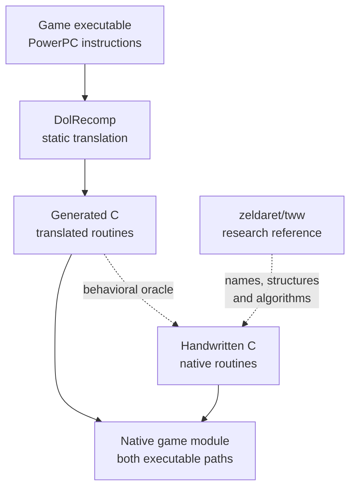
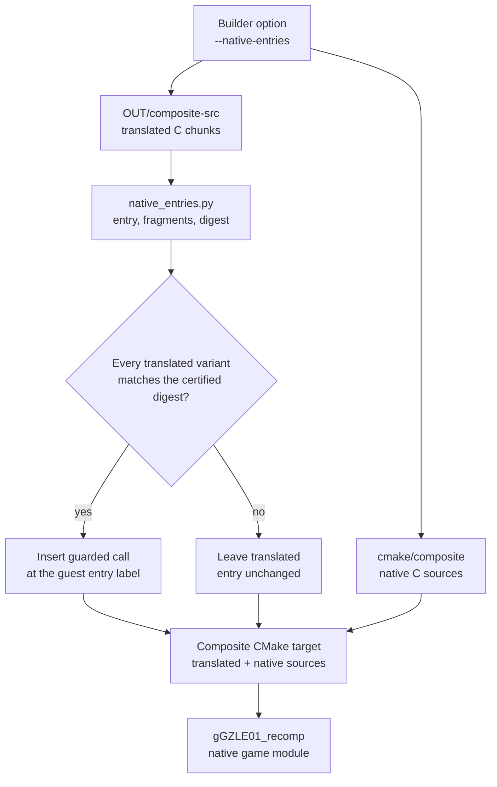
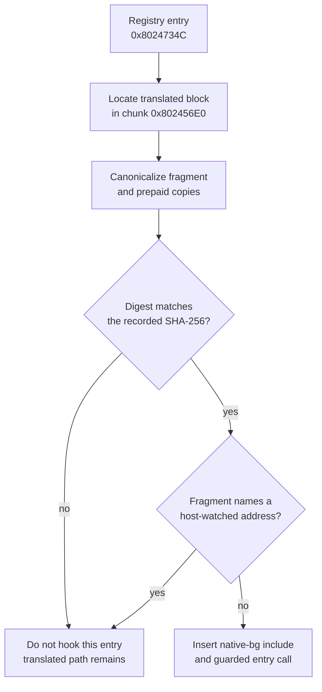
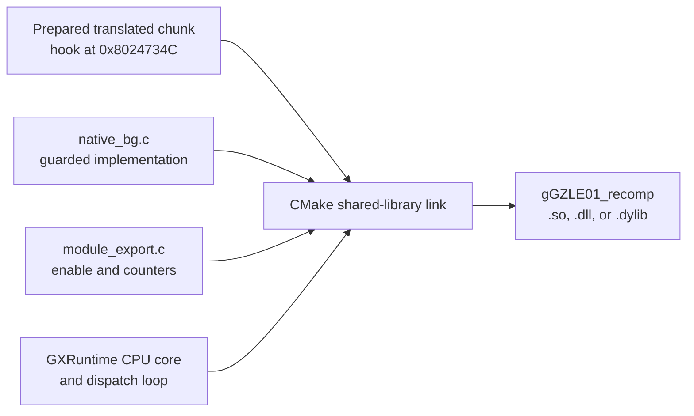
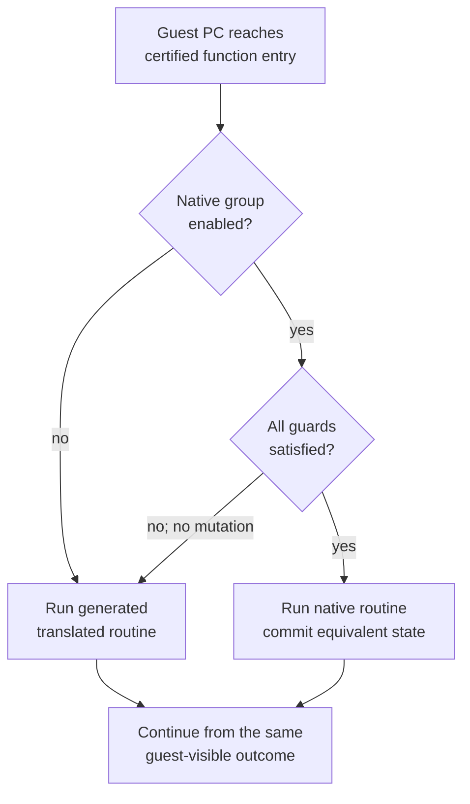
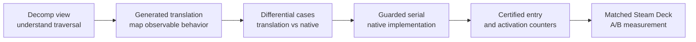

# Translated, native, and decomp routines

## Contents

- [Relationship](#relationship)
- [Build-time integration](#build-time-integration)
- [Runtime selection](#runtime-selection)
- [Guest-state contract](#guest-state-contract)
- [Correctness and certification](#correctness-and-certification)
- [GroundCrossGrpRp example](#groundcrossgrprp-example)
- [Adding a native routine](#adding-a-native-routine)
- [Source map](#source-map)

Architecture path: [Overview](Overview.md) → [Runtime](Runtime.md) →
[Native game module](GameModule.md) → **Translated, native, and decomp routines**

## Relationship

BlueWake normally runs code produced by statically translating the game's
PowerPC instructions to C and compiling that C for the host. For selected
routines, the native game module (`gGZLE01_recomp`) can instead run a
handwritten native implementation. Both executable paths live in that game
module and operate on the same authoritative [guest machine
state](GuestState.md). They are not part of the BlueWake host: the host loads
the game module through its ABI and coordinates its execution.

The [Wind Waker decompilation](https://github.com/zeldaret/tww) is different:
it reconstructs readable C++ that helps contributors understand names,
structures, and algorithms. BlueWake does not compile or execute that project
as part of this mechanism. The generated translation remains the behavioral
reference for a native replacement.



| Form | Role in BlueWake | Authoritative for |
| --- | --- | --- |
| Generated translated routine | Normal executable path produced from the user's game | Guest-visible behavior of the original binary |
| Handwritten native routine | Optional replacement for a specifically certified translated routine | Nothing independently; it must match the translated path |
| Decomp routine | Human-readable research reference outside the BlueWake build | Understanding intent, names, types, and control flow |

The two executable paths are host-native machine code after compilation. A
native replacement can still be faster because it can work in host locals,
cross several translated blocks internally, and commit guest-visible state
once instead of reproducing PowerPC bookkeeping at every block.

## Build-time integration

Native replacement support is prepared while the composite native game module
(`gGZLE01_recomp`) is built. It does not patch arbitrary machine code in a
running process or add the replacement to the BlueWake host.



[`native_entries.py`](../../scripts/windows/native_entries.py) identifies each
candidate by guest entry address, all translated fragments it replaces, and a
SHA-256 digest of their canonical source. It inserts a hook only when those
fragments still match the version used by the differential oracle and none of
the required addresses conflicts with a host watch boundary.

The composite build includes the corresponding native sources only when
`BLUEWAKE_NATIVE_ENTRIES` is selected. The Linux and Windows builders run the
same preparation script; its location under `scripts/windows/` is historical
rather than a Windows-only runtime boundary. See the [Linux builder
invocation](../../scripts/linux/build.py#L766-L790), [Windows builder
invocation](../../scripts/windows/build.py#L847-L873), and [module target
configuration](../../cmake/composite/CMakeLists.txt#L171-L190).

### Concrete example: `cBgS_Chk::ChkSameActorPid`

The collision function at guest address `0x8024734C` shows the complete path.
The [entry registry](../../scripts/windows/native_entries.py#L62-L75) binds
that address to translated fragment `0x8024734C..0x8024738C`, the `bg` native
group, and a SHA-256 digest. The certifier reconstructs and hashes the fragment
for the base translation and every mod variant, then also rejects an entry if
the fragment crosses a [host-watched
address](../../scripts/windows/native_entries.py#L368-L392).



For a certified chunk, the [transformation
step](../../scripts/windows/native_entries.py#L395-L428) inserts the equivalent
of this directly after `label_8024734C`:

```c
if (bluewake_native_bg_enabled &&
    bluewake_native_bg(ctx, 0x8024734Cu))
    goto return_dispatch_802456E0;
```

The call target is the handwritten [collision
implementation](../../cmake/composite/native_bg.c#L82-L120). It first checks
whether the current guest state is safe to handle. Its public dispatcher
returns `1` after a successful native result or `0` to leave execution on the
translated path; it also records activation and decline counts. See
[`bluewake_native_bg`](../../cmake/composite/native_bg.c#L282-L294).



Mechanically, the builder runs the preparation script against
`OUT/composite-src`, then passes `BLUEWAKE_NATIVE_ENTRIES=ON` to the composite
CMake build. CMake adds `native_bg.c` and the other selected native groups to
the same shared-library target that already contains the translated DOL and
REL chunks. The target is explicitly named
[`g${GAME_ID}_recomp`](../../cmake/composite/CMakeLists.txt#L50-L76); the
native-source selection is defined in the [native entries CMake
block](../../cmake/composite/CMakeLists.txt#L171-L190). The resulting artifact
is therefore one native game module containing both executable paths—not a
second plug-in and not part of the BlueWake host executable.

## Runtime selection

The generated function entry first asks the native implementation whether it
can safely handle the current state. A disabled entry or a declined call
continues through the untouched translated path.



The existing collision entry point demonstrates the interface:

```c
int bluewake_native_bg(CPUState* cpu, u32 address);
```

| Return | Contract |
| --- | --- |
| `1` | The native routine completed the guest function and committed the state the translated path would have produced. |
| `0` | The native routine changed nothing, so execution may continue through the translation. |

The global runtime setting `BLUEWAKE_NATIVE_ENTRIES=0` disables certified
native entries. Some native groups also expose narrower switches and report
activation and decline counts at process exit. See [native game module
activation](../../cmake/composite/module_export.c#L173-L237).

## Guest-state contract

Translated and native routines meet through guest state, not through the
decomp project's C++ types. A successful native path must preserve every
observable effect required by the translated path, including:

- general, floating-point, condition, and relevant control registers;
- MEM1 reads and writes, aliases, and guest byte order;
- the next guest PC, link register, exceptions, and reservation state;
- cycle accounting, deadlines, and observation suffixes; and
- callback order, callback-visible state, and host-observed boundaries.

These values live in `CPUState`, guest memory, and the surrounding dispatch
contract described in [Guest machine state](GuestState.md) and [translated
code dispatch](GameModule.md#translated-code-dispatch). The native routine may
temporarily represent values as ordinary C locals, but success must publish an
equivalent guest-visible result.

A decline is stricter: no guest-visible state may have changed. Native
implementations therefore validate the complete path before committing, and
use the translation whenever an alias, exception, deadline, callback, or host
boundary is not supported.

## Correctness and certification

Certification and testing solve different problems:

| Guardrail | What it establishes | What it does not establish |
| --- | --- | --- |
| Fragment hashes | The hook targets the exact translated source shape that was reviewed and tested | Behavioral equivalence by itself |
| Runtime guards | The native path runs only for state it claims to support | Correct results for accepted state |
| Decline tests | Unsupported state falls back without mutation | Activation during ordinary gameplay |
| Differential oracle | Accepted native cases match translated CPU and writable-memory results | A Steam Deck performance improvement |
| Activation counters | The measured scene actually used the native path | Correctness or useful speedup by itself |
| Matched hardware A/B | The enabled path improves the selected metric beyond run-to-run noise | Equivalence outside the tested coverage |

For example, [`native_bg_test.c`](../../tests/native_bg_test.c#L340-L395)
copies the same initial CPU and RAM state into native and translated cases. It
checks that a declined native call left state untouched, or compares an
accepted call with a private translated-reference build of the native game
module. These differential targets depend on locally generated game code and
are therefore distinct from public source-only tests; see [generated and
conditional tests](Testing.md#generated-and-conditional-tests).

## GroundCrossGrpRp example

`cBgW::GroundCrossGrpRp` at guest address `0x802491F4` is a planned collision
candidate, not an existing registered native entry. The decomp routine can
explain its group-tree traversal and recovered structures, while the generated
translation defines the exact registers, memory effects, callbacks, block
boundaries, and timing that a replacement must preserve.



The first implementation should preserve child order and compute into local
snapshots before committing. It should not parallelize stateful recursion.
Only after serial equivalence and useful activation are proven should a later
change consider algorithmic or parallel work. The implementation and
measurement workstream is tracked in [PR
#421](https://github.com/chrissotraidis/bluewake/pull/421).

## Adding a native routine

1. Map every translated block, cross-chunk edge, memory access, register
   effect, callback, and cycle charge covered by the candidate.
2. Use decomp source only to understand the algorithm; derive the executable
   contract from the generated translation.
3. Add differential and decline-without-mutation cases before enabling a hook.
4. Implement a guarded serial path that validates first, computes in locals,
   and commits only on success.
5. Register the guest address and activation counters in the appropriate
   native group.
6. Add all replaced fragments and their certified digest to
   `native_entries.py`.
7. Validate native-enabled, native-disabled, and forced-decline modes, then run
   matched hardware measurements before retaining the replacement.

## Source map

| Concern | Source |
| --- | --- |
| Entry certification and hook insertion | [`scripts/windows/native_entries.py`](../../scripts/windows/native_entries.py) |
| Native collision interface and return contract | [`cmake/composite/native_bg.h`](../../cmake/composite/native_bg.h), [`native_bg.c`](../../cmake/composite/native_bg.c) |
| Build selection and native source inclusion | [`cmake/composite/CMakeLists.txt`](../../cmake/composite/CMakeLists.txt#L171-L190) |
| Runtime enable, opt-out, and reports | [`cmake/composite/module_export.c`](../../cmake/composite/module_export.c#L173-L237) |
| Native-versus-translated collision oracle | [`tests/native_bg_test.c`](../../tests/native_bg_test.c) |
| Generated dispatch and guest execution loop | [`cmake/composite/dispatch_loop.h`](../../cmake/composite/dispatch_loop.h) |
| Decomp research reference | [`zeldaret/tww`](https://github.com/zeldaret/tww) |

Return to the [native game module](GameModule.md) or the runtime [high-level
view](Runtime.md#high-level-view).
