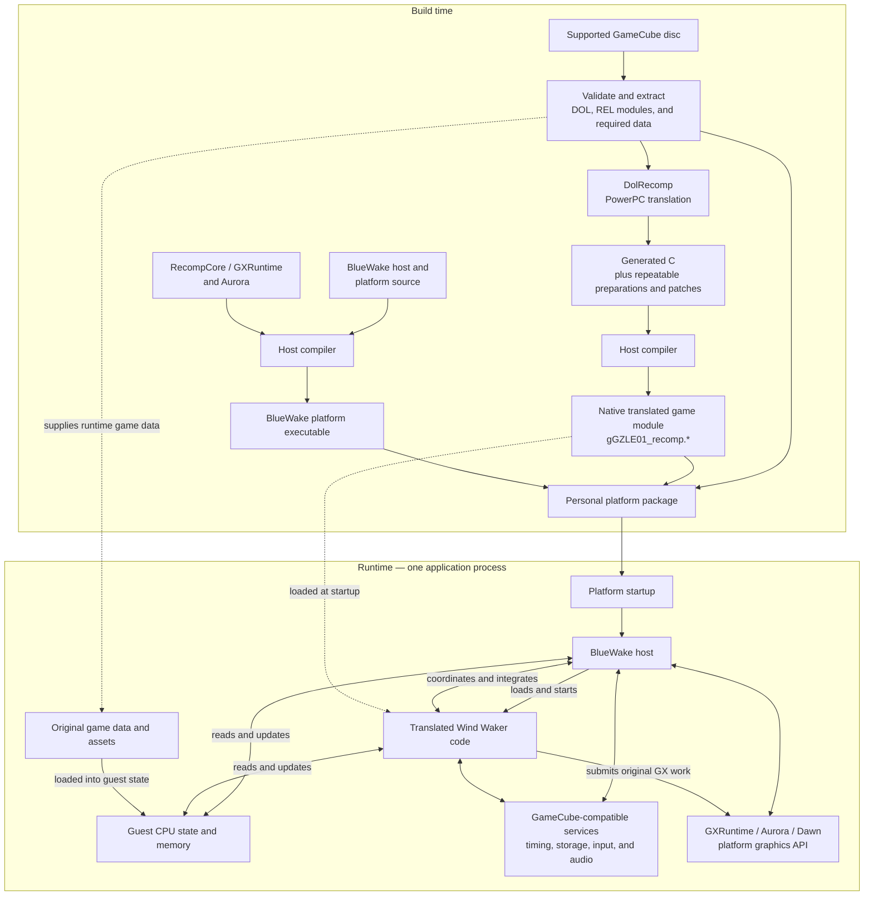

# BlueWake architecture overview

## Introduction

BlueWake runs *The Legend of Zelda: The Wind Waker* on modern platforms by
**statically recompiling** the supported GameCube game's PowerPC machine code.
During the build, DolRecomp translates that code into generated C. A host
compiler then turns the generated C into native code for the target platform.
BlueWake combines that translated game code with a handwritten host and a
compatibility runtime that provide the operating-system, input, audio, storage,
timing, and graphics services the game expects.

This puts BlueWake between several related approaches:

| Approach | What it does | How BlueWake relates to it |
| --- | --- | --- |
| Conventional emulation | Interprets or dynamically translates the original CPU instructions while the game is running and models the original system around them. | BlueWake does not use a conventional CPU-emulation loop for the translated game code. The PowerPC-to-native translation happens ahead of time. Its runtime still supplies compatible GameCube hardware and operating-system behavior, including emulated or high-level implementations of individual services. |
| Decompilation | Reconstructs readable source code that represents the original program, often with recovered types, names, and higher-level structure. | BlueWake does not recover Nintendo's original source code. DolRecomp mechanically preserves the behavior of compiled instructions. Projects such as [zeldaret/tww](https://github.com/zeldaret/tww) are useful research references, but their reconstructed source is not the code BlueWake normally executes. |
| Reimplementation | Rewrites the game or its systems as new handwritten host-native code. | BlueWake has handwritten platform and runtime components, but it is not a ground-up rewrite of Wind Waker. Most original game logic comes from translated machine code. Selected services, integrations, and optimized routines may be implemented natively. |
| Static recompilation | Translates code for one CPU into code that can be compiled for another CPU before the program runs. | This is BlueWake's primary execution model. The resulting native game module retains the original program's guest memory layout and other GameCube execution semantics. |

Static recompilation describes how the game code is produced; it does not mean
that the game's state is static. During play, translated game code and the host
continuously update guest CPU state, memory, graphics state, audio state, and
other runtime data.

BlueWake requires a supported, legally obtained USA revision-0 (`GZLE01`) disc.
The repository does not contain the game, its assets, or Nintendo's original
source code.

## High-level view

The build produces two principal native components: the BlueWake platform
executable and a translated game module. On Linux these are `bluewake` and
`gGZLE01_recomp.so`. They are separate files, but the executable loads the game
module into the same application process at runtime.

The diagram is a component and data-flow overview, not an exact call sequence.
Build details vary by platform, but the division between translated game code,
the handwritten host, guest state, and compatibility services is the central
architectural model.

### Source anchors

- [Linux build pipeline](../../scripts/linux/build.py)
- [Linux application composition](../../linux/CMakeLists.txt)
- [Linux startup and default paths](../../linux/src/linux_entry.c)
- [Composite DOL and REL generation](../../scripts/generate_composite.py)
- [Shared host runtime](../../runtime/host/src/main.c)
- [Pinned build dependencies](../../config/dependencies.lock.json)
