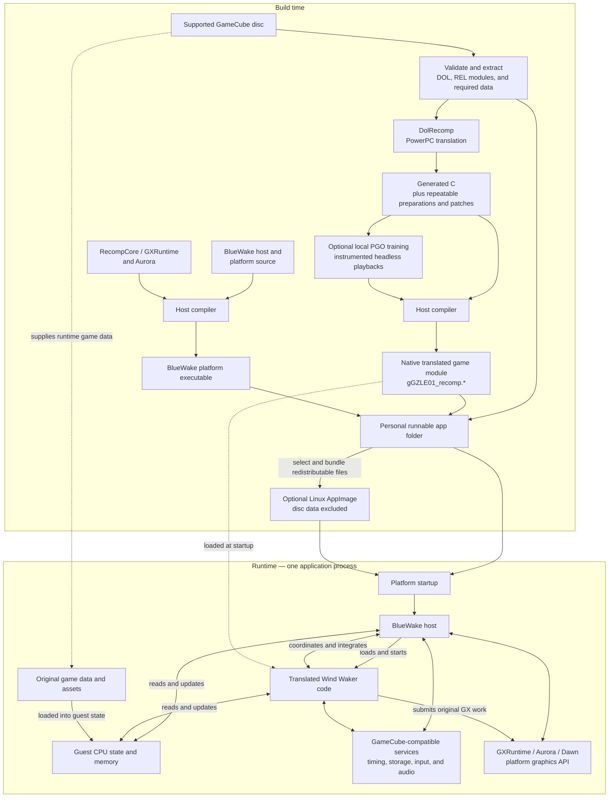

# BlueWake architecture overview

## Introduction

BlueWake runs *The Legend of Zelda: The Wind Waker* on modern platforms by
**statically recompiling** the supported GameCube game's PowerPC machine code.
During the build, DolRecomp translates that code into generated C. A host
compiler then turns the generated C into native code for the target platform.
BlueWake combines that translated game code with a handwritten host and a
compatibility runtime that provide the operating-system, input, audio, storage,
timing, and graphics services the game expects.

This puts BlueWake between several related approaches:

| Approach | What it does | How BlueWake relates to it |
| --- | --- | --- |
| Conventional emulation | Interprets or dynamically translates the original CPU instructions while the game is running and models the original system around them. | BlueWake does not use a conventional CPU-emulation loop for the translated game code. The PowerPC-to-native translation happens ahead of time. Its runtime still supplies compatible GameCube hardware and operating-system behavior, including emulated or high-level implementations of individual services. |
| Decompilation | Reconstructs readable source code that represents the original program, often with recovered types, names, and higher-level structure. | BlueWake does not recover Nintendo's original source code. DolRecomp mechanically preserves the behavior of compiled instructions. Projects such as [zeldaret/tww](https://github.com/zeldaret/tww) are useful research references, but their reconstructed source is not the code BlueWake normally executes. |
| Reimplementation | Rewrites the game or its systems as new handwritten host-native code. | BlueWake has handwritten platform and runtime components, but it is not a ground-up rewrite of Wind Waker. Most original game logic comes from translated machine code. Selected services, integrations, and optimized routines may be implemented natively. |
| Static recompilation | Translates code for one CPU into code that can be compiled for another CPU before the program runs. | This is BlueWake's primary execution model. The resulting native game module retains the original program's guest memory layout and other GameCube execution semantics. |

Static recompilation describes how the game code is produced; it does not mean
that the game's state is static. During play, translated game code and the host
continuously update guest CPU state, memory, graphics state, audio state, and
other runtime data.

BlueWake requires a supported, legally obtained USA revision-0 (`GZLE01`) disc.
The repository does not contain the game, its assets, or Nintendo's original
source code.

## High-level view

The build produces two principal native components: the BlueWake platform
executable and a translated game module. On Linux these are `bluewake` and
`gGZLE01_recomp.so`. They are separate files, but the executable loads the game
module into the same application process at runtime.

The diagram is a component and data-flow overview, not an exact call sequence.
Build details vary by platform, but the division between translated game code,
the handwritten host, guest state, and compatibility services is the central
architectural model.

### Build toolchain

The diagram deliberately groups many commands into a few components. The list
below expands its **Build time** subgraph using the current Linux builder as the
concrete reference. Windows and Apple builds preserve the same broad boundary
between translated game code and the host application, but use their own build
and packaging scripts.

1. **Build coordinator — the complete `Build time` subgraph.**
   [`scripts/linux/build.py`](../../scripts/linux/build.py) validates the tools
   and target CPU, selects the build options, runs each stage, records logs and
   writes build provenance. A native build uses the tools installed on the
   developer's machine. `--ci-container` runs the same builder inside the
   environment defined by
   [`scripts/linux/Dockerfile`](../../scripts/linux/Dockerfile).

2. **Pinned dependencies — `Translator` and `RuntimeSource`.**
   The builder reads the exact RecompCore and DolRecomp revisions from
   [`scripts/builder/profiles/bluewake.sh`](../../scripts/builder/profiles/bluewake.sh),
   checks them out under `ref/recompcore`, and refuses a modified dependency
   tree. [`config/dependencies.lock.json`](../../config/dependencies.lock.json)
   records their origins and roles. RecompCore supplies the compatibility
   runtime, GXRuntime, Aurora, DSP sources, and the pinned DolRecomp submodule.

3. **Disc validation and extraction — `Disc` → `Extract`.**
   The builder accepts an uncompressed `.iso` or `.gcm`, verifies `GZLE01`
   revision 0, and builds the extractor declared in
   [`linux/CMakeLists.txt`](../../linux/CMakeLists.txt). The extractor produces
   `main.dol` and 415 REL modules. The original disc remains the source of the
   game's runtime data and assets.

4. **PowerPC translation — `Extract` → `Translator` → `Generated`.**
   The builder first compiles the pinned
   [DolRecomp](../../ref/recompcore/DolRecomp) tool. It then invokes DolRecomp's
   GameCube/Gekko C backend for the main DOL and every REL. This output is a
   mechanical representation of the original instructions, not reconstructed
   game source.

5. **Composite generation and preparation — `Generated`.**
   [`scripts/generate_composite.py`](../../scripts/generate_composite.py)
   combines the translated DOL and REL outputs into one source tree with the
   module metadata and dispatch structures needed at runtime. The builder
   verifies that tree against the profile's expected digest, then applies the
   selected mods and repeatable, source-verified preparation steps. The
   original translation remains in place wherever an optimization's checks do
   not permit a replacement.

6. **Profile-guided optimization — `Generated` → `Training` → `GameCompiler`.**
   Unless disabled, the builder compiles an instrumented module, runs private
   headless playbacks, merges their LLVM profiles with `llvm-profdata`, and
   supplies the resulting profile to the final module compilation. Training
   data stays in the local build directory.

7. **Game-module compilation — `Generated` → `GameCompiler` → `GameModule`.**
   CMake and Ninja drive Clang and LLD over the prepared composite source and
   the required runtime interfaces. On Linux the result is
   `gGZLE01_recomp.so`: native machine code that still operates on guest CPU
   state and guest memory.

8. **Host application compilation — `HostSource` + `RuntimeSource` →
   `AppCompiler` → `Executable`.**
   [`linux/CMakeLists.txt`](../../linux/CMakeLists.txt) combines the Linux entry
   layer, the shared host, RecompCore/GXRuntime, Aurora, SDL, and the DSP
   implementation. CMake and Ninja drive Clang and the configured system
   linker, producing the Linux `bluewake` executable separately from the
   translated game module.

9. **Runnable package — `Extract` + `GameModule` + `Executable` → `Package`.**
   The builder assembles `build/linux/BlueWake/` by default. This personal app
   folder contains the executable, translated module, required support files,
   prepared DOL and REL data, and the user's disc image. It must not be shared.

10. **Optional AppImage — `Package` → `AppImage`.**
    [`scripts/linux/make_appimage.sh`](../../scripts/linux/make_appimage.sh)
    selects the host, translated module, DSP files, desktop metadata, and
    redistributable libraries. It deliberately excludes the disc image and
    extracted DOL/REL data; the AppImage setup flow obtains those from the
    player's disc on first launch. The script then creates the AppImage and its
    `.zsync` metadata, and the builder runs the
    [ABI check](../../scripts/linux/check_appimage_abi.py).

### Source anchors

- [Linux build pipeline](../../scripts/linux/build.py)
- [Linux application composition](../../linux/CMakeLists.txt)
- [Linux startup and default paths](../../linux/src/linux_entry.c)
- [Composite DOL and REL generation](../../scripts/generate_composite.py)
- [Shared host runtime](../../runtime/host/src/main.c)
- [Pinned build dependencies](../../config/dependencies.lock.json)
