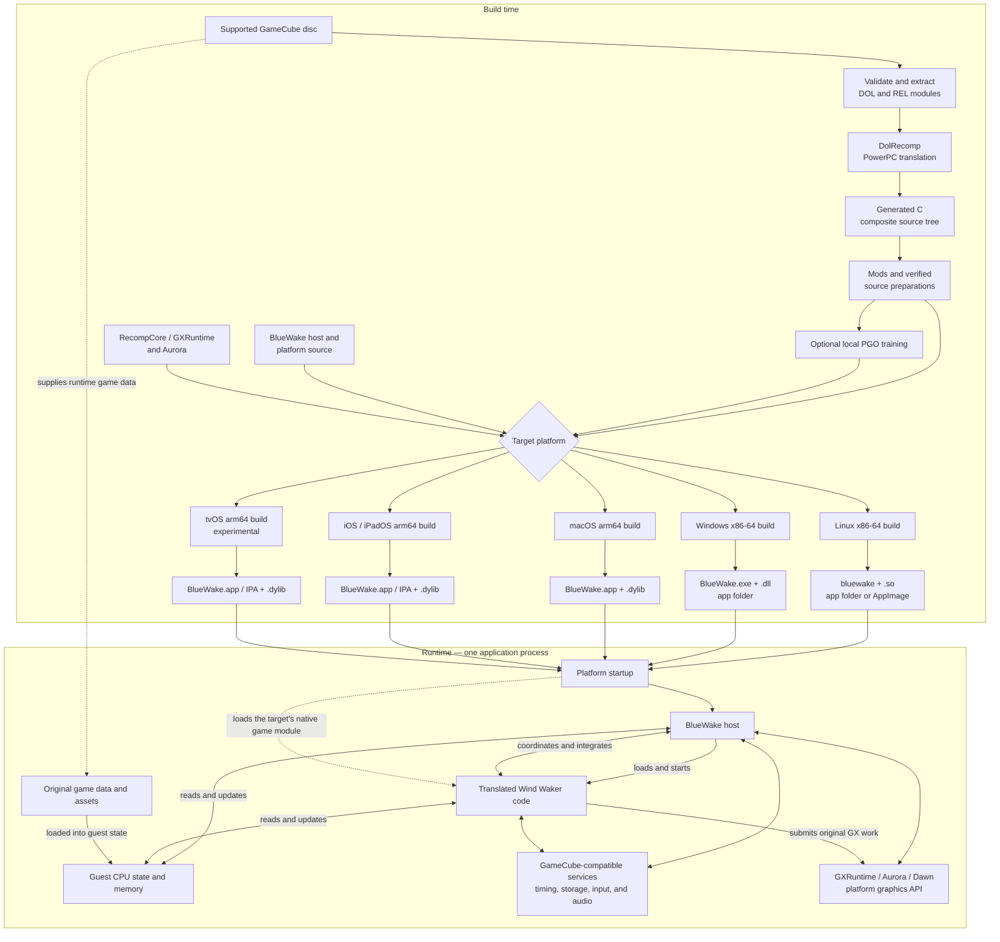

# BlueWake architecture overview

## Introduction

BlueWake runs *The Legend of Zelda: The Wind Waker* on modern platforms by
**statically recompiling** the supported GameCube game's PowerPC machine code.
During the build, DolRecomp translates that code into generated C. A host
compiler then turns the generated C into native code for the target platform.
BlueWake combines that translated game code with a handwritten host and a
compatibility runtime that provide the operating-system, input, audio, storage,
timing, and graphics services the game expects.

This puts BlueWake between several related approaches:

| Approach | What it does | How BlueWake relates to it |
| --- | --- | --- |
| Conventional emulation | Interprets or dynamically translates the original CPU instructions while the game is running and models the original system around them. | BlueWake does not use a conventional CPU-emulation loop for the translated game code. The PowerPC-to-native translation happens ahead of time. Its runtime still supplies compatible GameCube hardware and operating-system behavior, including emulated or high-level implementations of individual services. |
| Decompilation | Reconstructs readable source code that represents the original program, often with recovered types, names, and higher-level structure. | BlueWake does not recover Nintendo's original source code. DolRecomp mechanically preserves the behavior of compiled instructions. Projects such as [zeldaret/tww](https://github.com/zeldaret/tww) are useful research references, but their reconstructed source is not the code BlueWake normally executes. |
| Reimplementation | Rewrites the game or its systems as new handwritten host-native code. | BlueWake has handwritten platform and runtime components, but it is not a ground-up rewrite of Wind Waker. Most original game logic comes from translated machine code. Selected services, integrations, and optimized routines may be implemented natively. |
| Static recompilation | Translates code for one CPU into code that can be compiled for another CPU before the program runs. | This is BlueWake's primary execution model. The resulting native game module retains the original program's guest memory layout and other GameCube execution semantics. |

Static recompilation describes how the game code is produced; it does not mean
that the game's state is static. During play, translated game code and the host
continuously update guest CPU state, memory, graphics state, audio state, and
other runtime data.

BlueWake requires a supported, legally obtained USA revision-0 (`GZLE01`) disc.
The repository does not contain the game, its assets, or Nintendo's original
source code.

## High-level view

Every supported target produces two principal native components: a BlueWake
platform application and a translated game module. Their file formats and
packaging differ by platform, but the application loads the module into the
same process at runtime.

The diagram is a component and data-flow overview, not an exact call sequence.
Build details vary by platform, but the division between translated game code,
the handwritten host, guest state, and compatibility services is the central
architectural model.

### Build toolchain

The **Build time** subgraph has a shared front half and a platform-specific
back half. The numbered components below use the same names as the diagram.

1. **Build coordination — the complete `Build time` subgraph.**
   The [Apple builder](../../scripts/builder/build.sh),
   [Linux builder](../../scripts/linux/build.py), and
   [Windows builder](../../scripts/windows/build.py) validate their host tools,
   run the stages in order, retain reusable work, write logs, and record build
   provenance. They implement the same broad pipeline with target-specific
   compilation and packaging.

2. **Pinned inputs — `Translator` and `RuntimeSource`.**
   [`scripts/builder/profiles/bluewake.sh`](../../scripts/builder/profiles/bluewake.sh)
   is the source used by all three builders for the exact RecompCore,
   DolRecomp, and verified composite revisions. RecompCore supplies GXRuntime,
   Aurora, the DSP implementation, and its DolRecomp submodule.
   [`config/dependencies.lock.json`](../../config/dependencies.lock.json)
   records dependency origins and roles.

3. **Game extraction — `Disc` → `Extract`.**
   Each builder verifies the supported `GZLE01` revision-0 disc and extracts
   `main.dol` plus 415 REL modules. The DOL is the game's main executable; the
   REL files are loadable game modules. The disc remains the source of the
   original runtime data and assets.

4. **Static translation — `Extract` → `Translator` → `Generated`.**
   The pinned [DolRecomp](../../ref/recompcore/DolRecomp) tool translates the
   PowerPC code from the DOL and RELs with its GameCube/Gekko C backend. The
   result mechanically represents the original instructions; it is not
   reconstructed Nintendo source code.

5. **Composite source — `Generated`.**
   [`scripts/generate_composite.py`](../../scripts/generate_composite.py)
   combines the translated DOL and REL output with module metadata and dispatch
   structures. Every builder checks this source tree against the same expected
   digest before continuing.

6. **Build-time modifications — `Generated` → `Prepared`.**
   The builders add selected widescreen and Better Wind Waker variants, then
   apply enabled source preparations and certified native helpers. These are
   repeatable transformations rather than manual edits to generated files; a
   guarded optimization leaves the translated implementation in place when its
   expected input does not match.

7. **Optimization training — `Prepared` → `Training` → `Target`.**
   The normal personal-build paths can compile an instrumented module, run
   isolated headless playbacks, merge the resulting LLVM profiles, and feed
   them into the final compilation. Training is optional and platform-aware;
   its private profiles remain in the local build directory.

8. **Target build — `HostSource` + `RuntimeSource` + `Prepared` → `Target`.**
   CMake and Ninja build the prepared game source as a native dynamic module
   and compile the shared host with the selected platform entry layer,
   GXRuntime/Aurora, SDL, audio support, and native operating-system APIs. The
   target branches below identify the concrete builders and artifacts.

#### Linux (x86-64)

**Diagram path:** `Target` → `LinuxBuild` → `LinuxPackage`.

[`scripts/linux/build.py`](../../scripts/linux/build.py) drives Clang, CMake,
Ninja, and LLD, while [`linux/CMakeLists.txt`](../../linux/CMakeLists.txt)
builds the shared host with the Linux entry and setup layers. The principal
artifacts are `bluewake` and `gGZLE01_recomp.so`, assembled by default in
`build/linux/BlueWake/`. The optional
[`make_appimage.sh`](../../scripts/linux/make_appimage.sh) path bundles those
artifacts but excludes the disc and extracted DOL/REL files; first-run setup
imports them from the player's disc. `--ci-container` uses the shared
[`scripts/linux/Dockerfile`](../../scripts/linux/Dockerfile) environment.

#### Windows (x86-64)

**Diagram path:** `Target` → `WindowsBuild` → `WindowsPackage`.

[`scripts/windows/build.py`](../../scripts/windows/build.py) drives the Visual
Studio LLVM/Clang toolchain, CMake, and Ninja.
[`windows/CMakeLists.txt`](../../windows/CMakeLists.txt) adds the Windows entry,
settings, crash handling, resources, and POSIX compatibility layer to the
shared host. Dawn targets Direct3D 12 or Vulkan. The builder packages
`BlueWake.exe`, `gGZLE01_recomp.dll`, their runtime DLLs, and the personal game
inputs under `build/windows/BlueWake/` by default.

#### macOS (Apple silicon)

**Diagram path:** `Target` → `MacBuild` → `MacPackage`.

[`scripts/builder/build.sh`](../../scripts/builder/build.sh) with
`--platform macos` uses the Xcode macOS SDK and Apple Clang for arm64. It builds
the shared host and `gGZLE01_recomp.dylib`, then
[`package_macos.py`](../../scripts/builder/package_macos.py) creates and signs
`build/macos/packaged/BlueWake.app`. A personal Mac app includes the translated
module, extracted DOL/REL files, and disc, while player saves remain outside the
application bundle.

#### iPhone and iPad (iOS/iPadOS, arm64)

**Diagram path:** `Target` → `IOSBuild` → `IOSPackage`.

The default [`scripts/builder/build.sh`](../../scripts/builder/build.sh) target
uses the iPhoneOS SDK and Apple Clang. [`apple/ios/CMakeLists.txt`](../../apple/ios/CMakeLists.txt)
adds the UIKit lifecycle, touch controls, controller support, first-run import,
and mobile platform services to the shared host. The translated
`gGZLE01_recomp.dylib` is embedded under the app's `Frameworks` directory. The
builder can produce a signed `.app` or an unsigned IPA for a sideloading tool;
the IPA excludes the player's disc and extracted game files, which are imported
on the device.

#### Apple TV (tvOS, arm64; experimental)

**Diagram path:** `Target` → `TVBuild` → `TVPackage`.

[`scripts/tvos/build_device.sh`](../../scripts/tvos/build_device.sh) selects the
tvOS branch of the Apple builder. It uses the AppleTVOS SDK, the controller-first
entry path in [`apple/ios/CMakeLists.txt`](../../apple/ios/CMakeLists.txt), and a
currently retagged pinned Dawn iOS archive as a development bridge. It produces
a tvOS `.app` with the translated dylib and can sign, install, transfer the
player's disc into the app container, and launch it through `devicectl`. This
target remains experimental and does not include the iPhone/iPad touch shell.

### Source anchors

- [Shared Apple build pipeline](../../scripts/builder/build.sh)
- [BlueWake build profile and revision pins](../../scripts/builder/profiles/bluewake.sh)
- [Composite DOL and REL generation](../../scripts/generate_composite.py)
- [Shared host runtime](../../runtime/host/src/main.c)
- [Pinned build dependencies](../../config/dependencies.lock.json)
- [Linux builder](../../scripts/linux/build.py) and
  [application composition](../../linux/CMakeLists.txt)
- [Windows builder](../../scripts/windows/build.py) and
  [application composition](../../windows/CMakeLists.txt)
- [Apple application composition](../../apple/ios/CMakeLists.txt) and
  [macOS packaging](../../scripts/builder/package_macos.py)
