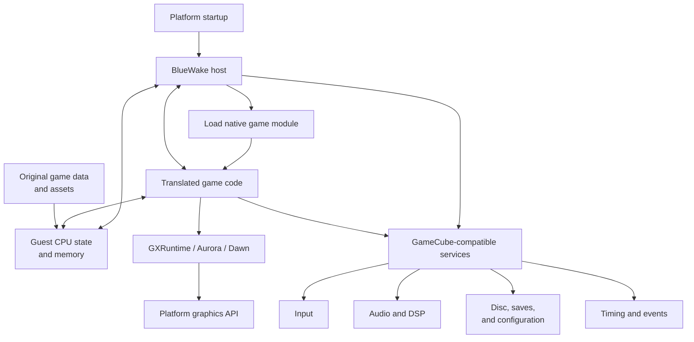

# BlueWake runtime architecture

## Contents

- [Introduction](#introduction)
- [Runtime overview](#runtime-overview)
- [Component boundaries](#component-boundaries)

## Introduction

This chapter expands the runtime half of the
[architecture overview](Overview.md). It follows a packaged BlueWake
application from process startup through loading and running the translated
game module, maintaining GameCube-compatible state, and connecting the game to
platform input, audio, storage, timing, and graphics services.

The translated game module contains native code produced ahead of time from the
game's PowerPC instructions. It runs in the same process as the BlueWake host,
but it retains the guest addresses, CPU state, and other execution semantics
expected by the original game.

## Runtime overview

The host owns process startup and platform integration. It loads the translated
module, initializes the shared runtime state, and supplies the services that the
game expects from GameCube hardware and software. The translated code operates
on that guest state and submits the original game's work through the runtime
interfaces rather than calling platform APIs directly.

## Component boundaries

| Component | Runtime responsibility |
| --- | --- |
| Translated game module | Executes the recompiled Wind Waker program logic while preserving guest addresses and CPU-state conventions. |
| BlueWake host | Starts the application, loads the game module, coordinates runtime state, and connects platform-specific services. |
| RecompCore | Provides the shared CPU/runtime interfaces and GameCube-compatible services used by the host and translated code. |
| GXRuntime, Aurora, and Dawn | Convert the game's GX graphics work into rendering commands for the target platform. |
| Original game data | Supplies the assets and data the running game reads into guest state; it remains separate from the translated code. |
