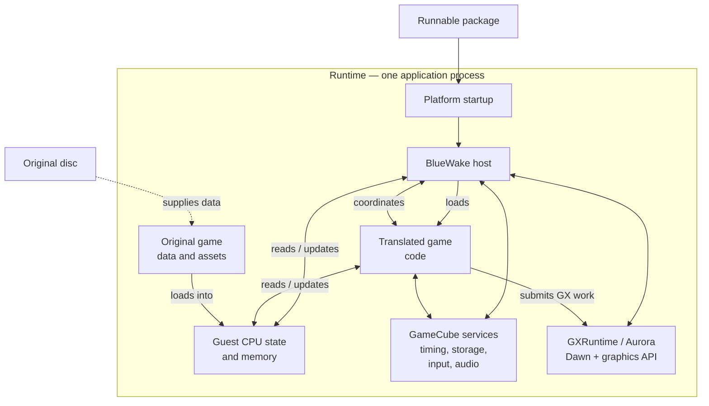

# BlueWake runtime architecture

## Contents

- [High-level view](#high-level-view)

This chapter expands the runtime half of the
[architecture overview](Overview.md). It begins where the
[build process](Build.md) ends: a platform application and translated game
module assembled into a runnable package.

## High-level view

The platform application and translated game module run in the same process,
but remain distinct components. Platform startup enters the handwritten
BlueWake host, which loads the module and coordinates its access to guest
state, GameCube-compatible services, graphics, and the player's original game
data.

The diagram shows component and data relationships, not an exact call
sequence. Later sections will trace startup, module loading, execution state,
services, graphics, and original asset access through their implementations.
