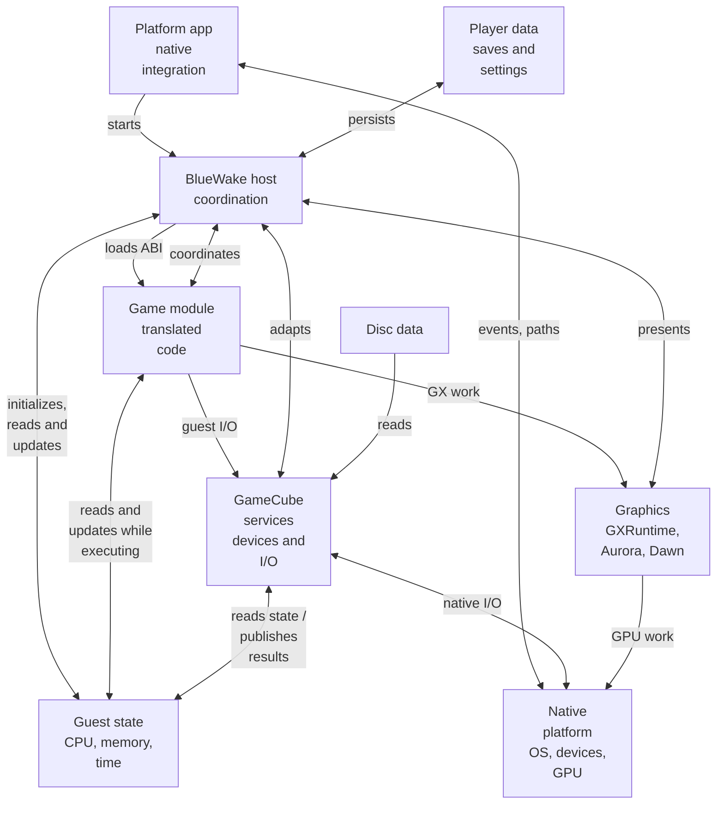
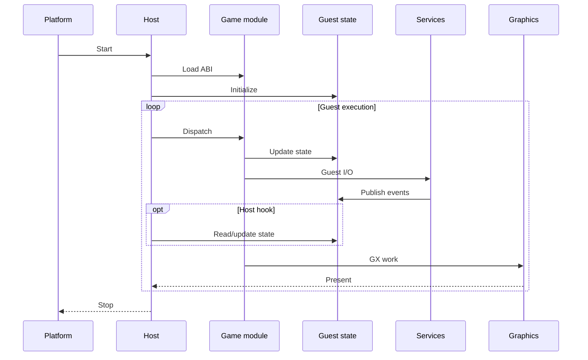

# BlueWake runtime architecture

## Contents

- [Purpose](#purpose)
- [High-level view](#high-level-view)
- [Runtime entities](#runtime-entities)
  - [Platform application](#platform-application)
  - [BlueWake host](#bluewake-host)
  - [Native game module](#native-game-module)
  - [Guest machine state](#guest-machine-state)
  - [Compatibility services](#compatibility-services)
  - [Graphics stack](#graphics-stack)
  - [Runtime data](#runtime-data)
- [Interaction boundaries](#interaction-boundaries)
- [Runtime lifecycle](#runtime-lifecycle)

## Purpose

This chapter maps the principal entities in a running BlueWake application and
the contracts between them. It describes runtime ownership and interaction;
the process that produces these artifacts belongs in the
[build architecture](Build.md).

BlueWake runs as one native process containing two separately compiled
components: the handwritten platform host and the ahead-of-time translated
game module. They cooperate through shared guest state and the module ABI. The
host connects that guest-facing environment to native files, input, audio,
graphics, timing, and presentation.

## High-level view

The diagram below is the runtime half of the
[architecture overview](Overview.md#high-level-view), expanded around the
entities that exist while BlueWake is running and the connections between
them.

These edges describe conceptual access and data flow, not necessarily a direct
function call between every pair of entities.

## Runtime entities

| Entity | Runtime responsibility | Owns or exposes | Internals |
| --- | --- | --- | --- |
| Platform application | Enters through the target OS, resolves bundle paths and writable storage, and forwards native events. | Process entry, platform paths, windows, and application lifecycle | [Host and platform integration](runtime/Host.md) |
| BlueWake host | Initializes and coordinates guest execution and reads or modifies guest state when delivering events, services, callbacks, interrupts, or game-specific integrations. | Runtime lifecycle and host-side adapters | [Host and platform integration](runtime/Host.md) |
| Native game module | Executes translated instructions that read and update guest registers, memory, PC, and timing state. | Translated code, dispatch tables, module descriptor, and optional shared storage | [Native game module](runtime/GameModule.md) |
| Guest machine state | Preserves the CPU, memory, address, timing, and exception model visible to the original program. | `CPUState`, MEM1, guest aliases, program counter, and cycle counters | [Guest machine state](runtime/GuestState.md) |
| Compatibility services | Maintain guest-visible device state and publish results through their integration with guest state. | MMIO devices, callbacks, interrupts, disc, card, input, audio, and DSP state | [Compatibility services](runtime/Services.md) |
| Graphics stack | Converts the game's GX command stream into native GPU work and presents completed frames. | GX state, renderer resources, command submission, and presentation | [Graphics stack](runtime/Graphics.md) |
| Runtime data | Supplies original assets and preserves mutable player state without embedding either into translated code. | Disc image, memory card, SRAM, settings, logs, and save states | [Runtime inputs and persistence](runtime/Host.md#runtime-inputs-and-persistence) |

### Platform application

The platform application is BlueWake's boundary with Linux, Windows, macOS,
iOS, or tvOS. Its entry layer resolves packaged resources and writable storage,
creates the native application environment, and passes normalized paths and
settings into the shared host. Platform-specific lifecycle and presentation
events return through this layer.

**Internals:** [Platform entry layers](runtime/Host.md#platform-entry-layers).

### BlueWake host

The host coordinates the running process. It validates launch configuration,
loads the translated module, and initializes and coordinates guest execution.
During play it also reads or modifies guest machine state to deliver services,
interrupts, callbacks, and game-specific integrations such as camera control.
It owns orderly shutdown and durable host-side data.

PR [#213](https://github.com/chrissotraidis/bluewake/pull/213) is one concrete
example. Conceptually, its controller gesture handling updates host-side input
state; [`zoom_frame`](../../runtime/host/src/mouse_camera.c#L1057-L1100) uses
that state to advance `g_zoom` and adjust camera structures through
guest-memory helpers; translated camera and rendering code then uses the
shared camera data. The gesture state machine lives in
[`stick_zoom.h`](../../runtime/host/src/stick_zoom.h#L22-L82), and its host input
integration is in
[`bluewake_mouse_camera_pad`](../../runtime/host/src/mouse_camera.c#L717-L785).
This extends existing host camera integration: it does not edit generated game
source, replace the complete original camera routine, or primarily zoom by
modifying PowerPC registers directly.

**Internals:** [Host lifecycle](runtime/Host.md#host-lifecycle) and
[shutdown](runtime/Host.md#shutdown).

### Native game module

The game module is a native shared library containing the translated DOL and
REL functions. It publishes its entry point, dispatch tables, metadata,
callbacks, and optional shared storage through `StaticRecompModuleDesc`. The
host invokes it using guest addresses and shared machine state rather than a
rewritten high-level game API.

**Internals:** [Native game module](runtime/GameModule.md).

### Guest machine state

Guest state is the GameCube-visible machine shared by the host and translated
code. It preserves CPU registers, MEM1, guest addresses, aliases, timing,
exceptions, and the program counter across every host/module transition. The
DOL and REL layouts provide runtime data and addresses even though their
instructions were translated ahead of time.

**Internals:** [Guest machine state](runtime/GuestState.md).

### Compatibility services

Compatibility services implement the hardware and operating-system behavior
observed by the original program. MMIO, timing, interrupts, disc access,
memory-card operations, controller input, audio, DSP, and callbacks retain
guest-visible semantics while adapters connect them to native facilities.

**Internals:** [Compatibility services](runtime/Services.md).

### Graphics stack

The graphics stack accepts the game's original GX FIFO and display-list work.
GXRuntime interprets the GameCube command stream, Aurora turns the resulting
state into renderer work, and Dawn reaches the target platform's GPU API. The
host coordinates initialization, synchronization, retrace, and presentation.

**Internals:** [Graphics stack](runtime/Graphics.md).

### Runtime data

Runtime data crosses two distinct boundaries. The supported disc and DOL
supply read-only original data, while settings, memory card, SRAM, logs, and
save states are mutable player data kept in platform-managed storage. Neither
category is part of the translated code's internal implementation.

**Internals:** [Runtime inputs and persistence](runtime/Host.md#runtime-inputs-and-persistence)
and [disc and storage services](runtime/Services.md#disc-and-storage).

## Interaction boundaries

| Boundary | Runtime contract | Why it exists | Reference |
| --- | --- | --- | --- |
| Platform application → host | Resolved paths, launch settings, and native lifecycle events | Keeps OS-specific startup outside shared runtime logic | [Platform entry layers](runtime/Host.md#platform-entry-layers) |
| Host ↔ game module | `StaticRecompModuleDesc`, callbacks, dispatch, and shared-storage exports | Allows the host and translated code to be compiled separately | [Module loading and ABI](runtime/GameModule.md#module-loading-and-abi) |
| Host ↔ guest state | Access to shared CPU state and guest memory through runtime interfaces and guest-memory helpers | Supports execution control, event delivery, and game-specific integrations | [Host lifecycle](runtime/Host.md#host-lifecycle), [ownership and address model](runtime/GuestState.md#ownership-and-address-model) |
| Module ↔ guest state | Shared `CPUState`, memory access, guest PC, and address aliases | Preserves the machine model expected by translated PowerPC code | [Ownership and address model](runtime/GuestState.md#ownership-and-address-model) |
| Guest execution ↔ services | MMIO, HLE calls, deadlines, callbacks, and interrupts | Turns guest-visible hardware operations into host-managed work | [Service boundary](runtime/Services.md#service-boundary) |
| Game module → graphics | GX gather-pipe data and display lists | Preserves the original graphics command model while using a native renderer | [GX command path](runtime/Graphics.md#gx-command-path) |
| Host ↔ persistent data | Platform storage paths and durable file formats | Keeps mutable player data outside the application and game module | [Runtime inputs and persistence](runtime/Host.md#runtime-inputs-and-persistence) |

## Runtime lifecycle

The entities above remain present throughout play. Their main runtime
interaction sequence is:

Execution is cyclical, not a one-way pipeline. The host gives translated code a
bounded amount of guest time, services devices at a safe boundary, publishes
pending callbacks or interrupts, and resumes at the guest program counter.
The sequence is conceptual: host hooks access guest state only at relevant
integration points, not on every dispatch.

Return to the [architecture overview](Overview.md), or review how these runtime
artifacts are produced in the [build architecture](Build.md).
