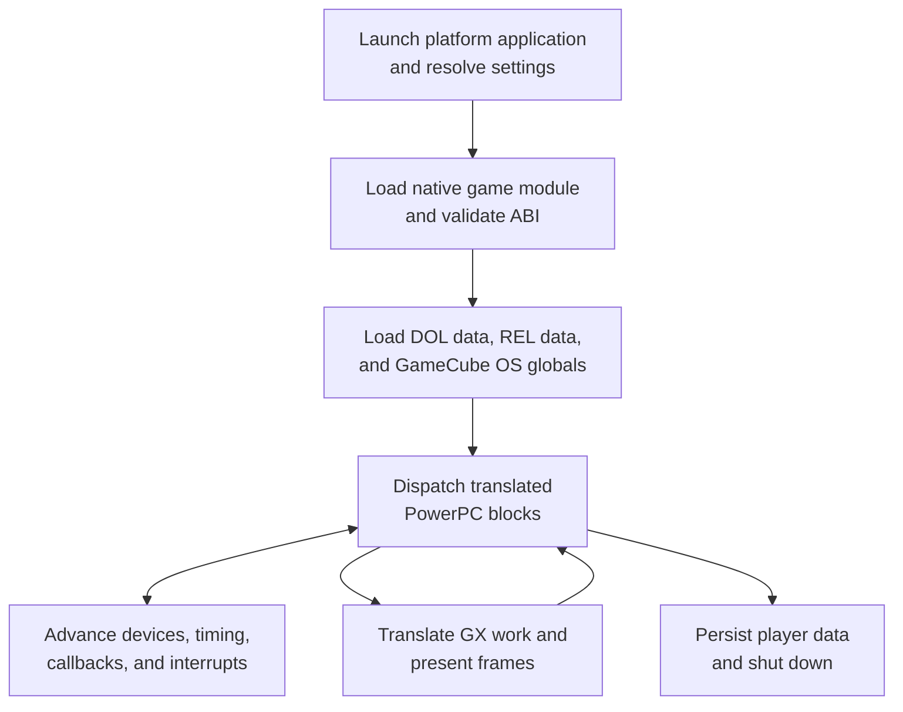
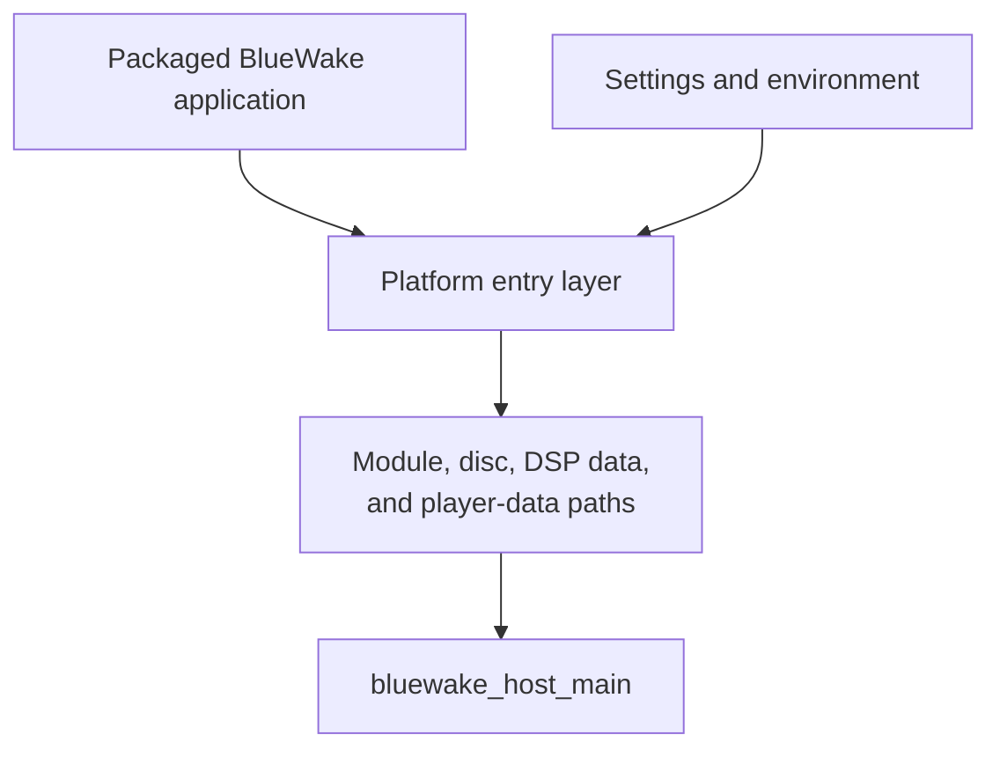
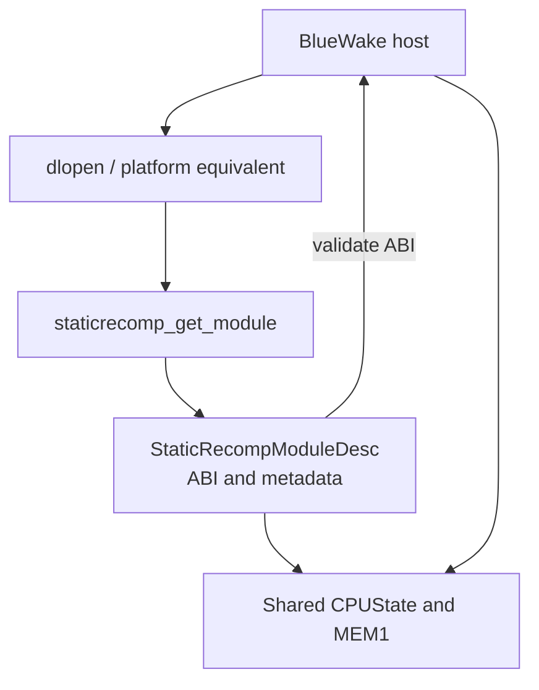
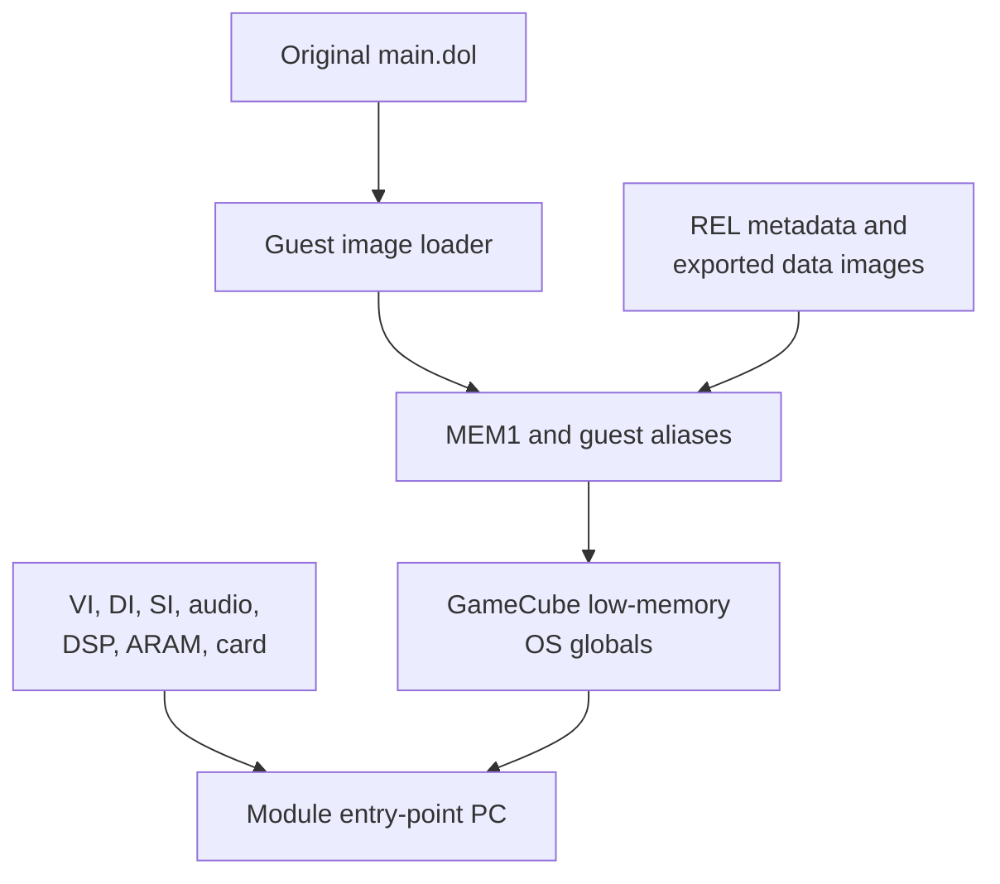
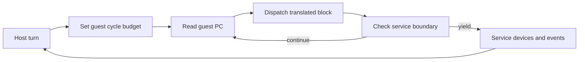
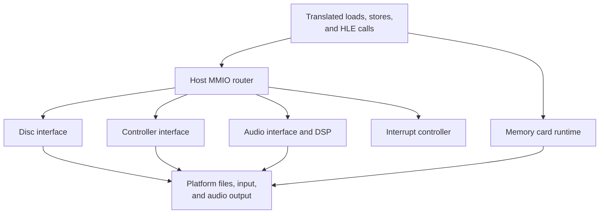
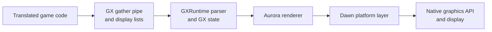
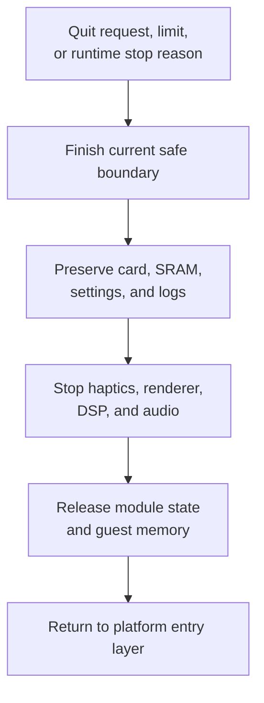

# BlueWake runtime architecture

## Contents

- [End-to-end overview](#end-to-end-overview)
- [Runtime component overview](#runtime-component-overview)
  - [Concepts](#concepts)
- [1. Launch and configure](#1-launch-and-configure)
  - [Platform entry layers](#platform-entry-layers)
  - [Runtime inputs and player data](#runtime-inputs-and-player-data)
- [2. Load the native game module](#2-load-the-native-game-module)
  - [Dynamic module loading](#dynamic-module-loading)
  - [Shared CPU and memory ownership](#shared-cpu-and-memory-ownership)
- [3. Boot guest state](#3-boot-guest-state)
  - [DOL image and OS globals](#dol-image-and-os-globals)
  - [REL code and data](#rel-code-and-data)
- [4. Run translated code](#4-run-translated-code)
  - [Dispatch loop](#dispatch-loop)
  - [Guest time and interrupts](#guest-time-and-interrupts)
- [5. Service GameCube interfaces](#5-service-gamecube-interfaces)
  - [Memory-mapped devices](#memory-mapped-devices)
  - [Disc and storage](#disc-and-storage)
  - [Input](#input)
  - [Audio and DSP](#audio-and-dsp)
- [6. Render and present](#6-render-and-present)
  - [GX command path](#gx-command-path)
  - [Aurora and platform graphics APIs](#aurora-and-platform-graphics-apis)
- [7. Persist and stop](#7-persist-and-stop)

This chapter expands the runtime half of the
[architecture overview](Overview.md). It follows a packaged BlueWake
application from platform startup through loading the translated game module,
booting GameCube-compatible state, running the game, and connecting its work to
the player's display, controllers, audio, disc image, and saved data.

The build produces two cooperating native binaries: a platform host and a game
module containing ahead-of-time translated PowerPC code. They run in one
process and share guest CPU and memory state. The host preserves the hardware
and operating-system behavior that the translated game expects while routing
work to native platform services.

## End-to-end overview

After initialization, execution is a loop rather than a one-way pipeline. The
host gives translated code a bounded amount of guest time, services devices at
the resulting boundary, delivers pending callbacks or interrupts, and resumes
at the guest program counter. Video retraces pace frame presentation and input
polling while audio, disc, controller, and storage state advance in the same
guest-time domain.

## Runtime component overview

### Concepts

- **Host** — the native BlueWake application around the translated game. The
  platform entry layer locates files and collects settings; the shared host
  initializes and runs the GameCube-compatible environment.

- **Native game module** — the shared library produced from the generated
  composite source. It contains translated DOL and REL functions, dispatch and
  metadata tables, and the module ABI used by the host.

- **Guest state** — the `CPUState`, guest RAM, registers, program counter,
  exceptions, timing counters, and address aliases that preserve the model
  visible to the original PowerPC program.

- **DOL** — the original main executable. Its instructions were translated at
  build time, but its section layout and initialized data are still loaded into
  guest memory at runtime.

- **REL** — a relocatable game module. Translated REL functions live in the
  native game module; exported REL data and BSS mappings give them the guest
  addresses expected by the game.

- **MMIO** — memory-mapped input/output. Reads and writes to GameCube hardware
  address ranges call host device models instead of ordinary guest RAM.

- **GX** — the GameCube graphics interface. GXRuntime interprets the game's
  FIFO commands and Aurora submits equivalent work through the platform
  graphics layer.

| Stage | Main code or component | What it does | Result | Runtime state or output |
| --- | --- | --- | --- | --- |
| Launch and configure | Platform entry layer | Locates the packaged module, disc, DSP data, and player-data directory; applies platform settings. | Validated arguments for the shared host | Paths, environment, and launch settings |
| Load module | Shared host and native game module | Opens the translated module, reads its descriptor, checks the ABI, and chooses the shared CPU and RAM storage. | Compatible host/module pair | Module handle, descriptor, `CPUState`, and MEM1 |
| Boot guest state | RecompCore loader and BlueWake host | Loads DOL sections and REL data, establishes guest aliases, initializes OS globals, and selects the entry point. | GameCube-compatible initial machine state | Guest RAM, aliases, device state, and initial PC |
| Run translated code | Composite dispatcher and host loop | Resolves the guest PC to native translated blocks and runs until a service boundary. | Continued game execution | Updated registers, memory, PC, and cycle counters |
| Service interfaces | RecompCore device models and BlueWake adapters | Handles MMIO, timing, interrupts, disc reads, controller state, audio, DSP, and memory-card callbacks. | Hardware-visible events and completed I/O | Device registers, queues, callbacks, and interrupt state |
| Render and present | GXRuntime, Aurora, and Dawn | Parses GX work, records native rendering work, and presents at video retraces. | A rendered frame on the target platform | Renderer resources and presentation state |
| Persist and stop | BlueWake host and platform storage | Flushes durable player data and tears down host services in order. | Clean application exit | Memory card, SRAM, settings, logs, and optional save state |

## 1. Launch and configure

### Platform entry layers

Linux, Windows, and Apple use small native entry layers around the same shared
host. Each layer applies the platform's bundle or executable layout, resolves
the writable player-data location, validates required files, and then calls
`bluewake_host_main`.

| Stage | What it does | Result | Runtime state or output | Code reference |
| --- | --- | --- | --- | --- |
| Enter on Linux | Resolves the application directory, portable mode, and Linux player-data paths before invoking the host. | Linux paths and settings | Host argument vector | [Linux entry](../../linux/src/linux_entry.c#L361-L566) |
| Enter on Windows | Resolves the executable directory and Windows player-data paths and prepares the process for the shared host. | Windows paths and settings | Host argument vector | [Windows entry](../../windows/src/win_entry.c#L563-L747) |
| Enter on Apple platforms | Resolves resources from the app bundle and writable data from the app container before starting the host. | Apple bundle and data paths | Host argument vector | [Apple entry](../../apple/ios/src/ios_entry.m#L276-L474) |
| Start the shared host | Parses runtime options, chooses defaults, and receives the resolved module and DOL paths. | Platform-independent runtime configuration | Host configuration and feature flags | [Host startup](../../runtime/host/src/main.c#L7248-L7314) |

### Runtime inputs and player data

The packaged program keeps executable artifacts separate from original game
content and mutable player data. The exact filesystem layout varies by
platform, but the roles remain the same.

| Input or data | Purpose | Lifetime | Code reference |
| --- | --- | --- | --- |
| Native game module | Supplies translated functions, dispatch tables, REL metadata, and the module ABI. | Read-only for the process lifetime | [Module path selection](../../runtime/host/src/main.c#L7248-L7322) |
| `main.dol` | Supplies the original DOL section layout and initialized bytes loaded into guest memory. | Read during guest boot | [DOL load](../../runtime/host/src/main.c#L7957-L7960) |
| Supported disc image | Supplies the file-system table and original game assets requested through DVD interfaces. | Read throughout play | [Disc initialization](../../runtime/host/src/main.c#L7819-L7865) |
| DSP data | Supplies the DSP program or donor-backed data used by the selected audio path. | Read during audio initialization and execution | [DSP adapter](../../runtime/host/src/dsp_adapter.cpp) |
| Memory card and SRAM | Hold durable game saves and console-like configuration. | Loaded at startup and updated during play or shutdown | [Memory-card runtime](../../runtime/host/src/card_runtime.c), [SRAM runtime](../../runtime/host/src/ipl_sram.c) |
| Settings, logs, and optional save states | Hold host preferences, diagnostics, and complete resumable runtime snapshots. | Platform-managed player data | [Save-state implementation](../../runtime/host/src/save_state.c) |

## 2. Load the native game module

### Dynamic module loading

The host opens the platform's translated shared library and obtains its
`StaticRecompModuleDesc` through `staticrecomp_get_module`. That descriptor is
the contract between separately compiled host and game code: it identifies the
entry point, code ranges, REL metadata, dispatch function, and compatible CPU
ABI. Startup stops if the export is missing or the versions do not match.

| Stage | What it does | Result | Runtime state or output | Code reference |
| --- | --- | --- | --- | --- |
| Open | Loads `gGZLE01_recomp` with the platform dynamic loader. | Native translated code mapped into the process | Module handle | [Module loading](../../runtime/host/src/main.c#L7316-L7322) |
| Describe | Calls `staticrecomp_get_module` to obtain generated code and metadata exports. | Host-visible module description | `StaticRecompModuleDesc` | [Composite generation](../../scripts/generate_composite.py#L799) |
| Validate | Checks the module ABI and required callbacks before guest initialization. | Compatible module accepted | Validated function and metadata pointers | [ABI validation](../../runtime/host/src/main.c#L7329-L7343) |

### Shared CPU and memory ownership

The host and translated module must operate on the same machine state. The
module can export its own aligned `CPUState` and MEM1 storage; the host selects
those exports when present, initializes them, and passes the same CPU pointer
through dispatch, memory, device, and callback paths. This avoids copying state
across an ABI boundary and keeps guest addresses stable.

| Stage | What it does | Result | Runtime state or output | Code reference |
| --- | --- | --- | --- | --- |
| Select storage | Uses module-exported CPU and MEM1 storage when supplied, with host-owned storage as the compatibility path. | One authoritative machine state | Shared `CPUState` and RAM pointer | [Storage selection](../../runtime/host/src/main.c#L7329-L7343) |
| Attach accessors | Installs MMIO callbacks and guest-memory access used by translated loads and stores. | Hardware ranges route to host devices | CPU memory callback table | [MMIO callback setup](../../runtime/host/src/main.c#L7943-L7948) |
| Establish aliases | Maps relocated REL data at linked guest addresses while retaining executable guest addresses for dispatch. | Stable REL data and function-pointer semantics | Guest alias table | [REL alias setup](../../runtime/host/src/main.c#L7968-L8101) |

## 3. Boot guest state

### DOL image and OS globals

Ahead-of-time translation replaces DOL instructions with native functions; it
does not remove the DOL's role as the initial memory image. RecompCore's loader
copies its initialized sections into guest RAM, clears BSS, and reports the
layout. The boot helper then writes the low-memory globals, arena boundaries,
clock values, stack state, and other values expected by the GameCube OS before
the host sets the module's entry-point PC.

| Stage | What it does | Result | Runtime state or output | Code reference |
| --- | --- | --- | --- | --- |
| Initialize devices | Creates video, disc, controller, interrupt, audio, DSP, ARAM, SRAM, and memory-card state. | Reset GameCube-compatible peripherals | Host device structures | [Host initialization](../../runtime/host/src/main.c#L7550-L7686), [device setup](../../runtime/host/src/main.c#L7819-L7865) |
| Load DOL image | Copies data sections, clears BSS, and records the DOL layout in guest RAM. | Initial program data in GameCube addresses | DOL layout and initialized MEM1 | [Host DOL load](../../runtime/host/src/main.c#L7957-L7960), [RecompCore loader](https://github.com/chrissotraidis/RecompCore/blob/ee99bbc13c948351f6974c745cad2593a25eacbf/GXRuntime/src/loader.c) |
| Create OS state | Populates GameCube low-memory globals and the initial execution environment. | Guest OS assumptions satisfied | Low memory, arena, stack, clocks, and MSR | [Host boot call](../../runtime/host/src/main.c#L8102-L8115), [RecompCore boot](https://github.com/chrissotraidis/RecompCore/blob/ee99bbc13c948351f6974c745cad2593a25eacbf/GXRuntime/src/boot.c) |
| Select entry point | Copies the descriptor's entry address into the guest PC. | Guest ready for its first dispatch | `cpu.pc` | [Execution start](../../runtime/host/src/main.c#L8112-L8115) |

### REL code and data

The composite module contains translated functions for all supported RELs and
metadata that preserves their original linked addresses. During startup, the
host installs aliases for relocated data and BSS and materializes exported data
images. Executable REL ranges remain represented by guest addresses; the
dispatcher maps those addresses to native functions when the game loads and
calls them.

| Stage | What it does | Result | Runtime state or output | Code reference |
| --- | --- | --- | --- | --- |
| Read metadata | Uses the generated module descriptor's REL section and code-range tables. | Original module layout available to the host | REL module metadata | [Composite generator](../../scripts/generate_composite.py#L799) |
| Map data | Adds shared guest aliases for linked data and BSS and copies file-backed bytes. | REL state appears at expected guest addresses | Alias mappings and initialized REL data | [REL materialization](../../runtime/host/src/main.c#L7968-L8101) |
| Resolve code | Retains linked guest code addresses so dispatch and guest function pointers use one address model. | Calls into loaded RELs reach native translations | Guest-address dispatch entries | [Dispatch generation](../../scripts/generate_composite.py#L562-L707) |

## 4. Run translated code

### Dispatch loop

The generated dispatcher maps a guest PowerPC address to the corresponding
native translated function. A chassis loop can run successive blocks without
returning to the outer host after every block, but it yields when the cycle
budget expires, an exception becomes pending, translated progress stops, or an
edge service requires host work. The guest PC and registers in `CPUState`
identify exactly where execution resumes.

| Stage | What it does | Result | Runtime state or output | Code reference |
| --- | --- | --- | --- | --- |
| Begin turn | Applies pending host work and computes the next bounded amount of guest execution. | Safe execution window | Downcount and cycle budget | [Main runtime loop](../../runtime/host/src/main.c#L8651-L8662), [cycle domain](../../runtime/host/src/cycle_domain.c) |
| Resolve PC | Selects a translated block from generated DOL and REL dispatch tables. | Native function for the current guest address | Dispatch result | [Generated dispatcher](../../scripts/generate_composite.py#L562-L707) |
| Run blocks | Executes translated blocks and updates shared CPU and memory state. | Game advances without instruction interpretation on the normal path | Registers, RAM, PC, and cycle count | [Dispatch chassis](../../cmake/composite/dispatch_loop.h) |
| Yield | Returns to host service code at a timing, exception, callback, or diagnostic boundary. | Host regains control without losing guest position | Boundary reason and current `CPUState` | [Dispatch loop conditions](../../cmake/composite/dispatch_loop.h#L35-L77) |

### Guest time and interrupts

Translated blocks charge guest cycles rather than using wall-clock time
directly. The cycle domain advances video, audio, disc, controller, and DSP
models to a common point and chooses the next deadline. Device state publishes
interrupt sources through the interrupt controller; the host delivers an
external interrupt only at a guest boundary where architectural and scheduler
state can be preserved.

| Stage | What it does | Result | Runtime state or output | Code reference |
| --- | --- | --- | --- | --- |
| Account time | Converts completed translated work into the shared absolute guest timeline. | Deterministic ordering among runtime devices | Cycle-domain counters | [Cycle domain](../../runtime/host/src/cycle_domain.c) |
| Advance devices | Synchronizes video, audio, DSP, disc, controller, and other cycle-driven state. | Devices observe the same guest time | Updated device cursors and queues | [Device synchronization](../../runtime/host/src/main.c#L5455-L5474) |
| Publish interrupts | Combines device interrupt lines into the GameCube interrupt-controller state. | Guest-visible pending interrupt | PI cause and mask state | [Interrupt-source routing](../../runtime/host/src/main.c#L3441-L3544) |
| Deliver | Saves guest context and enters the appropriate exception path at a safe boundary. | Guest interrupt handler runs through translated code | Exception registers and handler PC | [External interrupt delivery](../../runtime/host/src/main.c#L3078-L3234) |

## 5. Service GameCube interfaces

### Memory-mapped devices

Translated memory accesses use ordinary guest RAM unless their address belongs
to a hardware range. The host's MMIO callbacks first synchronize cycle-driven
devices, route the access to the matching RecompCore or BlueWake model, and
refresh interrupt state when a register operation raises or acknowledges an
event.

| Stage | What it does | Result | Runtime state or output | Code reference |
| --- | --- | --- | --- | --- |
| Intercept | Receives a translated read or write outside ordinary guest RAM. | Hardware access separated from memory access | Address, width, and value | [MMIO callback installation](../../runtime/host/src/main.c#L7943-L7948) |
| Synchronize | Advances time-sensitive device state before exposing registers. | Register values match current guest time | Updated device state | [MMIO read](../../runtime/host/src/main.c#L3581), [MMIO write](../../runtime/host/src/main.c#L4723) |
| Route | Selects DI, SI, PI, VI, audio, DSP, ARAM, GX, or another mapped device. | Device-specific operation completed | Register result or side effect | [MMIO read routing](../../runtime/host/src/main.c#L3606-L3820), [MMIO write routing](../../runtime/host/src/main.c#L4723) |
| Refresh | Republishes interrupt inputs after state-changing operations. | CPU sees newly raised or cleared events | Interrupt-controller state | [Interrupt refresh](../../runtime/host/src/main.c#L3525-L3544) |

### Disc and storage

The disc interface serves the original game's file requests from the player's
validated image. RecompCore parses the disc file-system table and copies
requested ranges into guest addresses. BlueWake schedules asynchronous DVD
completion callbacks on guest time. The memory-card runtime separately maps
the game's card operations to a durable `GZLE01.card` file.

| Stage | What it does | Result | Runtime state or output | Code reference |
| --- | --- | --- | --- | --- |
| Open disc | Attaches the validated image and reads its file-system metadata. | Original assets addressable by path or offset | Disc and FST state | [Host disc setup](../../runtime/host/src/main.c#L7819-L7865), [RecompCore DVD service](https://github.com/chrissotraidis/RecompCore/blob/ee99bbc13c948351f6974c745cad2593a25eacbf/GXRuntime/src/dvd.c) |
| Complete reads | Copies disc bytes to guest memory and schedules asynchronous callbacks against guest cycles. | Requested game asset becomes visible to translated code | Guest buffer and callback queue | [DVD completion queue](../../runtime/host/src/dvd_completion.h), [callback delivery](../../runtime/host/src/callback_delivery.c) |
| Emulate card operations | Services guest card commands and callbacks against the host-backed card image. | Game save operations retain their expected interface | `GZLE01.card` and callback state | [Memory-card runtime](../../runtime/host/src/card_runtime.c) |

### Input

Platform input is normalized by the runtime and exposed through the GameCube
serial-interface model. Polling is tied to video retraces so the guest observes
controller samples at a stable point in its frame cadence. BlueWake's mappings,
motion input, haptics, and accessibility options transform the platform state
before or alongside the standard pad data.

| Stage | What it does | Result | Runtime state or output | Code reference |
| --- | --- | --- | --- | --- |
| Poll | Samples platform controllers, keyboard, mouse, touch, or motion sources at the retrace boundary. | Current native input state | Platform pad sample | [VI retrace service](../../runtime/host/src/main.c#L5381-L5453) |
| Transform | Applies controller-port, button-remap, camera, gyro, and other enabled input policies. | Configured GameCube control state | Mapped buttons, sticks, and motion | [Input remapping](../../runtime/host/src/input_remap.h), [controller ports](../../runtime/host/src/controller_ports.h) |
| Publish | Updates SI registers and raises the appropriate device event for guest reads. | Translated PAD code receives a GameCube-compatible sample | SI state and interrupt | [RecompCore SI interface](https://github.com/chrissotraidis/RecompCore/blob/ee99bbc13c948351f6974c745cad2593a25eacbf/GXRuntime/include/gxruntime/si.h) |

### Audio and DSP

The audio interface advances DMA at guest-cycle deadlines and submits decoded
PCM to the platform audio path. DSP behavior is supplied by the configured
runtime path, including the BlueWake DSP adapter where available. Mailboxes,
DMA completion, and audio interrupts remain visible through GameCube-style
registers even though final playback uses the native device.

| Stage | What it does | Result | Runtime state or output | Code reference |
| --- | --- | --- | --- | --- |
| Advance audio DMA | Consumes guest memory at the configured sample cadence and produces audio chunks. | Timed PCM stream | DMA cursor, buffers, and interrupt state | [Audio DMA service](../../runtime/host/src/main.c#L5150-L5220), [RecompCore audio DMA](https://github.com/chrissotraidis/RecompCore/blob/ee99bbc13c948351f6974c745cad2593a25eacbf/GXRuntime/src/audio_dma.c) |
| Service DSP | Exchanges mail, runs the selected DSP path, and coordinates ARAM transfers. | Game audio commands become samples and completion events | DSP mailbox, ARAM, and adapter state | [DSP adapter](../../runtime/host/src/dsp_adapter.cpp), [ARAM DMA](../../runtime/host/src/aram_dma.c) |
| Output | Sends completed audio frames through the platform runtime. | Audible native playback | Platform audio queue | [Stereo output bridge](../../runtime/host/src/audio_dma_stereo.h) |

## 6. Render and present

### GX command path

The game writes commands and data to the emulated GX FIFO using the same guest
addresses and formats as the original hardware. The gather-pipe bridge batches
those writes, and GXRuntime parses command processor, transform, rasterization,
texture, display-list, and copy state. Flush and synchronization operations
turn accumulated state into renderer work at the points required by the game.

| Stage | What it does | Result | Runtime state or output | Code reference |
| --- | --- | --- | --- | --- |
| Collect | Routes translated gather-pipe writes through the module/host bridge. | Ordered GX byte stream | Gather-pipe batches | [Gather-pipe setup](../../runtime/host/src/main.c#L8269-L8274), [bridge ABI](../../runtime/host/src/gather_pipe_bridge.h) |
| Parse | Decodes FIFO commands and display lists and updates GameCube GX state. | Native renderer description of the game's graphics work | GX registers, resources, and draw commands | [RecompCore GX parser](https://github.com/chrissotraidis/RecompCore/blob/ee99bbc13c948351f6974c745cad2593a25eacbf/GXRuntime/include/gxruntime/gx_recomp.h) |
| Flush | Submits pending work when guest synchronization or rendering semantics require it. | Complete render work available to the backend | Backend command stream | [Host GX synchronization](../../runtime/host/src/main.c#L10214-L10281) |

### Aurora and platform graphics APIs

GXRuntime hands normalized rendering work to Aurora. Aurora manages native GPU
resources and uses Dawn as the portability layer for the graphics API exposed
by the target platform. At each completed video retrace, the host services
presentation, updates platform-facing features, and polls the next input
sample.

| Stage | What it does | Result | Runtime state or output | Code reference |
| --- | --- | --- | --- | --- |
| Initialize backend | Selects and starts the available renderer before guest execution. | Native graphics device ready | Aurora and platform graphics state | [Renderer initialization](../../runtime/host/src/main.c#L7550-L7628) |
| Record and submit | Converts parsed GX state into native render passes, resources, and commands. | GPU executes the emulated frame | Aurora/Dawn command stream | [RecompCore Aurora backend](https://github.com/chrissotraidis/RecompCore/tree/ee99bbc13c948351f6974c745cad2593a25eacbf/GXRuntime/graphics/aurora) |
| Present | Services the renderer at a guest VI retrace and displays completed work. | Frame becomes visible with guest-timed cadence | Presented swap-chain image | [Retrace and presentation](../../runtime/host/src/main.c#L5381-L5453) |

## 7. Persist and stop

Normal termination begins at a host boundary, where no translated block is
partially executed. The host can finish pending durable writes, disconnect the
gather pipe, and tear down platform services in a defined order before freeing
the shared CPU state. Optional save states use a broader snapshot path: they
serialize CPU, memory, aliases, device, DSP, and GX state and rebuild derived
renderer state when restored.

| Stage | What it does | Result | Runtime state or output | Code reference |
| --- | --- | --- | --- | --- |
| Detect stop | Observes a platform quit request, configured execution limit, or fatal runtime condition at the host loop. | Controlled exit from guest dispatch | Stop reason | [Main runtime loop](../../runtime/host/src/main.c#L8651-L8662) |
| Persist player data | Completes host-backed card and console-state writes and retains settings and diagnostics. | Durable state available to the next launch | Card, SRAM, settings, and logs | [Memory-card runtime](../../runtime/host/src/card_runtime.c), [SRAM runtime](../../runtime/host/src/ipl_sram.c) |
| Save or restore a snapshot | Serializes authoritative CPU, memory, alias, device, DSP, and GX state and reconstructs derived state when loading. | Optional resumable execution point | BlueWake save-state file | [Save-state implementation](../../runtime/host/src/save_state.c), [host integration](../../runtime/host/src/main.c#L6454) |
| Shut down | Disconnects the GX bridge, stops haptics, renderer, DSP, and card services, and frees module-owned CPU storage. | Platform resources released | Clean process return | [Host shutdown](../../runtime/host/src/main.c#L16364-L16373) |
