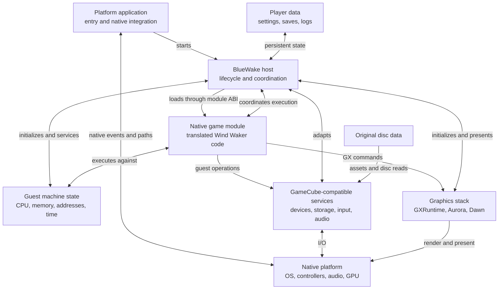
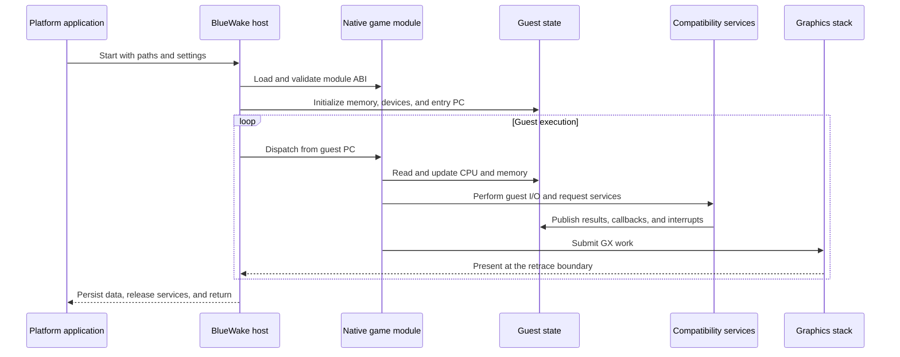

# BlueWake runtime architecture

## Contents

- [Purpose](#purpose)
- [Runtime entities](#runtime-entities)
- [Interaction boundaries](#interaction-boundaries)
- [Runtime lifecycle](#runtime-lifecycle)
- [Entity internals](#entity-internals)

## Purpose

This chapter maps the principal entities in a running BlueWake application and
the contracts between them. It describes runtime ownership and interaction;
the process that produces these artifacts belongs in the
[build architecture](Build.md).

BlueWake runs as one native process containing two separately compiled
components: the handwritten platform host and the ahead-of-time translated
game module. They cooperate through shared guest state and the module ABI. The
host connects that guest-facing environment to native files, input, audio,
graphics, timing, and presentation.

## Runtime entities

| Entity | Runtime responsibility | Owns or exposes | Internals |
| --- | --- | --- | --- |
| Platform application | Enters through the target OS, resolves bundle paths and writable storage, and forwards native events. | Process entry, platform paths, windows, and application lifecycle | [Host and platform integration](runtime/Host.md) |
| BlueWake host | Validates configuration, loads the module, initializes runtime systems, and coordinates execution and shutdown. | Runtime lifecycle and host-side adapters | [Host and platform integration](runtime/Host.md) |
| Native game module | Provides native functions translated from the DOL and RELs plus the metadata and dispatch ABI required to call them. | Translated code, dispatch tables, module descriptor, and optional shared storage | [Native game module](runtime/GameModule.md) |
| Guest machine state | Preserves the CPU, memory, address, timing, and exception model visible to the original program. | `CPUState`, MEM1, guest aliases, program counter, and cycle counters | [Guest machine state](runtime/GuestState.md) |
| Compatibility services | Present GameCube-style devices and operating-system behavior to translated code while using native facilities underneath. | MMIO devices, callbacks, interrupts, disc, card, input, audio, and DSP state | [Compatibility services](runtime/Services.md) |
| Graphics stack | Converts the game's GX command stream into native GPU work and presents completed frames. | GX state, renderer resources, command submission, and presentation | [Graphics stack](runtime/Graphics.md) |
| Runtime data | Supplies original assets and preserves mutable player state without embedding either into translated code. | Disc image, memory card, SRAM, settings, logs, and save states | [Runtime inputs and persistence](runtime/Host.md#runtime-inputs-and-persistence) |

## Interaction boundaries

| Boundary | Runtime contract | Why it exists | Reference |
| --- | --- | --- | --- |
| Platform application → host | Resolved paths, launch settings, and native lifecycle events | Keeps OS-specific startup outside shared runtime logic | [Platform entry layers](runtime/Host.md#platform-entry-layers) |
| Host ↔ game module | `StaticRecompModuleDesc`, callbacks, dispatch, and shared-storage exports | Allows the host and translated code to be compiled separately | [Module loading and ABI](runtime/GameModule.md#module-loading-and-abi) |
| Module ↔ guest state | Shared `CPUState`, memory access, guest PC, and address aliases | Preserves the machine model expected by translated PowerPC code | [Ownership and address model](runtime/GuestState.md#ownership-and-address-model) |
| Guest execution ↔ services | MMIO, HLE calls, deadlines, callbacks, and interrupts | Turns guest-visible hardware operations into host-managed work | [Service boundary](runtime/Services.md#service-boundary) |
| Game module → graphics | GX gather-pipe data and display lists | Preserves the original graphics command model while using a native renderer | [GX command path](runtime/Graphics.md#gx-command-path) |
| Host ↔ persistent data | Platform storage paths and durable file formats | Keeps mutable player data outside the application and game module | [Runtime inputs and persistence](runtime/Host.md#runtime-inputs-and-persistence) |

## Runtime lifecycle

The entities above remain present throughout play. Their main runtime
interaction sequence is:

Execution is cyclical, not a one-way pipeline. The host gives translated code a
bounded amount of guest time, services devices at a safe boundary, publishes
pending callbacks or interrupts, and resumes at the guest program counter.

## Entity internals

- [Host and platform integration](runtime/Host.md) — startup, coordination,
  runtime inputs, persistence, and shutdown.
- [Native game module](runtime/GameModule.md) — module contents, ABI loading,
  and translated-code dispatch.
- [Guest machine state](runtime/GuestState.md) — CPU and memory ownership, DOL
  and REL boot state, addresses, and guest time.
- [Compatibility services](runtime/Services.md) — MMIO, timing, interrupts,
  disc, storage, input, audio, and DSP.
- [Graphics stack](runtime/Graphics.md) — GX collection and parsing, Aurora,
  Dawn, and presentation.

Return to the [architecture overview](Overview.md), or review how these runtime
artifacts are produced in the [build architecture](Build.md).
