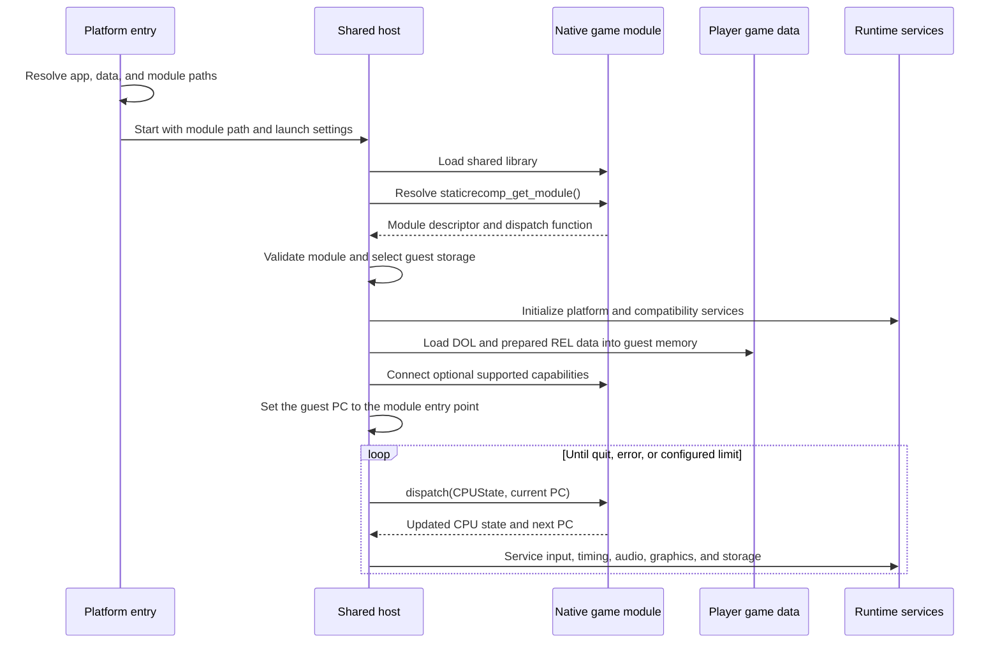

# BlueWake runtime startup

## Contents

- [Scope](#scope)
- [Startup sequence](#startup-sequence)
- [1. Platform entry](#1-platform-entry)
- [2. Native module loading](#2-native-module-loading)
- [3. Required module contract](#3-required-module-contract)
- [4. Guest state and game data](#4-guest-state-and-game-data)
- [5. Optional capabilities](#5-optional-capabilities)
- [6. Translated execution](#6-translated-execution)
- [Platform paths](#platform-paths)
- [Source map](#source-map)

## Scope

This chapter expands the runtime half of the
[architecture overview](Overview.md). It follows a packaged BlueWake launch
from the platform entry point to the first translated game dispatch. For how
the application and translated module are produced, see
[Build toolchain](Build.md).

The translated game is a native shared library, but it still operates on a
GameCube-shaped CPU state and guest address space. The handwritten host owns
the process, platform services, and execution loop; the module supplies native
translations of the game's PowerPC code.

## Startup sequence

This is the shared architectural order, not every initialization call. Some
services are initialized earlier or later according to their dependencies.

## 1. Platform entry

The platform layer establishes the launch environment before translated code
runs. It finds the application and player-data directories, applies saved
settings, resolves the disc-derived files, and selects the translated module.
Explicit command-line or environment choices take precedence over packaged
defaults.

Linux and Windows compile the shared host with its `main` symbol renamed to
`bluewake_host_main`. Their platform entry files perform setup and then call
that function with the selected `.so` or `.dll`. iOS and tvOS use the same
pattern with their Objective-C entry layer. A packaged macOS host recognizes
its bundle layout and derives its `.dylib` and resource paths directly.

## 2. Native module loading

The shared host opens the selected module with `dlopen` and resolves symbols
with `dlsym`. On Windows, BlueWake's POSIX compatibility layer maps those calls
to `LoadLibraryExW` and `GetProcAddress`, preserving the shared loader logic.

The file extension and lookup path vary by platform:

| Platform | Module | Default location |
| --- | --- | --- |
| Linux | `gGZLE01_recomp.so` | Beside the executable |
| Windows | `gGZLE01_recomp.dll` | Beside the executable |
| macOS | `gGZLE01_recomp.dylib` | The app bundle's `Frameworks` directory |
| iOS/iPadOS/tvOS | `gGZLE01_recomp.dylib` | The app bundle's `Frameworks` directory or the platform data container |

Loading the library is only the transport step. The descriptor returned by
the required export defines whether the module can run with this host.

## 3. Required module contract

Every game module must export `staticrecomp_get_module()`. It returns a
`StaticRecompModuleDesc` containing the module ABI version, CPU-state ABI and
size, game ID, guest entry point, translated address ranges, REL metadata, and
the dispatch function.

The host rejects incompatible ABI or CPU-state layouts before execution. It
then selects module-owned CPU and MEM1 storage when the module exposes it, or
uses host-owned storage where the contract permits. This prevents the host and
translated code from operating on different copies of guest state.

## 4. Guest state and game data

After the module contract is accepted, the host initializes the compatibility
backend and the guest CPU interfaces. It loads the original DOL's data and BSS
layout into guest memory, then imports prepared REL data exported by the
composite module when available.

REL file-backed sections and BSS storage are connected to their linked guest
addresses through shared aliases. The host then initializes the operating-
system globals expected by the game. The module contains translated code; the
player's prepared data still supplies the runtime memory image and assets.

## 5. Optional capabilities

Only `staticrecomp_get_module()` is the base module requirement. BlueWake also
probes for optional exports that connect features supported by a particular
module build, including REL lifecycle data, guest-memory aliases, mods and
options, edge services, direct-call paths, native helpers, gather-pipe support,
and diagnostic write journaling.

These symbols form capability handshakes. The host enables a path only when
the corresponding module export and runtime support are both present; their
absence is not equivalent to a missing base module descriptor.

## 6. Translated execution

The host sets the guest program counter to the module entry point and owns the
outer execution loop. On each turn it services pending host work, then calls
`mod->dispatch(&cpu, cpu.pc)`.

The dispatch function executes a translated segment beginning at that guest
address. A successful dispatch updates the shared `CPUState`, including the
next program counter, and returns control to the host. This boundary lets the
host coordinate input, timing, audio, graphics, storage, exceptions, and
diagnostics around ahead-of-time translated game code.

## Platform paths

| Platform layer | Path and settings responsibilities | Shared-host handoff |
| --- | --- | --- |
| [Linux entry](../../linux/src/linux_entry.c) | Executable directory, user data, setup/launcher settings, disc-derived paths | Calls `bluewake_host_main` with the selected `.so` |
| [Windows entry](../../windows/src/win_entry.c) | Executable or portable directory, `%APPDATA%`, launcher settings, disc-derived paths | Calls `bluewake_host_main` with the selected `.dll` |
| [Apple mobile entry](../../apple/ios/src/ios_entry.m) | App container, first-run data, platform preferences, bundle/data module choice | Calls `bluewake_host_main` with the selected `.dylib` when explicit |
| [macOS bundle resolver](../../runtime/host/src/main.c) | Detects a personal packaged app from its provenance marker and resolves bundled resources | Supplies host defaults before module loading |

All routes converge on the same host implementation and module ABI. Platform
code chooses locations and native integration; it does not replace the shared
translated-execution contract.

## Source map

| Runtime responsibility | Primary source |
| --- | --- |
| Shared loader, initialization, and execution loop | [`runtime/host/src/main.c`](../../runtime/host/src/main.c) |
| Required module ABI | [`StaticRecompABI.h`](../../ref/recompcore/Source/Core/Core/PowerPC/StaticRecomp/StaticRecompABI.h) |
| Composite descriptor and exported capabilities | [`cmake/composite/module_export.c`](../../cmake/composite/module_export.c) |
| Shared module CPU and MEM1 storage | [`cmake/composite/guest_cpu.c`](../../cmake/composite/guest_cpu.c) |
| Module-storage compatibility checks | [`cmake/composite/module_cpu_contract.h`](../../cmake/composite/module_cpu_contract.h) |
| Windows dynamic-loader compatibility | [`windows/compat/bw_posix_compat.c`](../../windows/compat/bw_posix_compat.c) |
