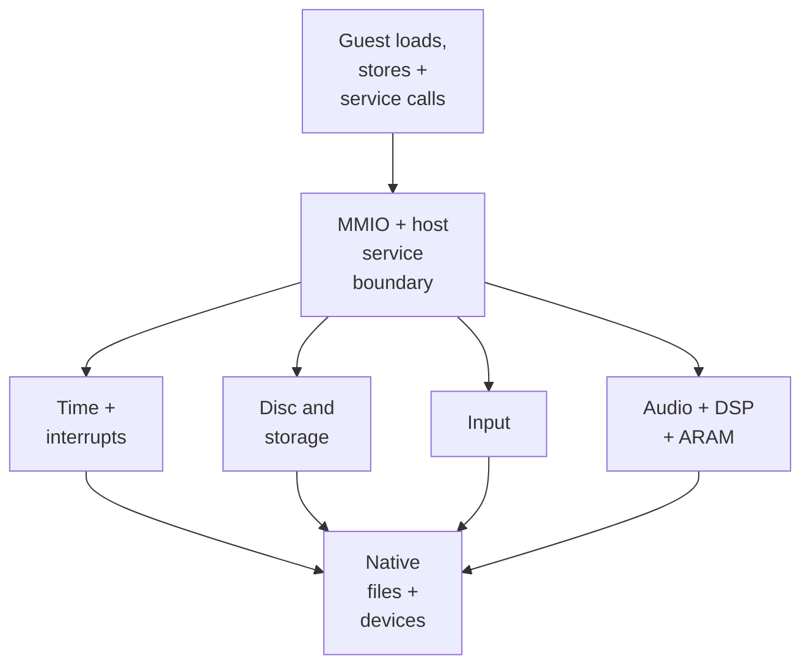
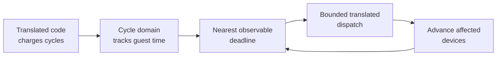

# Compatibility services

## Contents

- [Responsibility](#responsibility)
- [Mechanical contents](#mechanical-contents)
  - [Ownership split](#ownership-split)
  - [MMIO dispatch](#mmio-dispatch)
  - [Guest time and deadlines](#guest-time-and-deadlines)
  - [Artifact-to-game examples](#artifact-to-game-examples)
- [Interrupt delivery](#interrupt-delivery)
- [Disc and persistent storage](#disc-and-persistent-storage)
  - [Disc commands and asynchronous completion](#disc-commands-and-asynchronous-completion)
  - [Memory card and SRAM](#memory-card-and-sram)
- [Input](#input)
- [Audio, DSP, and ARAM](#audio-dsp-and-aram)
- [Lifecycle and observable state](#lifecycle-and-observable-state)

## Responsibility

Compatibility services preserve the GameCube-facing device interfaces expected
by translated code while adapting their effects to native files, controllers,
audio devices, and scheduling. RecompCore supplies reusable device models;
BlueWake wires them to guest memory, platform resources, and guest-cycle time.

## Mechanical contents

### Ownership split

| Layer | Owns | Does not own | Code reference |
| --- | --- | --- | --- |
| Translated game | Guest device commands and responses | Native resources | [Guest-state boundary](GuestState.md#host-work-across-the-guestnative-boundary) |
| RecompCore | Reusable DI, SI, VI, PI, audio-DMA, and interrupt rules | BlueWake file layout or event loop | [Platform interface](https://github.com/chrissotraidis/RecompCore/blob/f647d03d3886eb2357950190fe1cba3fa3d10242/GXRuntime/include/gxruntime/platform.h) |
| BlueWake host | Address routing, scheduling, adapters, and game integration | The game's decisions to access devices | [Host runtime](../../runtime/host/src/main.c), [cycle domain](../../runtime/host/src/cycle_domain.h) |
| Native platform | OS input, audio, and storage facilities | GameCube-visible semantics | [RecompCore platform ABI](https://github.com/chrissotraidis/RecompCore/blob/f647d03d3886eb2357950190fe1cba3fa3d10242/GXRuntime/include/gxruntime/platform.h) |

Native facilities return results through guest memory, MMIO registers,
interrupts, or callbacks rather than directly replacing arbitrary guest state.

### MMIO dispatch

Memory-mapped I/O (MMIO) lets guest code communicate with GameCube devices by
loading from and storing to reserved address ranges as though they were memory.
Those addresses do not hold ordinary MEM1 bytes: BlueWake interprets each
access as a register read or command for the corresponding compatibility
service.

Translated memory accesses use guest RAM unless an address belongs to a
hardware range. MMIO callbacks synchronize time-sensitive state, route the
operation to the matching device, and refresh interrupt state after a register
raises or acknowledges an event.

| MMIO family | Guest-visible purpose | Host integration |
| --- | --- | --- |
| PI, VI, PE | Interrupt masks, video timing, and graphics completion | [Interrupt refresh](../../runtime/host/src/main.c#L3525-L3544), [VI synchronization](../../runtime/host/src/main.c#L5381-L5453) |
| DI | Disc commands, DMA, status, and completion | [DI adapter](../../runtime/host/src/main.c#L3024-L3076), [DI model](https://github.com/chrissotraidis/RecompCore/blob/f647d03d3886eb2357950190fe1cba3fa3d10242/GXRuntime/include/gxruntime/di.h) |
| SI | Controller polls, channel status, and interrupts | [SI model](https://github.com/chrissotraidis/RecompCore/blob/f647d03d3886eb2357950190fe1cba3fa3d10242/GXRuntime/include/gxruntime/si.h) |
| AI, DSP, ARAM | Audio DMA, mailboxes, accelerator state, and transfers | [Audio synchronization](../../runtime/host/src/main.c#L5148-L5220), [ARAM DMA](../../runtime/host/src/aram_dma.c) |
| GX, EFB | FIFO traffic, PE state, and graphics barriers | [Graphics stack](Graphics.md) |
| EXI storage | Memory-card and console-configuration transactions | [Card runtime](../../runtime/host/src/card_runtime.c), [SRAM runtime](../../runtime/host/src/ipl_sram.c) |

The host installs the MMIO callbacks as external-memory hooks during startup.
[MMIO hook installation](../../runtime/host/src/main.c#L7943-L7948)

### Guest time and deadlines

The shared cycle domain orders device work independently of host wall-clock
speed. Generated code charges guest cycles; the cycle domain caps the next
dispatch at the nearest VI, DSP, audio, decrementer, or interrupt deadline.
When the module yields, the host advances device cursors and rebudgets.

References: [cycle domain](../../runtime/host/src/cycle_domain.c),
[device synchronization](../../runtime/host/src/main.c#L5455-L5474), and
[deadline selection](../../runtime/host/src/main.c#L1435-L1518).

### Artifact-to-game examples

| Service artifact or data | In-game action | Runtime contact | Example project contribution |
| --- | --- | --- | --- |
| VI, PI, and PE state | A frame reaches retrace, the game observes graphics completion, or an enabled interrupt enters its handler. | Device models update status and causes; PI masks and CPU state determine delivery. | [PR #353](https://github.com/chrissotraidis/bluewake/pull/353) exercises presentation continuity by keeping Vulkan rendering alive across a resize. |
| DI registers and completion queue | Entering a scene or starting a sequence requests assets from the disc and later runs the game's completion path. | DI commands copy bytes to guest memory; guest-cycle deadlines expose status, interrupts, or callbacks. | [PR #142](https://github.com/chrissotraidis/bluewake/pull/142) defers DVD completion so the history intro retains its music transition. |
| SI channels and pad samples | Moving Link, aiming, conducting, navigating a menu, or entering first person reads a GameCube-format controller sample. | Native input is mapped and latched into SI channel state at retrace. | [PR #222](https://github.com/chrissotraidis/bluewake/pull/222) assigns player one to the controller the player presses and limits rumble to that port. |
| Host camera-input state | Holding R3 and moving the right stick changes follow-camera distance while a tap still enters first person. | Host gesture state updates the existing camera integration, which adjusts camera data in guest memory. | [PR #221](https://github.com/chrissotraidis/bluewake/pull/221), carrying [PR #213](https://github.com/chrissotraidis/bluewake/pull/213), adds optional controller camera zoom. |
| AI, DSP, PCM, and ARAM data | Music, voices, ambient sound, and effects stream while gameplay continues. | Guest-cycle audio DMA reads PCM; DSP mailboxes and ARAM transfers publish completion and interrupts. | [PR #37](https://github.com/chrissotraidis/bluewake/pull/37) consolidated the DSP, audio-recovery, capture, and shared host integration. |
| Memory-card image | Selecting or saving a file changes durable game progress. | EXI/card transactions update the validated host-backed card while preserving guest status and callbacks. | [PR #37](https://github.com/chrissotraidis/bluewake/pull/37) integrated card locking, backup, validation, and atomic persistence patches. |
| IPL SRAM | The game observes console-like configuration such as sound or clock-related state. | The SRAM adapter exposes guest bytes and persists accepted changes separately from the disc. | [PR #37](https://github.com/chrissotraidis/bluewake/pull/37) consolidated the SRAM runtime and player-storage integration. |

## Interrupt delivery

A device event and a CPU exception are distinct stages. A model first records
a source; PI masking and the guest CPU's interrupt-enable state then determine
whether the host delivers an external interrupt at a safe execution boundary.

| Stage | State change | Code reference |
| --- | --- | --- |
| Device completion | DI, SI, DSP, AI, VI, or PE records a pending source | [BlueWake sources](../../runtime/host/src/interrupt_sources.c), [RecompCore state](https://github.com/chrissotraidis/RecompCore/blob/f647d03d3886eb2357950190fe1cba3fa3d10242/GXRuntime/include/gxruntime/interrupts.h) |
| Source publication | Device state becomes guest-visible PI cause state | [Interrupt refresh](../../runtime/host/src/main.c#L3525-L3544) |
| Mask evaluation | PI and CPU masks gate delivery | [Interrupt delivery](../../runtime/host/src/main.c#L3078-L3234) |
| Safe boundary | Guest exception state is updated before execution resumes | [Guest exceptions](GuestState.md#guest-time-callbacks-and-exceptions) |

Guest callbacks are separate from external interrupts. A queued DVD callback,
for example, runs with the guest register and scheduler conventions expected by
the game. [Callback delivery](../../runtime/host/src/callback_delivery.c)

## Disc and persistent storage

### Disc commands and asynchronous completion

The disc interface serves original assets from the player's validated image.
RecompCore parses the file-system table and copies requested ranges into guest
addresses; BlueWake schedules asynchronous completion callbacks in guest time.
The card and SRAM services separately map mutable console data to host files.

| Operation | Runtime result | Code reference |
| --- | --- | --- |
| Open the disc and its FST | Original assets become addressable by path or offset | [Host disc setup](../../runtime/host/src/main.c#L7819-L7865), [RecompCore DVD service](https://github.com/chrissotraidis/RecompCore/blob/f647d03d3886eb2357950190fe1cba3fa3d10242/GXRuntime/src/dvd.c) |
| Complete asynchronous reads | Requested bytes enter guest memory and callbacks run on the guest timeline | [DVD completion queue](../../runtime/host/src/dvd_completion.h), [callback delivery](../../runtime/host/src/callback_delivery.c) |

### Memory card and SRAM

These mutable stores remain separate from the read-only disc. Their adapters
translate guest transactions to durable files while preserving guest-visible
layout, status, and transaction behavior.

| Store | Guest-facing role | Native responsibility | Code reference |
| --- | --- | --- | --- |
| Memory card | Save blocks and card status | Validate, modify, and persist the card image | [Card runtime](../../runtime/host/src/card_runtime.c), [interface](../../runtime/host/src/card_runtime.h) |
| IPL SRAM | Console settings and checksums | Load defaults or persisted state and save accepted changes | [SRAM runtime](../../runtime/host/src/ipl_sram.c), [interface](../../runtime/host/src/ipl_sram.h) |

## Input

The runtime samples platform controllers, keyboard, mouse, touch, or motion at
the video-retrace boundary. Mapping and accessibility policies transform that
native state before the serial-interface model publishes a GameCube-compatible
controller sample.

| Step | Runtime result | Code reference |
| --- | --- | --- |
| Poll native sources | Current platform input is captured at a stable frame boundary | [VI retrace service](../../runtime/host/src/main.c#L5381-L5453) |
| Apply mappings | Buttons, sticks, camera, gyro, ports, and enabled policies produce configured pad state | [Input remapping](../../runtime/host/src/input_remap.h), [controller ports](../../runtime/host/src/controller_ports.h) |
| Publish through SI | Translated PAD code receives the sample and device event | [RecompCore SI interface](https://github.com/chrissotraidis/RecompCore/blob/f647d03d3886eb2357950190fe1cba3fa3d10242/GXRuntime/include/gxruntime/si.h) |

The published pad state contains digital buttons, both sticks, analog triggers,
analog A/B values, and an error field. Guest code receives that stable sample,
not a native controller object.

## Audio, DSP, and ARAM

The audio interface advances DMA at guest-cycle deadlines and submits decoded
PCM to the native audio path. The selected DSP implementation exchanges
mailboxes and coordinates ARAM transfers while preserving GameCube-visible
completion and interrupt behavior.

| Step | Runtime result | Code reference |
| --- | --- | --- |
| Advance audio DMA | Guest memory becomes a timed PCM stream | [Audio DMA service](../../runtime/host/src/main.c#L5150-L5220), [RecompCore DMA](https://github.com/chrissotraidis/RecompCore/blob/f647d03d3886eb2357950190fe1cba3fa3d10242/GXRuntime/src/audio_dma.c) |
| Service DSP and ARAM | Audio commands produce samples, mailbox responses, and completion events | [DSP adapter](../../runtime/host/src/dsp_adapter.cpp), [ARAM DMA](../../runtime/host/src/aram_dma.c) |
| Output audio | Completed frames enter the platform audio queue | [Stereo output bridge](../../runtime/host/src/audio_dma_stereo.h) |

The PCM bridge converts the GameCube channel order before submitting samples.
Native buffering does not define when the guest believes DMA advanced; the
guest-cycle domain does.

## Lifecycle and observable state

| Phase | Service-layer action | Observable result |
| --- | --- | --- |
| Initialize | Open resources, construct models, install callbacks, and select the first deadline | Coherent device registers at boot |
| Dispatch | Run translated work within the current budget | Guest commands and RAM changes |
| Synchronize | Advance devices required by time or an observable access | Ordered DMA, status, callbacks, and interrupts |
| Rebudget | Select the next device, decrementer, or interrupt boundary | Execution cannot skip a required event |
| Shut down | Stop adapters and persist accepted mutable storage | No worker retains invalid guest resources |

Graphics-related GX services continue in the [graphics stack](Graphics.md).

Return to the runtime [high-level view](Runtime.md#high-level-view).
