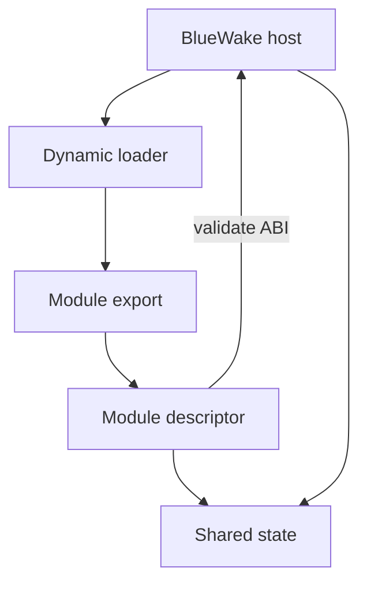
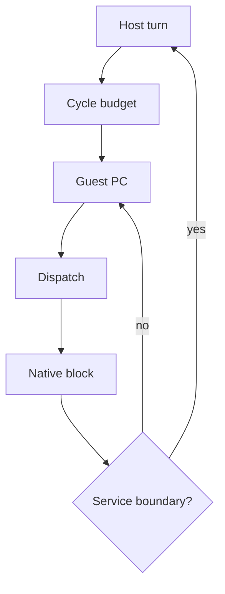

# Native game module

## Contents

- [Responsibility](#responsibility)
- [Module contents](#module-contents)
- [Module loading and ABI](#module-loading-and-abi)
- [Translated-code dispatch](#translated-code-dispatch)

## Responsibility

The native game module contains the ahead-of-time translated Wind Waker code.
It is compiled separately from the BlueWake host and loaded into the same
process. It preserves guest addresses and machine state rather than exposing a
new high-level game API.

## Module contents

| Content | Runtime purpose | Source |
| --- | --- | --- |
| Translated DOL functions | Implement the original main executable as native functions. | DolRecomp output composed in [Build Stage 5](../Build.md#5-compose-and-prepare) |
| Translated REL functions | Implement the game's relocatable code modules while preserving linked guest addresses. | REL-grouped composite source |
| Dispatch tables | Map a guest program counter or function pointer to the corresponding native function. | [`generate_composite.py`](../../../scripts/generate_composite.py#L562-L707) |
| DOL and REL metadata | Describe code ranges, data images, BSS, aliases, and the initial entry point. | [`generate_composite.py`](../../../scripts/generate_composite.py#L799) |
| Module descriptor | Publishes the ABI contract, callbacks, metadata, and optional shared CPU and memory storage. | `staticrecomp_get_module` export |

## Module loading and ABI

The host opens `gGZLE01_recomp` with the platform dynamic loader and obtains
its `StaticRecompModuleDesc`. Startup stops if the export is missing or the
descriptor is incompatible.

| Step | Runtime result | Code reference |
| --- | --- | --- |
| Open the shared library | Translated native code is mapped into the process | [Module loading](../../../runtime/host/src/main.c#L7316-L7322) |
| Read the exported descriptor | The host receives entry, dispatch, metadata, callbacks, and storage exports | [Composite generation](../../../scripts/generate_composite.py#L799) |
| Validate the ABI | Only a compatible host/module pair continues to guest initialization | [ABI validation](../../../runtime/host/src/main.c#L7329-L7343) |

## Translated-code dispatch

The host starts a guest turn with a bounded cycle budget. The generated
dispatcher maps the current guest PC to a native DOL or REL function. A chassis
loop can continue through successive blocks, returning to the host when time,
an exception, a callback, or another service boundary requires it.

| Step | Runtime effect | Code reference |
| --- | --- | --- |
| Resolve the guest PC | Selects a native function from the DOL and REL dispatch tables | [Generated dispatcher](../../../scripts/generate_composite.py#L562-L707) |
| Execute translated blocks | Updates the shared registers, memory, PC, and cycle count without instruction interpretation on the normal path | [Dispatch chassis](../../../cmake/composite/dispatch_loop.h) |
| Yield to the host | Preserves guest position while services process the boundary | [Dispatch conditions](../../../cmake/composite/dispatch_loop.h#L35-L77) |

The module's relationship with CPU storage, memory, and guest addresses is
covered in [Guest machine state](GuestState.md).

Return to the runtime [high-level view](../Runtime.md#high-level-view).
