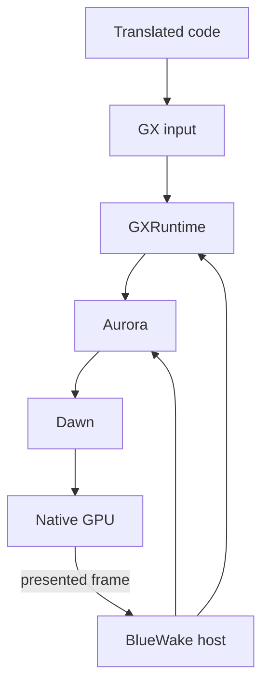

# Graphics stack

## Contents

- [Responsibility](#responsibility)
- [Component boundaries](#component-boundaries)
- [GX command path](#gx-command-path)
- [Native rendering and presentation](#native-rendering-and-presentation)

## Responsibility

The graphics stack preserves the game's GX-facing command model while
producing native GPU work. Translated code supplies the original FIFO and
display-list data; GXRuntime interprets it, Aurora builds renderer work, and
Dawn connects that work to the platform graphics API.

## Component boundaries

| Entity | Runtime responsibility | Boundary |
| --- | --- | --- |
| Translated game code | Writes the same GX command formats and guest addresses expected by the original program. | Gather-pipe and display-list bytes |
| GXRuntime | Parses GX commands and maintains GameCube command-processor, transform, rasterization, texture, and copy state. | Normalized renderer operations |
| Aurora | Manages renderer resources and converts normalized GX state into native render work. | Dawn command and resource interfaces |
| Dawn | Provides the platform graphics abstraction used to reach the native GPU API. | Native device, queue, and presentation surface |
| BlueWake host | Initializes the stack and coordinates flush, synchronization, retrace, and presentation. | Host lifecycle and guest-time boundaries |

## GX command path

The game writes commands and data to the emulated GX FIFO. The gather-pipe
bridge batches those writes, and GXRuntime parses FIFO commands and display
lists. Flush and synchronization operations expose completed work to Aurora at
the points required by guest semantics.

| Step | Runtime result | Code reference |
| --- | --- | --- |
| Collect gather-pipe writes | Ordered GX byte batches cross the module/host boundary | [Gather-pipe setup](../../../runtime/host/src/main.c#L8269-L8274), [bridge ABI](../../../runtime/host/src/gather_pipe_bridge.h) |
| Parse FIFO and display lists | GX registers, resources, and draw commands reflect the game's command stream | [RecompCore GX interface](https://github.com/chrissotraidis/RecompCore/blob/ee99bbc13c948351f6974c745cad2593a25eacbf/GXRuntime/include/gxruntime/gx_recomp.h) |
| Flush required work | Complete render operations become available to Aurora | [Host GX synchronization](../../../runtime/host/src/main.c#L10214-L10281) |

## Native rendering and presentation

Aurora turns parsed GX state into render passes and GPU resources. Dawn
provides the platform-facing graphics layer. At completed video retraces, the
host services the renderer, presents finished work, and polls the next input
sample against the same guest-time boundary.

| Step | Runtime result | Code reference |
| --- | --- | --- |
| Initialize | A native graphics device and renderer state are available before guest execution | [Renderer initialization](../../../runtime/host/src/main.c#L7550-L7628) |
| Record and submit | Parsed GX state becomes GPU resources, passes, and commands | [Aurora backend](https://github.com/chrissotraidis/RecompCore/tree/ee99bbc13c948351f6974c745cad2593a25eacbf/GXRuntime/graphics/aurora) |
| Present | A completed frame reaches the display with guest-timed cadence | [Retrace and presentation](../../../runtime/host/src/main.c#L5381-L5453) |

Return to the runtime [high-level view](../Runtime.md#high-level-view).
