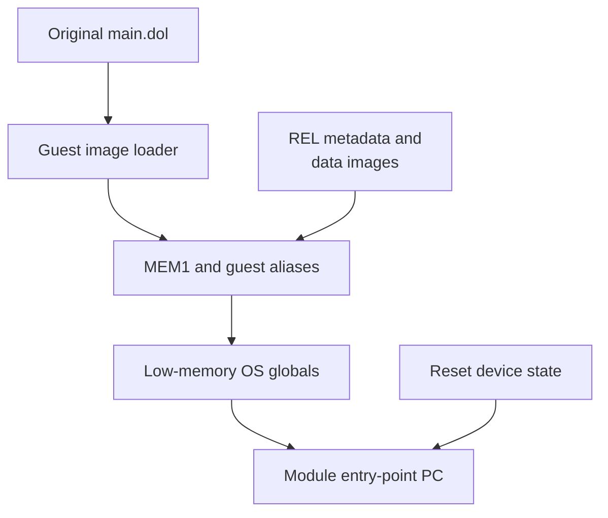

# Guest machine state

## Contents

- [Responsibility](#responsibility)
- [Ownership and address model](#ownership-and-address-model)
- [Boot state](#boot-state)
- [DOL and REL roles](#dol-and-rel-roles)
- [Guest time and exceptions](#guest-time-and-exceptions)

## Responsibility

Guest state is the GameCube-visible machine model shared by the host and the
translated module. It holds CPU registers, memory, addresses, timing counters,
exceptions, and the program counter at which translated execution resumes.

## Ownership and address model

The module can export aligned `CPUState` and MEM1 storage. The host selects
those exports when present, initializes them, and passes the same CPU pointer
through dispatch, memory, device, and callback paths. No state copy is required
when execution crosses the host/module ABI.

| Step | Runtime result | Code reference |
| --- | --- | --- |
| Select module-exported or compatibility storage | One authoritative `CPUState` and MEM1 allocation | [Storage selection](../../../runtime/host/src/main.c#L7329-L7343) |
| Install memory and MMIO accessors | Ordinary addresses reach RAM; hardware ranges reach compatibility services | [MMIO callback setup](../../../runtime/host/src/main.c#L7943-L7948) |
| Establish REL aliases | Relocated data uses linked guest addresses while code addresses remain valid for dispatch and guest function pointers | [REL alias setup](../../../runtime/host/src/main.c#L7968-L8101) |

## Boot state

| Step | Runtime result | Code reference |
| --- | --- | --- |
| Initialize devices | Reset video, disc, controller, interrupt, audio, DSP, ARAM, SRAM, and card state | [Host initialization](../../../runtime/host/src/main.c#L7550-L7686) |
| Load DOL sections | Initialized data is copied into MEM1 and BSS is cleared | [Host DOL load](../../../runtime/host/src/main.c#L7957-L7960), [RecompCore loader](https://github.com/chrissotraidis/RecompCore/blob/ee99bbc13c948351f6974c745cad2593a25eacbf/GXRuntime/src/loader.c) |
| Create GameCube OS state | Low memory, arenas, stack, clocks, and machine-state registers satisfy guest startup assumptions | [Host boot call](../../../runtime/host/src/main.c#L8102-L8115), [RecompCore boot](https://github.com/chrissotraidis/RecompCore/blob/ee99bbc13c948351f6974c745cad2593a25eacbf/GXRuntime/src/boot.c) |
| Select the entry point | `cpu.pc` is set to the module descriptor's entry address | [Execution start](../../../runtime/host/src/main.c#L8112-L8115) |

## DOL and REL roles

Ahead-of-time translation replaces executable instructions with native
functions, but the original executable formats still define runtime data and
addresses.

- **DOL** — provides the initial section layout and initialized data copied into
  guest memory. Its translated functions live in the native game module.
- **REL** — provides relocatable module layout, data, BSS, and linked guest
  addresses. Its translated functions also live in the native game module.
- **Dispatch metadata** — maps DOL and REL guest code addresses to their native
  translations. See [composite generation](../../../scripts/generate_composite.py#L562-L707).

## Guest time and exceptions

Translated blocks charge guest cycles rather than reading wall time directly.
The cycle domain advances devices to a shared point and chooses the next safe
boundary. Services publish interrupt sources; the host delivers an exception
only where architectural and scheduler state can be preserved.

| Step | Runtime result | Code reference |
| --- | --- | --- |
| Account completed work | All devices observe one absolute guest timeline | [Cycle domain](../../../runtime/host/src/cycle_domain.c) |
| Advance to the next deadline | Video, audio, DSP, disc, and controller state remain ordered | [Device synchronization](../../../runtime/host/src/main.c#L5455-L5474) |
| Publish and deliver interrupts | Guest exception state and handler PC are established at a safe boundary | [Interrupt routing](../../../runtime/host/src/main.c#L3441-L3544), [delivery](../../../runtime/host/src/main.c#L3078-L3234) |

Return to the runtime [high-level view](../Runtime.md#high-level-view).
