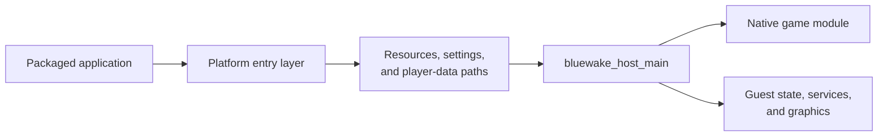

# Host and platform integration

## Contents

- [Responsibility](#responsibility)
- [Platform entry layers](#platform-entry-layers)
- [Host lifecycle](#host-lifecycle)
- [Runtime inputs and persistence](#runtime-inputs-and-persistence)
- [Shutdown](#shutdown)

## Responsibility

The platform application and shared BlueWake host form the handwritten native
side of the running process. Platform entry code resolves OS-specific
resources and events; the host owns the common lifecycle, loads the translated
module, and coordinates guest execution with compatibility and graphics
services.

## Platform entry layers

Each target uses a small native wrapper around the shared host. It understands
the platform's executable or bundle layout, writable data location, and event
model, then invokes `bluewake_host_main` with normalized inputs.

| Platform | Technical steps | Runtime result | Code reference |
| --- | --- | --- | --- |
| Linux | Resolves the application directory, portable mode, settings path, module, disc, and DSP files. | Host argument vector and Linux runtime paths | [Linux entry](../../../linux/src/linux_entry.c#L361-L566) |
| Windows | Resolves the executable directory and Windows player-data paths and prepares the native process. | Host argument vector and Windows runtime paths | [Windows entry](../../../windows/src/win_entry.c#L563-L747) |
| Apple | Resolves read-only resources from the app bundle and writable data from the app container. | Bundle resources and Apple data paths | [Apple entry](../../../apple/ios/src/ios_entry.m#L276-L474) |
| Shared host | Parses runtime options and validates the normalized module, DOL, disc, DSP, and data paths. | Platform-independent runtime configuration | [Host startup](../../../runtime/host/src/main.c#L7248-L7314) |

## Host lifecycle

The host is the process coordinator; it is not the translated game. After
loading the module ABI, it selects shared machine-state storage, initializes
devices and graphics, boots guest state, and repeatedly alternates translated
execution with service work.

| Phase | Host responsibility | Cooperating entity | Code reference |
| --- | --- | --- | --- |
| Configure | Applies settings and feature flags and validates required inputs. | Platform application | [Host startup](../../../runtime/host/src/main.c#L7248-L7314) |
| Load | Opens the native game module and validates its descriptor and ABI. | [Native game module](GameModule.md) | [Module loading](../../../runtime/host/src/main.c#L7316-L7343) |
| Initialize | Creates renderer, device, storage, audio, DSP, and guest-memory state. | [Guest state](GuestState.md), [services](Services.md), and [graphics](Graphics.md) | [Host initialization](../../../runtime/host/src/main.c#L7550-L7686) |
| Run | Dispatches translated code for a bounded guest-time interval, then services deadlines, callbacks, and interrupts. | Module and compatibility services | [Main runtime loop](../../../runtime/host/src/main.c#L8651-L8662) |
| Stop | Reaches a safe host boundary, persists durable state, and tears down native services. | Platform application and player storage | [Host shutdown](../../../runtime/host/src/main.c#L16364-L16373) |

## Runtime inputs and persistence

Executable artifacts, original game content, and mutable player data remain
separate even though the host coordinates all three.

| Input or data | Runtime role | Lifetime | Code reference |
| --- | --- | --- | --- |
| Native game module | Supplies translated functions, dispatch tables, REL metadata, and the module ABI. | Read-only for the process lifetime | [Module path selection](../../../runtime/host/src/main.c#L7248-L7322) |
| `main.dol` | Supplies section layout and initialized bytes loaded into guest memory. | Read during guest boot | [DOL load](../../../runtime/host/src/main.c#L7957-L7960) |
| Supported disc image | Supplies the file-system table and original assets requested through disc interfaces. | Read throughout play | [Disc initialization](../../../runtime/host/src/main.c#L7819-L7865) |
| DSP data | Supplies the program or donor-backed data used by the selected audio path. | Read during audio initialization and execution | [DSP adapter](../../../runtime/host/src/dsp_adapter.cpp) |
| Memory card and SRAM | Preserve game saves and console-like configuration. | Loaded at startup and updated during play or shutdown | [Memory-card runtime](../../../runtime/host/src/card_runtime.c), [SRAM runtime](../../../runtime/host/src/ipl_sram.c) |
| Settings and logs | Preserve host preferences and diagnostics. | Platform-managed player data | [Host startup](../../../runtime/host/src/main.c#L7248-L7314) |
| Save states | Serialize authoritative CPU, memory, alias, device, DSP, and GX state. | Created or restored on request | [Save-state implementation](../../../runtime/host/src/save_state.c) |

## Shutdown

Normal termination begins at a host boundary, where no translated block is
partially executed. The host can complete durable writes, disconnect the GX
bridge, stop haptics, rendering, DSP and audio, and then release module-owned
CPU storage.

| Step | Runtime result | Code reference |
| --- | --- | --- |
| Detect a quit request, configured limit, or runtime stop reason | Guest dispatch ends at a controlled boundary | [Main runtime loop](../../../runtime/host/src/main.c#L8651-L8662) |
| Flush memory-card, SRAM, settings, and diagnostic state | Player data remains available to the next launch | [Card runtime](../../../runtime/host/src/card_runtime.c), [SRAM runtime](../../../runtime/host/src/ipl_sram.c) |
| Tear down services and shared storage | Native resources are released before returning to the platform layer | [Host shutdown](../../../runtime/host/src/main.c#L16364-L16373) |

Return to the [runtime entity map](../Runtime.md#runtime-entities).
