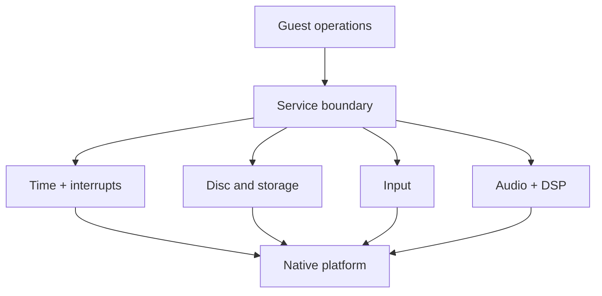

# Compatibility services

## Contents

- [Responsibility](#responsibility)
- [Service boundary](#service-boundary)
- [Timing and interrupts](#timing-and-interrupts)
- [Disc and storage](#disc-and-storage)
- [Input](#input)
- [Audio and DSP](#audio-and-dsp)

## Responsibility

Compatibility services preserve the GameCube-facing interfaces expected by
translated code while adapting their effects to native files, controllers,
audio devices, and scheduling. They include RecompCore device models and
BlueWake-specific adapters coordinated by the host.

## Service boundary

Translated memory accesses use guest RAM unless an address belongs to a
hardware range. MMIO callbacks synchronize time-sensitive state, route the
operation to the matching device, and refresh interrupt state after a register
raises or acknowledges an event.

| Step | Runtime result | Code reference |
| --- | --- | --- |
| Intercept a non-RAM access | Address, width, and value enter the host MMIO router | [MMIO setup](../../../runtime/host/src/main.c#L7943-L7948) |
| Synchronize devices | Register values reflect current guest time | [MMIO read](../../../runtime/host/src/main.c#L3581), [MMIO write](../../../runtime/host/src/main.c#L4723) |
| Route the operation | DI, SI, PI, VI, audio, DSP, ARAM, GX, or another device handles it | [Read routing](../../../runtime/host/src/main.c#L3606-L3820), [write routing](../../../runtime/host/src/main.c#L4723) |
| Refresh interrupts | The CPU sees newly raised or cleared device events | [Interrupt refresh](../../../runtime/host/src/main.c#L3525-L3544) |

## Timing and interrupts

The shared cycle domain orders device work independently of host wall-clock
speed. Device models schedule deadlines and publish interrupt sources through
the GameCube interrupt controller. The host delivers pending exceptions when
translated execution reaches a safe boundary.

References: [cycle domain](../../../runtime/host/src/cycle_domain.c),
[device synchronization](../../../runtime/host/src/main.c#L5455-L5474), and
[interrupt delivery](../../../runtime/host/src/main.c#L3078-L3234).

## Disc and storage

The disc interface serves original assets from the player's validated image.
RecompCore parses the file-system table and copies requested ranges into guest
addresses; BlueWake schedules asynchronous completion callbacks in guest time.
The card and SRAM services separately map mutable console data to host files.

| Operation | Runtime result | Code reference |
| --- | --- | --- |
| Open the disc and its FST | Original assets become addressable by path or offset | [Host disc setup](../../../runtime/host/src/main.c#L7819-L7865), [RecompCore DVD service](https://github.com/chrissotraidis/RecompCore/blob/ee99bbc13c948351f6974c745cad2593a25eacbf/GXRuntime/src/dvd.c) |
| Complete asynchronous reads | Requested bytes enter guest memory and callbacks run on the guest timeline | [DVD completion queue](../../../runtime/host/src/dvd_completion.h), [callback delivery](../../../runtime/host/src/callback_delivery.c) |
| Service card and SRAM operations | Saves and console-like configuration persist in player storage | [Card runtime](../../../runtime/host/src/card_runtime.c), [SRAM runtime](../../../runtime/host/src/ipl_sram.c) |

## Input

The runtime samples platform controllers, keyboard, mouse, touch, or motion at
the video-retrace boundary. Mapping and accessibility policies transform that
native state before the serial-interface model publishes a GameCube-compatible
controller sample.

| Step | Runtime result | Code reference |
| --- | --- | --- |
| Poll native sources | Current platform input is captured at a stable frame boundary | [VI retrace service](../../../runtime/host/src/main.c#L5381-L5453) |
| Apply mappings | Buttons, sticks, camera, gyro, ports, and enabled policies produce configured pad state | [Input remapping](../../../runtime/host/src/input_remap.h), [controller ports](../../../runtime/host/src/controller_ports.h) |
| Publish through SI | Translated PAD code receives the sample and device event | [RecompCore SI interface](https://github.com/chrissotraidis/RecompCore/blob/ee99bbc13c948351f6974c745cad2593a25eacbf/GXRuntime/include/gxruntime/si.h) |

## Audio and DSP

The audio interface advances DMA at guest-cycle deadlines and submits decoded
PCM to the native audio path. The selected DSP implementation exchanges
mailboxes and coordinates ARAM transfers while preserving GameCube-visible
completion and interrupt behavior.

| Step | Runtime result | Code reference |
| --- | --- | --- |
| Advance audio DMA | Guest memory becomes a timed PCM stream | [Audio DMA service](../../../runtime/host/src/main.c#L5150-L5220), [RecompCore DMA](https://github.com/chrissotraidis/RecompCore/blob/ee99bbc13c948351f6974c745cad2593a25eacbf/GXRuntime/src/audio_dma.c) |
| Service DSP and ARAM | Audio commands produce samples, mailbox responses, and completion events | [DSP adapter](../../../runtime/host/src/dsp_adapter.cpp), [ARAM DMA](../../../runtime/host/src/aram_dma.c) |
| Output audio | Completed frames enter the platform audio queue | [Stereo output bridge](../../../runtime/host/src/audio_dma_stereo.h) |

Graphics-related GX services continue in the [graphics stack](Graphics.md).

Return to the runtime [high-level view](../Runtime.md#high-level-view).
