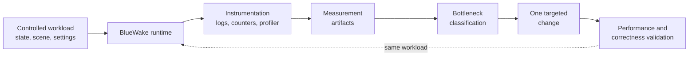
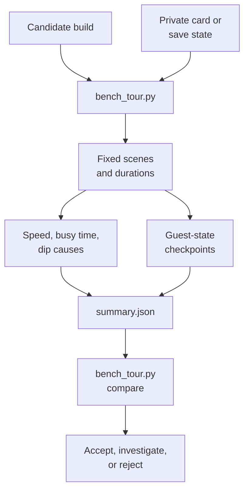
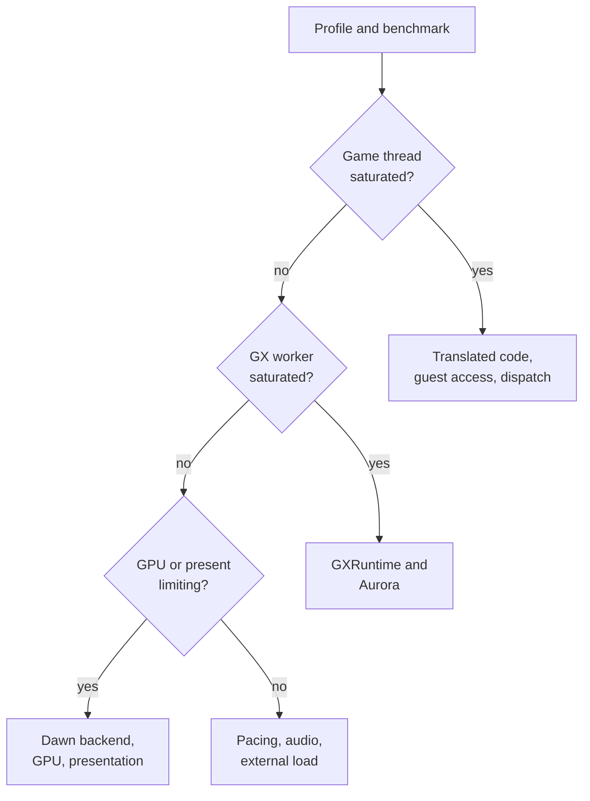

# BlueWake performance overview

## Contents

- [Introduction](#introduction)
- [Performance workflow](#performance-workflow)
- [Performance domains](#performance-domains)
- [Profiling](#profiling)
- [Benchmarking](#benchmarking)
- [Tuning](#tuning)
- [Evidence and results](#evidence-and-results)

Performance path: [Index](README.md) → **Overview**

## Introduction

Performance work in BlueWake has three separate jobs:

- **Profiling** identifies where a run spends its time.
- **Benchmarking** measures whether a build became faster under a repeatable
  workload.
- **Tuning** changes one measured bottleneck and verifies both performance and
  game behavior.

None of these alone proves that an optimization is safe. A profile can name a
hot function without showing that changing it helps. A faster result can be
noise or can come from skipped work. A correct checkpoint can show that sampled
guest state agrees while still requiring player-visible checks for timing,
audio, graphics, and input.

The entities being measured are introduced in the
[runtime architecture](../architecture/Runtime.md). The build options and
profile-guided optimization (PGO) stages that shape the resulting binaries are
described in the [build architecture](../architecture/Build.md).

## Performance workflow

A performance change starts and ends with the same controlled workload. The
measurement artifacts determine the limiting component; they do not prescribe
an optimization by themselves.

The loop has four practical rules:

1. Compare the same scene, state, settings, pacing, and hardware conditions.
2. Use multiple samples and report a representative result, not the best run.
3. Change one hypothesis at a time so the result has one plausible cause.
4. Check guest behavior and the player-visible systems affected by the change.

The fixed-scene harness is
[`scripts/bench_tour.py`](../../scripts/bench_tour.py). Linux and Steam Deck CPU
sampling is automated by
[`scripts/linux/profile_deck.sh`](../../scripts/linux/profile_deck.sh).

## Performance domains

The first decision is which runtime domain limits the measured workload.
BlueWake's game logic, compatibility services, graphics conversion, and native
presentation run in one process, but they do not necessarily compete on the
same thread or wait for the same resource.

| Domain | Work being measured | Useful evidence | Architecture owner |
| --- | --- | --- | --- |
| Translated game execution | Native translations of DOL and REL instructions, dispatch, and generated helper calls | Game-thread utilization and translated symbols in a CPU profile | [Game module](../architecture/GameModule.md) |
| Guest-state access | Register synchronization, guest-address resolution, memory helpers, and execution bookkeeping | Hot guest-memory or dispatch helpers and guest checkpoints | [Guest state](../architecture/GuestState.md) |
| Compatibility services | MMIO, deadlines, callbacks, interrupts, audio, input, disc, and storage work | Service symbols, deadline activity, audio diagnostics, and session events | [Services](../architecture/Services.md) |
| Host coordination | Module dispatch, host hooks, lifecycle, persistence, and frame coordination | Host symbols, callback frequency, and session timing | [Host](../architecture/Host.md) |
| GX processing | Gather-pipe and display-list interpretation, graphics-state conversion, and renderer command construction | GX-worker utilization and GXRuntime or Aurora symbols | [Graphics](../architecture/Graphics.md#gx-command-path) |
| GPU and presentation | Dawn backend submission, native GPU execution, synchronization, display pacing, and Smooth Motion | Backend selection, GPU or present waits, frame-pacing logs, and rendered results | [Graphics](../architecture/Graphics.md#textures-frame-buffers-and-presentation) |
| Build and code generation | Compiler selection, generated-code transformations, optimization profiles, and code layout | Matched build receipts, module size, compile logs, and repeatable runtime comparisons | [Build](../architecture/Build.md) |

A low rendered frame rate does not identify the GPU as the cause. For example,
a saturated game thread can leave both the graphics worker and GPU waiting.
Likewise, a fast headless run does not prove that presentation is the only
remaining cost: the rendered profile is still needed to distinguish CPU-side
graphics conversion from GPU or display waits.

## Profiling

Profiling answers **where time went in one run**. BlueWake provides two
complementary evidence streams:

- Session instrumentation records frame-rate dips, component utilization,
  renderer selection, pacing, and a final performance summary. The watcher is
  implemented by [`runtime/host/src/fps_watch.c`](../../runtime/host/src/fps_watch.c).
- A platform profiler samples native call stacks and attributes CPU time to
  translated functions, the host, services, GXRuntime, Aurora, or driver code.

On Linux, [`profile_deck.sh`](../../scripts/linux/profile_deck.sh) supports two
intentional modes:

| Mode | What it isolates | Primary artifacts |
| --- | --- | --- |
| Headless, unpaced | Game-thread and runtime throughput without native rendering or wall pacing | `perf.data`, `report.txt`, and `run.log` |
| Rendered, wall-paced | The game, GX worker, renderer, GPU, and presentation working together | The same profiler artifacts plus `[fps-dip]` and `[perf-summary]` session evidence |

The current Steam Deck procedure and artifact interpretation remain in
[Profiling BlueWake on the Steam Deck](../PROFILING.md). Profiling artifacts can
contain local paths and runtime details; they must be reviewed before excerpts
are posted publicly.

## Benchmarking

Benchmarking answers **whether one build is faster than another under the same
workload**. [`bench_tour.py`](../../scripts/bench_tour.py) creates a private
scratch environment, starts measured runs from the same state, visits fixed
scenes, discards each stop's settling interval, and writes `summary.json`.

The speed measurement and checkpoint comparison answer different questions:

- Stop speed and busy time quantify performance and identify unstable samples.
- Guest checkpoints compare CPU, memory, alias, and timing state at defined
  retraces. They catch behavioral divergence; they are not an FPS metric.
- A player-visible check covers behavior outside the sampled state, including
  audio, input, transitions, rendering, and persistence.

The command, output contract, default stops, and synthetic parser tests live in
[`scripts/bench_tour.py`](../../scripts/bench_tour.py) and
[`tests/test_bench_tour.py`](../../tests/test_bench_tour.py). The original
implementation task is retained in [The benchmark tour](../BENCHMARK_TOUR.md).

## Tuning

Tuning begins only after the evidence assigns a bottleneck. The implementation
layer should match the limiting domain:

A tuning pull request should state:

1. The profile evidence and bottleneck it addresses.
2. The single mechanism being changed.
3. The before-and-after benchmark from identical inputs.
4. The correctness checks appropriate to that mechanism.
5. The platforms tested, and any platform still awaiting a hardware check.

Generated-code and build-option changes normally require a new game module.
Host-only changes can often reuse the module. Graphics changes require rendered
measurements, while changes intended to preserve translated behavior require
guest-state comparison in addition to play testing.

The active strategy, acceptance gates, and measured work are maintained in
[Making BlueWake faster](../PERFORMANCE.md). Implemented optimizations and their
switches are catalogued in
[Performance optimizations](../PERFORMANCE_OPTIMIZATIONS.md).

## Evidence and results

Performance documentation serves three different lifetimes:

| Material | Role | Location |
| --- | --- | --- |
| Stable concepts and workflow | Explain how to profile, benchmark, diagnose, and validate | This performance documentation |
| Active strategy and next experiments | Record what is currently worth testing and its acceptance gate | [`docs/PERFORMANCE.md`](../PERFORMANCE.md) |
| Implemented or rejected work | Preserve measured results, switches, and supporting contribution history | [`docs/PERFORMANCE_OPTIMIZATIONS.md`](../PERFORMANCE_OPTIMIZATIONS.md) and dated [`docs/status`](../status/) records |

Results should identify the build commit, compiler and options, device, scene or
state, rendered mode, pacing, sample count, representative result, and relevant
correctness check. Disc images, extracted game files, translated modules, cards,
save states, raw private logs, and optimization profiles do not belong in the
repository.

Return to the [performance index](README.md), or review the components being
measured in the [architecture overview](../architecture/Overview.md).
