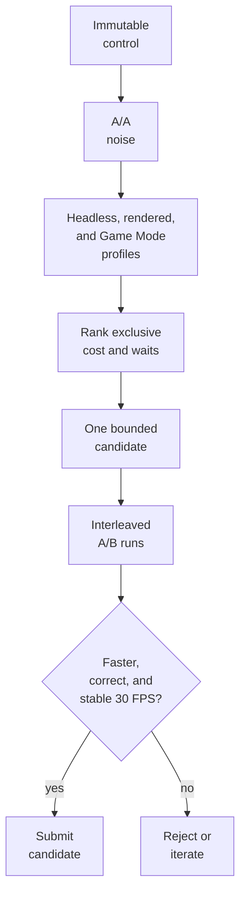

# TECH_PLAN — Steam Deck game-thread optimization

Status: Planning only

Source: upstream `main` at `2ab8118fc09fa08569100201a871616d18a1b771`

[PRD](PRD.md) · [Tracker](PROGRESS.md)

Architecture: [game thread](../../architecture/GameThread.md) ·
[test evidence](../../architecture/Testing.md) ·
[performance workflow](../../performance/Overview.md)

## Inspected facts

- [`bench_tour.py`](../../../scripts/bench_tour.py) controls fixed scenes and
  emits speed, busy time, dip causes, and guest checkpoints in `summary.json`.
- [`profile_deck.sh`](../../../scripts/linux/profile_deck.sh) launches one state,
  samples the Linux process with `perf`, and emits `perf.data`, `report.txt`,
  `run.log`, and a session-log copy. Headless and rendered runs answer different
  questions; neither invokes the benchmark tour.
- [`native_work_pool.c`](../../../cmake/composite/native_work_pool.c) provides
  synchronous range work on POSIX; Windows remains serial. #424 adds broader
  pool/lifecycle coverage but is not evidence that any game candidate is faster.
- No old #421 result is retained. Baseline, noise, hotspots, and activation are
  **unknown/not measured** for this plan.

## Planned changes

| Status | Surface | Practical change | Requirement |
|---|---|---|---|
| Modify | Steam Deck measurement procedure and evidence record | Freeze inputs, measure A/A noise, profile, and rank current costs | FR-01, FR-02 |
| Proposed | One M0-selected game-thread code path | Implement one bounded, opt-in candidate with activation evidence | FR-03 |
| Modify | Benchmark and profiling evidence | Compare matched builds against cost-reduction and stable-30 gates | FR-04 |
| Modify | Candidate-specific tests and qualification record | Prove behavior, fallback, lifecycle, and platform compatibility | FR-05 |

## Steam Deck procedure

Keep the control immutable. Build candidates from the same source revision,
compiler, PGO inputs, options, and AppImage environment; change only the
candidate. Never publish the personal module, state, card, or raw private log.

### Optional: SSH setup and limits

SSH can drive the headless benchmarks, profiles, comparisons, and evidence
collection. On the Deck, enter Desktop Mode, open Konsole, set a password if
needed, start the server, and obtain its LAN address:

```bash
passwd
sudo systemctl enable --now sshd
hostname -I
```

From the development machine, connect as `deck` and copy the private test bundle
only between machines you control:

```bash
ssh deck@DECK_IP
rsync -av ./deck-test/ deck@DECK_IP:~/bluewake-test/
```

Prefer SSH keys over leaving password authentication exposed. To stop and
disable the service after testing, run `sudo systemctl disable --now sshd` on
the Deck.

| Task | From SSH? | Boundary |
|---|---|---|
| Copy AppImages/scripts and collect redacted evidence | Yes | Keep the personal AppImage, state, card, module, and raw logs private |
| Headless `bench_tour.py`, `profile_deck.sh`, `perf report`, hashes, and comparisons | Yes | No display session is required |
| Rendered Desktop Mode benchmark/profile | Partly | A local graphical session must already be active; SSH needs its valid `DISPLAY` and `XAUTHORITY` |
| Game Mode launch and gameplay checks | No | Start and play the Steam entry on the Deck |
| Attach `perf` to an already-running Game Mode process and retrieve logs | Yes | Launch locally first, then attach by the verified process ID over SSH |

Commands in the following sections run in an SSH shell unless they explicitly
require Desktop Mode or Game Mode. Do not use X11 forwarding as a substitute
for measuring the Deck's own rendered session.

### 1. Build and identify the control

On the development machine:

```bash
git switch --detach 2ab8118fc09fa08569100201a871616d18a1b771
python3 scripts/linux/build.py /path/to/GZLE01.iso \
  --out build/deck-control --ci-container --appimage
sha256sum build/deck-control/BlueWake-x86_64.AppImage \
  build/deck-control/composite/gGZLE01_recomp.so
```

Record the commit, dependency-lock hash, compiler, builder command, AppImage and
module hashes, PGO/training status, and build summary. Copy the AppImage plus
`scripts/bench_tour.py` and `scripts/linux/profile_deck.sh` to the Deck. Both
the default Clang 18 and optional Clang 22 `x86-64-v3` container paths are
currently blocked by [#433](https://github.com/chrissotraidis/bluewake/issues/433);
neither is a valid control until that issue is resolved.

### Verified profiling control

[`3b5c5c4826ef62bd1f8ff387734ff2ef295898e5`](https://github.com/chrissotraidis/bluewake/commit/3b5c5c4826ef62bd1f8ff387734ff2ef295898e5)
is the source revision used for the recorded measurements. It compiles the
Clang 22 application
through the earlier packaged-Dawn route (RecompCore
`77d4717d868cec8b4014932bb22978c284a535a7`). Its AppImage ABI audit fails on
`GLIBCXX_3.4.32`, but that warning is not a Deck compatibility verdict: the
resulting AppImage launched on the Deck, loaded the fixed state, and executed
gameplay. It is the profiling control, not a release candidate.

### Deck test bundle

Copy only the private AppImage, the two measurement scripts, and selected save
states. Do not copy the build tree, ISO, generated sources, standalone module,
or local logs.

```text
~/bluewake-test/
├── BlueWake-x86_64.AppImage
├── bench_tour.py
├── profile_deck.sh
└── states/
    └── quick-N.bwstate
```

With `bench_tour.py --state states/quick-N.bwstate`, its positional card
argument is unused; pass `unused.card`. The AppImage already contains the
private translated module and disc copy, so retain it only on machines you
control.

### 2. Freeze the Deck environment and private workload

Record Steam Deck revision, SteamOS/kernel, Game Mode or Desktop Mode, refresh
rate, frame cap, TDP/clock limits, power source, renderer, resolution, textures,
Smooth Motion, and state hash. Use one heavy state (initially Outset), another
measured slow scene, and a low-load control. Fix cooling/power conditions and
discard warmup before comparing runs.

### 3. Establish same-build noise

From the Deck, run the control at least three times per mode:

```bash
python3 scripts/bench_tour.py unused.card ./BlueWake-x86_64.AppImage \
  --state /home/deck/.local/share/BlueWake/quick-N.bwstate --mode headless
mv summary.json evidence/control-headless-1.json

python3 scripts/bench_tour.py unused.card ./BlueWake-x86_64.AppImage \
  --state /home/deck/.local/share/BlueWake/quick-N.bwstate --mode rendered
mv summary.json evidence/control-rendered-1.json

python3 scripts/bench_tour.py compare \
  evidence/control-headless-1.json evidence/control-headless-2.json
```

Repeat with identical settings. If same-build speed varies by more than 3%, or
checkpoints differ, fix the workload before profiling candidates.

### 4. Capture CPU profiles

Headless/unpaced isolates execution throughput; rendered/Desktop Mode exposes
GX, GPU, and presentation waits:

```bash
scripts/linux/profile_deck.sh --seconds 30 \
  --appimage ./BlueWake-x86_64.AppImage \
  --state /home/deck/.local/share/BlueWake/quick-N.bwstate \
  --out evidence/profile-headless

scripts/linux/profile_deck.sh --rendered --seconds 30 \
  --appimage ./BlueWake-x86_64.AppImage \
  --state /home/deck/.local/share/BlueWake/quick-N.bwstate \
  --out evidence/profile-rendered
```

For the primary Game Mode capture, launch the same AppImage/state through Steam,
then attach over SSH rather than launching a second process:

```bash
PID=$(pgrep -n -f 'mount_.*bluewake')
perf record -g -F 99 -p "$PID" -o evidence/game-mode.data -- sleep 30
perf report -i evidence/game-mode.data --stdio --no-children \
  > evidence/game-mode-flat.txt
perf report -i evidence/game-mode.data --stdio --sort=tid,symbol \
  > evidence/game-mode-threads.txt
```

Reject a capture with the wrong PID/scene, lost samples, thermal/power changes,
missing symbols, or insufficient post-warmup duration.

### 5. Rank and investigate candidates

Correlate flat self-time, per-thread ownership, session `busy`/wait fields, and
cycles/instructions per retrace. Use `perf annotate` on each leading symbol.
Generated `func_<address>` symbols are chunks, not original game functions;
map ranges before naming game logic.

### 6. Compare a candidate

Build A and B from the same revision and inputs. Run five interleaved pairs
(`A/B/B/A/...`) in headless and rendered modes, then repeat the Game Mode scene.
Use `bench_tour.py compare`, verify candidate activation, compare medians and
noise, re-profile B, and complete the gameplay route. Missing activation,
correctness evidence, or 30 FPS evidence leaves qualification incomplete.



## Candidate surfaces

Selection is measurement-driven; the rows are investigation boundaries, not
preapproved changes.

| Candidate | Referenced code | Why it may matter | Selection evidence |
|---|---|---|---|
| Dispatch/direct-call bookkeeping | [`dispatch_loop.h`](../../../cmake/composite/dispatch_loop.h), [`direct_calls.h`](../../../cmake/composite/direct_calls.h), [`host_direct_can_skip_with`](../../../runtime/host/src/main.c) | Runs at translated/host boundaries | High exclusive cost and call frequency after current defaults |
| Hot translated chunk or larger native span | [`module_export.c`](../../../cmake/composite/module_export.c), patterns in [`native_search.c`](../../../cmake/composite/native_search.c) and [`native_j3d.c`](../../../cmake/composite/native_j3d.c) | Removes repeated translated bookkeeping from measured game work | Mapped hot chunk, verified original range, safe native boundary, upper-bound benefit |
| Independent numeric batch | [`native_math.c`](../../../cmake/composite/native_math.c), [`native_skin.c`](../../../cmake/composite/native_skin.c), [`native_work_pool.c`](../../../cmake/composite/native_work_pool.c) | Can use otherwise idle CPU cores when inputs/outputs are independent | Inclusive kernel cost, profitable batch sizes, positive worker activation |
| Guest-state/access helpers | [`guest_cpu.c`](../../../cmake/composite/guest_cpu.c), [`inline_gpr.h`](../../../cmake/composite/inline_gpr.h), [`inline_fp.h`](../../../cmake/composite/inline_fp.h) | Generated execution may spend time synchronizing or interpreting values | Annotated self-time; no assumption that inlining or caching helps |
| GX command preparation on the game thread | [`gather_pipe.h`](../../../cmake/composite/gather_pipe.h), [`gather_pipe_batch.h`](../../../cmake/composite/gather_pipe_batch.h) | Game-thread command production can remain costly even with an idle GPU | Game-thread/GX symbols and waits, not GPU utilization alone |

Proposed candidate instrumentation must be compile-time or explicitly opt-in,
must report path activation, and must not be part of the timed A/B binaries.

## Metrics and verification

| Metric | Unit / source | Decision use |
|---|---|---|
| Game rate | game FPS and retraces/s from benchmark/session logs | Stable-30 gate and throughput benefit |
| Game-thread cost | busy %, wall time per fixed retrace window | Primary critical-path reduction |
| CPU work | cycles and instructions per retrace; IPC | Distinguish less work from clock/noise effects |
| Hotspot ownership | flat self-time %, annotated instructions, TID | Select and explain candidate |
| Waiting | GX/present/GPU wait ms; worker busy % | Reject wrong-domain optimization |
| Distribution | median plus p95/p99 update time where available | Detect tail regressions hidden by averages |
| Activation | calls, accepted/declined jobs, batches, items | Prove the candidate ran |
| Correctness | checkpoints, differential oracle, source tests | Reject skipped or changed game work |
| Environment | clocks, temperature, power/TDP, hashes | Identify incomparable runs |

## Findings

These are findings from the source-identified profiling control. The raw
AppImage, state, logs, and `perf.data` remain private.

### Environment

| Item | Measured value |
|---|---|
| Hardware / OS | Steam Deck Jupiter; SteamOS 3.8.28; kernel 6.18.50 |
| Power / CPU policy | AC power; `powersave`; 2.42 GHz observed during collection; reported power cap `15000000` |
| Temperature | 29°C Deck sensor; 48°C APU |
| Sessions | Plasma Wayland Desktop Mode on an external 1920×1080/120 Hz display; Game Mode at 1280×800 |
| Controlled rendered configuration | Vulkan/Mailbox; 960×720 host window and framebuffer; scale 1; default GXCore renderer; blank isolated settings, so no HD texture pack or personal options |
| Artifact | Source [`3b5c5c4`](https://github.com/chrissotraidis/bluewake/commit/3b5c5c4826ef62bd1f8ff387734ff2ef295898e5); AppImage `2fdd36…2dd2b6b`; module `0775a8…e28c552` |
| Instrumentation | `perf` 6.15; process-attached cycle sampling works; system-wide `perf stat` is denied by `perf_event_paranoid=2` |
| Worker pool | The benchmark runs were serial because `bench_tour.py` clears inherited `BLUEWAKE_*` settings. A separate two-worker probe also reported `parallel=0`: its largest vector array was 8 items, below the 768-item split threshold (`256 × 3` participants). |

### Measurement methodology

- Loaded the same private `quick-23874.bwstate`. The original single-scene A/A
  runs produced matching checkpoints.
- Ran three five-scene headless sweeps with the benchmark's explicit virtual-pad
  pulse sequence. Every requested scene loaded, all 31 checkpoints matched
  across all runs, and every scene stayed below the 3% same-build noise guide.
- Ran three wall-paced rendered sweeps over the three slowest headless scenes in
  the active Desktop session. Every requested scene loaded and all 19
  checkpoints matched. These controlled runs used isolated default settings,
  not the personal HD-texture/options configuration.
- Attached `perf record -g -F 99` to one 30-second headless run. It captured
  2K user-space cycle samples with zero loss. `perf annotate` was used to
  inspect the leading symbols.
- Ran the guide's wall-paced rendered command,
  [`profile_deck.sh --rendered`](../../../scripts/linux/profile_deck.sh), in
  the Deck's local Wayland session. Its post-warmup samples were 27–29 game
  FPS, `busy=97%`, `cause=game-thread`, `workers: gx=32–38%`, and `gpu=1ms`.
  This is a single Desktop Mode capture, not a Game Mode qualification.
- Ran one non-comparative, headless probe with `BLUEWAKE_NATIVE_WORKERS=2` and
  allowed normal shutdown so the native-math counters were printed. It is
  activation evidence only, not an A/B result.
- Captured one post-settle 30-second `perf` profile per scene. Starting `perf`
  after the eight-second settle retained the module mapping events, so symbols
  resolved in every report. More than 99.5% of samples in every capture
  belonged to the main thread; all captures lost zero samples.

### Five-scene workload survey

These are unpaced computational-throughput results, not player-visible FPS.
All scene windows stayed below the 3% same-build noise guide and checkpoints
were identical. Earlier divergence came from omitting the explicit virtual-pad
sequence, so those runs are excluded.

| Scene | Mean game frames/s | Range / mean | Relative cost |
|---|---:|---:|---|
| Sea by Forsaken Fortress | 33.63 | 0.52% | Slowest |
| Forest Haven | 36.35 | 0.47% | Second slowest |
| Outset | 40.76 | 0.73% | Third slowest |
| Windfall | 43.14 | 0.95% | Fourth |
| Dragon Roost Cavern | 58.57 | 1.31% | Fastest / low-load control |

### Rendered Desktop slow-scene survey

These are wall-paced observations in the controlled Desktop configuration
listed above. They establish repeatability and expose the active wait domain;
they are not Game Mode or representative-HD-texture qualification.

| Scene | Mean game FPS | Range / mean | Mean game-thread busy |
|---|---:|---:|---:|
| Sea by Forsaken Fortress | 29.979 | 0.55% | 97.48% |
| Forest Haven | 29.943 | 0.25% | 96.39% |
| Outset | 29.955 | 0.03% | 88.55% |

Only transient startup/load samples fell below target after warmup. Their
reported cause was `game-thread`, with zero recorded GPU-wait milliseconds.

### Source-matched Game Mode capture

The Steam shortcut was retargeted to the verified `3b5c5c4` control. The
running AppImage hash was `2fdd36…2dd2b6b`; its loaded module hash was
`0775a8…e28c552`. Three matched 30-second Fortress sea captures lost zero
samples.

| Run | Estimated game FPS | Range | Busy | Leading main-thread symbol |
|---|---:|---:|---:|---|
| 1 | 28.65 | 26.15–29.65 | 97.72% | `func_802456E0` 4.55% |
| 2 | 28.46 | 26.60–28.95 | 97.63% | `func_802456E0` 4.28% |
| 3 | 28.25 | 25.30–28.70 | 97.58% | `func_802456E0` 4.04% |

Game FPS is derived from every per-second retrace-rate sample, not only
`fps-dip` lines. `build_draw_plan_into` is 4.10–4.49% of process samples but
runs on the secondary render thread. The module reports
`direct-calls=on inline-answer=on`; the old host callback hotspot is absent.
This control also improves over the older installed build used before the
profiling artifact was pinned.

### Mapped leading candidate

The leading annotated offsets in `func_802456E0` map to guest range
`0x802491F4–0x80249368`: Wind Waker's
[`cBgW::GroundCrossGrpRp`](https://github.com/zeldaret/tww/blob/main/src/SSystem/SComponent/c_bg_w.cpp#L577-L602).
It filters a collision group, checks its bounds and ground tree, then recursively
visits child groups. Nearby samples map to other `cBgS`/`cBgW` collision paths,
including registration and line crossing.

BlueWake does not currently replace `GroundCrossGrpRp` natively. A first
candidate should preserve its guest-visible registers, cycle/deadline behavior,
group-pass callbacks, traversal order, and updates to the shared ground-check
result. That state dependency makes parallel child traversal unsafe without a
separate equivalence proof; a semantics-matched native path with translated
fallback is the bounded first experiment.

### Candidate status after the scene sweep

`gGZLE01_recomp.so` entries execute in the loaded game module; `bluewake`
entries execute in the host. The headless scene profiles isolate the main
thread, while the earlier wall-paced rendered profile is process-wide. No
optimization target is selected yet.

| Candidate surface | Evidence across scenes | Decision |
|---|---|---|
| Ground-collision traversal in translated chunk [`func_802456E0`](../../../cmake/composite/module_export.c) | The chunk leads the Game Mode main thread at 4.04–4.55% and four headless scenes at 5.41–6.29%. Its leading annotated offsets map to `cBgW::GroundCrossGrpRp`; `func_803256E0` and `chassis_dispatch` also recur. | Selected bounded experiment: a semantics-matched native `GroundCrossGrpRp` path with translated fallback and differential tests. Do not parallelize its stateful recursion without separate proof. |
| Guest alias resolver in RecompCore [`cpu.c`](../../../ref/recompcore/GXRuntime/src/core/cpu.c) | `ppc_guest_alias_resolve` appears in every source-matched headless scene and reaches 4.13% in Forest Haven. | Second investigation. Annotate call sites and distinguish unavoidable aliases from fast-path misses before changing address resolution. |
| Native math/vector paths: [`native_game_math.c`](../../../cmake/composite/native_game_math.c), [`native_math.c`](../../../cmake/composite/native_math.c), [`native_vec.c`](../../../cmake/composite/native_vec.c) | Native game-math/vector probes consume roughly 2–3.5% in source-matched headless scenes and 2.10–2.54% in Game Mode. The worker probe's largest array was 8, below the 768-item parallel threshold, so `parallel=0`. | Third investigation. Measurable but not evidence for pool activation; find a genuinely large independent batch first. |
| GX draw-plan construction in [`gxcore.cpp`](../../../ref/recompcore/GXRuntime/graphics/gxcore/src/gxcore.cpp) | `build_draw_plan_into` is 4.10–4.49% in the source-matched Game Mode profiles. | Secondary render-thread cost, not the leading game-thread candidate. Keep separate from the 30 FPS critical path. |
| Host-specific helpers in [`main.c`](../../../runtime/host/src/main.c) | Corrected symbol-complete reports do not show actor search or another concrete host helper as a dominant recurring cost. | Do not select from the earlier unresolved reports. Reconsider only if Game Mode or annotated call paths expose a specific host cost. |

The current ranking is an investigation order, not M0 candidate selection.
Current-source control construction remains blocked by
[#433](https://github.com/chrissotraidis/bluewake/issues/433). The source-matched
Game Mode captures reproduce [#215](https://github.com/chrissotraidis/bluewake/issues/215)
at 28.25–28.65 FPS and rank the translated chunk surface, but the chunk must be
mapped and the result reproduced on a current-source control before selecting
a bounded candidate.
