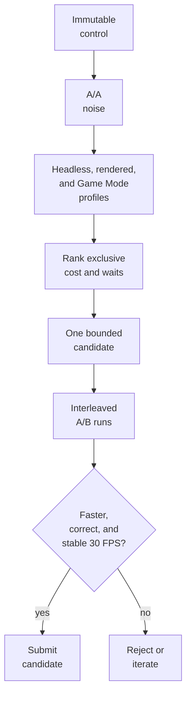

# TECH_PLAN — Steam Deck game-thread optimization

Status: Planning only

Source: upstream `main` at `2ab8118fc09fa08569100201a871616d18a1b771`

[PRD](PRD.md) · [Tracker](PROGRESS.md)

Architecture: [game thread](../../architecture/GameThread.md) ·
[test evidence](../../architecture/Testing.md) ·
[performance workflow](../../performance/Overview.md)

## Inspected facts

- [`bench_tour.py`](../../../scripts/bench_tour.py) controls fixed scenes and
  emits speed, busy time, dip causes, and guest checkpoints in `summary.json`.
- [`profile_deck.sh`](../../../scripts/linux/profile_deck.sh) launches one state,
  samples the Linux process with `perf`, and emits `perf.data`, `report.txt`,
  `run.log`, and a session-log copy. Headless and rendered runs answer different
  questions; neither invokes the benchmark tour.
- [`native_work_pool.c`](../../../cmake/composite/native_work_pool.c) provides
  synchronous range work on POSIX; Windows remains serial. #424 adds broader
  pool/lifecycle coverage but is not evidence that any game candidate is faster.
- No old #421 result is retained. Baseline, noise, hotspots, and activation are
  **unknown/not measured** for this plan.

## Planned changes

| Status | Surface | Practical change | Requirement |
|---|---|---|---|
| Modify | Steam Deck measurement procedure and evidence record | Freeze inputs, measure A/A noise, profile, and rank current costs | FR-01, FR-02 |
| Proposed | One M0-selected game-thread code path | Implement one bounded, opt-in candidate with activation evidence | FR-03 |
| Modify | Benchmark and profiling evidence | Compare matched builds against cost-reduction and stable-30 gates | FR-04 |
| Modify | Candidate-specific tests and qualification record | Prove behavior, fallback, lifecycle, and platform compatibility | FR-05 |

## Steam Deck procedure

Keep the control immutable. Build candidates from the same source revision,
compiler, PGO inputs, options, and AppImage environment; change only the
candidate. Never publish the personal module, state, card, or raw private log.

### Optional: SSH setup and limits

SSH can drive the headless benchmarks, profiles, comparisons, and evidence
collection. On the Deck, enter Desktop Mode, open Konsole, set a password if
needed, start the server, and obtain its LAN address:

```bash
passwd
sudo systemctl enable --now sshd
hostname -I
```

From the development machine, connect as `deck` and copy the private test bundle
only between machines you control:

```bash
ssh deck@DECK_IP
rsync -av ./deck-test/ deck@DECK_IP:~/bluewake-test/
```

Prefer SSH keys over leaving password authentication exposed. To stop and
disable the service after testing, run `sudo systemctl disable --now sshd` on
the Deck.

| Task | From SSH? | Boundary |
|---|---|---|
| Copy AppImages/scripts and collect redacted evidence | Yes | Keep the personal AppImage, state, card, module, and raw logs private |
| Headless `bench_tour.py`, `profile_deck.sh`, `perf report`, hashes, and comparisons | Yes | No display session is required |
| Rendered Desktop Mode benchmark/profile | Partly | A local graphical session must already be active; SSH needs its valid `DISPLAY` and `XAUTHORITY` |
| Game Mode launch and gameplay checks | No | Start and play the Steam entry on the Deck |
| Attach `perf` to an already-running Game Mode process and retrieve logs | Yes | Launch locally first, then attach by the verified process ID over SSH |

Commands in the following sections run in an SSH shell unless they explicitly
require Desktop Mode or Game Mode. Do not use X11 forwarding as a substitute
for measuring the Deck's own rendered session.

### 1. Build and identify the control

On the development machine:

```bash
git switch --detach 2ab8118fc09fa08569100201a871616d18a1b771
python3 scripts/linux/build.py /path/to/GZLE01.iso \
  --out build/deck-control --ci-container --appimage
sha256sum build/deck-control/BlueWake-x86_64.AppImage \
  build/deck-control/composite/gGZLE01_recomp.so
```

Record the commit, dependency-lock hash, compiler, builder command, AppImage and
module hashes, PGO/training status, and build summary. Copy the AppImage plus
`scripts/bench_tour.py` and `scripts/linux/profile_deck.sh` to the Deck. Both
the default Clang 18 and optional Clang 22 `x86-64-v3` container paths are
currently blocked by [#433](https://github.com/chrissotraidis/bluewake/issues/433);
neither is a valid control until that issue is resolved.

### Historical diagnostic

[`3b5c5c4826ef62bd1f8ff387734ff2ef295898e5`](https://github.com/chrissotraidis/bluewake/commit/3b5c5c4826ef62bd1f8ff387734ff2ef295898e5)
is the last source revision verified locally to compile the Clang 22 application
through the earlier packaged-Dawn route (RecompCore
`77d4717d868cec8b4014932bb22978c284a535a7`). Its AppImage ABI audit fails on
`GLIBCXX_3.4.32`, but that warning is not a Deck compatibility verdict: the
resulting AppImage launched on the Deck, loaded the fixed state, and executed
gameplay. It remains a diagnostic checkpoint, not the reproducible current
source control or a release candidate.

### Deck test bundle

Copy only the private AppImage, the two measurement scripts, and selected save
states. Do not copy the build tree, ISO, generated sources, standalone module,
or local logs.

```text
~/bluewake-test/
├── BlueWake-x86_64.AppImage
├── bench_tour.py
├── profile_deck.sh
└── states/
    └── quick-N.bwstate
```

With `bench_tour.py --state states/quick-N.bwstate`, its positional card
argument is unused; pass `unused.card`. The AppImage already contains the
private translated module and disc copy, so retain it only on machines you
control.

### 2. Freeze the Deck environment and private workload

Record Steam Deck revision, SteamOS/kernel, Game Mode or Desktop Mode, refresh
rate, frame cap, TDP/clock limits, power source, renderer, resolution, textures,
Smooth Motion, and state hash. Use one heavy state (initially Outset), another
measured slow scene, and a low-load control. Fix cooling/power conditions and
discard warmup before comparing runs.

### 3. Establish same-build noise

From the Deck, run the control at least three times per mode:

```bash
python3 scripts/bench_tour.py unused.card ./BlueWake-x86_64.AppImage \
  --state /home/deck/.local/share/BlueWake/quick-N.bwstate --mode headless
mv summary.json evidence/control-headless-1.json

python3 scripts/bench_tour.py unused.card ./BlueWake-x86_64.AppImage \
  --state /home/deck/.local/share/BlueWake/quick-N.bwstate --mode rendered
mv summary.json evidence/control-rendered-1.json

python3 scripts/bench_tour.py compare \
  evidence/control-headless-1.json evidence/control-headless-2.json
```

Repeat with identical settings. If same-build speed varies by more than 3%, or
checkpoints differ, fix the workload before profiling candidates.

### 4. Capture CPU profiles

Headless/unpaced isolates execution throughput; rendered/Desktop Mode exposes
GX, GPU, and presentation waits:

```bash
scripts/linux/profile_deck.sh --seconds 30 \
  --appimage ./BlueWake-x86_64.AppImage \
  --state /home/deck/.local/share/BlueWake/quick-N.bwstate \
  --out evidence/profile-headless

scripts/linux/profile_deck.sh --rendered --seconds 30 \
  --appimage ./BlueWake-x86_64.AppImage \
  --state /home/deck/.local/share/BlueWake/quick-N.bwstate \
  --out evidence/profile-rendered
```

For the primary Game Mode capture, launch the same AppImage/state through Steam,
then attach over SSH rather than launching a second process:

```bash
PID=$(pgrep -n -f 'mount_.*bluewake')
perf record -g -F 99 -p "$PID" -o evidence/game-mode.data -- sleep 30
perf report -i evidence/game-mode.data --stdio --no-children \
  > evidence/game-mode-flat.txt
perf report -i evidence/game-mode.data --stdio --sort=tid,symbol \
  > evidence/game-mode-threads.txt
```

Reject a capture with the wrong PID/scene, lost samples, thermal/power changes,
missing symbols, or insufficient post-warmup duration.

### 5. Rank and investigate candidates

Correlate flat self-time, per-thread ownership, session `busy`/wait fields, and
cycles/instructions per retrace. Use `perf annotate` on each leading symbol.
Generated `func_<address>` symbols are chunks, not original game functions;
map ranges before naming game logic.

### 6. Compare a candidate

Build A and B from the same revision and inputs. Run five interleaved pairs
(`A/B/B/A/...`) in headless and rendered modes, then repeat the Game Mode scene.
Use `bench_tour.py compare`, verify candidate activation, compare medians and
noise, re-profile B, and complete the gameplay route. Missing activation,
correctness evidence, or 30 FPS evidence leaves qualification incomplete.



## Candidate surfaces

Selection is measurement-driven; the rows are investigation boundaries, not
preapproved changes.

| Candidate | Referenced code | Why it may matter | Selection evidence |
|---|---|---|---|
| Dispatch/direct-call bookkeeping | [`dispatch_loop.h`](../../../cmake/composite/dispatch_loop.h), [`direct_calls.h`](../../../cmake/composite/direct_calls.h), [`host_direct_can_skip_with`](../../../runtime/host/src/main.c) | Runs at translated/host boundaries | High exclusive cost and call frequency after current defaults |
| Hot translated chunk or larger native span | [`module_export.c`](../../../cmake/composite/module_export.c), patterns in [`native_search.c`](../../../cmake/composite/native_search.c) and [`native_j3d.c`](../../../cmake/composite/native_j3d.c) | Removes repeated translated bookkeeping from measured game work | Mapped hot chunk, verified original range, safe native boundary, upper-bound benefit |
| Independent numeric batch | [`native_math.c`](../../../cmake/composite/native_math.c), [`native_skin.c`](../../../cmake/composite/native_skin.c), [`native_work_pool.c`](../../../cmake/composite/native_work_pool.c) | Can use otherwise idle CPU cores when inputs/outputs are independent | Inclusive kernel cost, profitable batch sizes, positive worker activation |
| Guest-state/access helpers | [`guest_cpu.c`](../../../cmake/composite/guest_cpu.c), [`inline_gpr.h`](../../../cmake/composite/inline_gpr.h), [`inline_fp.h`](../../../cmake/composite/inline_fp.h) | Generated execution may spend time synchronizing or interpreting values | Annotated self-time; no assumption that inlining or caching helps |
| GX command preparation on the game thread | [`gather_pipe.h`](../../../cmake/composite/gather_pipe.h), [`gather_pipe_batch.h`](../../../cmake/composite/gather_pipe_batch.h) | Game-thread command production can remain costly even with an idle GPU | Game-thread/GX symbols and waits, not GPU utilization alone |

Proposed candidate instrumentation must be compile-time or explicitly opt-in,
must report path activation, and must not be part of the timed A/B binaries.

## Metrics and verification

| Metric | Unit / source | Decision use |
|---|---|---|
| Game rate | game FPS and retraces/s from benchmark/session logs | Stable-30 gate and throughput benefit |
| Game-thread cost | busy %, wall time per fixed retrace window | Primary critical-path reduction |
| CPU work | cycles and instructions per retrace; IPC | Distinguish less work from clock/noise effects |
| Hotspot ownership | flat self-time %, annotated instructions, TID | Select and explain candidate |
| Waiting | GX/present/GPU wait ms; worker busy % | Reject wrong-domain optimization |
| Distribution | median plus p95/p99 update time where available | Detect tail regressions hidden by averages |
| Activation | calls, accepted/declined jobs, batches, items | Prove the candidate ran |
| Correctness | checkpoints, differential oracle, source tests | Reject skipped or changed game work |
| Environment | clocks, temperature, power/TDP, hashes | Identify incomparable runs |

## Findings

These are preliminary findings from a source-identified historical AppImage,
not the pinned current-source control. The raw AppImage, state, logs, and
`perf.data` remain private.

### Environment

| Item | Measured value |
|---|---|
| Hardware / OS | Steam Deck Jupiter; SteamOS 3.8.28; kernel 6.18.50 |
| Power / CPU policy | AC power; `powersave`; 2.42 GHz observed at collection |
| Temperature | 29°C Deck sensor; 48°C APU |
| Session | Plasma Wayland Desktop Mode; not Game Mode |
| Artifact | Source [`3b5c5c4`](https://github.com/chrissotraidis/bluewake/commit/3b5c5c4826ef62bd1f8ff387734ff2ef295898e5); AppImage `2fdd36…2dd2b6b`; module `0775a8…e28c552` |
| Instrumentation | `perf` 6.15; process-attached cycle sampling works; system-wide `perf stat` is denied by `perf_event_paranoid=2` |
| Worker pool | The benchmark runs were serial because `bench_tour.py` clears inherited `BLUEWAKE_*` settings. A separate two-worker probe also reported `parallel=0`: its largest vector array was 8 items, below the 768-item split threshold (`256 × 3` participants). |

### Measurement methodology

- Loaded the same private `quick-23874.bwstate`; every run produced six
  matching guest checkpoints.
- Ran [`bench_tour.py`](../../../scripts/bench_tour.py) three times headless
  and three times with the renderer in the active Desktop session. It discards
  the first 300 retraces and measures the next 1,500. Both modes are unpaced;
  they measure simulation throughput, not player-visible FPS. They must not be
  compared with the real-time Steam Deck report in [#215](https://github.com/chrissotraidis/bluewake/issues/215).
- Attached `perf record -g -F 99` to one 30-second headless run. It captured
  2K user-space cycle samples with zero loss. `perf annotate` was used to
  inspect the leading symbols.
- Ran one non-comparative, headless probe with `BLUEWAKE_NATIVE_WORKERS=2` and
  allowed normal shutdown so the native-math counters were printed. It is
  activation evidence only, not an A/B result.

### Ranked optimization investigations

The profile was attached to the running `bluewake` process. `gGZLE01_recomp.so`
entries execute in the loaded game module; `bluewake` entries execute in the
BlueWake host executable. Source files are build inputs, but the functions
listed here are runtime costs.

| Rank | Code path | Metric found | Why it ranks here / required proof |
|---|---|---:|---|
| 1 | Generated translated chunks reached through [`module_export.c`](../../../cmake/composite/module_export.c) | `func_802456E0` 7.80%; `func_803256E0` 3.90% self time | Largest individual costs. Map each generated chunk to its guest range and establish a correctness oracle before proposing a native boundary. |
| 2 | BlueWake host edge/service and actor-search paths in [`main.c`](../../../runtime/host/src/main.c) | `host_chassis_requires_full` 1.15%; `host_actor_search_native` 1.12%; `bw_search_word` 0.72%; `host_chassis_edge_service_full` 0.57% | Direct host-side evidence. Measure call/decline reasons first; preserve interrupt, deadline, and guest-memory contracts. `bluewake_host_main` is 1.62% but is an umbrella, not a candidate itself. |
| 3 | [`dispatch_loop.h`](../../../cmake/composite/dispatch_loop.h) and [`module_export.c`](../../../cmake/composite/module_export.c) | `chassis_dispatch` 2.70% | Shared module boundary overhead may compound across guest edges. Measure dispatch/direct-call frequency and preserve edge-service and deadline semantics. |
| 4 | RecompCore [`cpu.c`](../../../ref/recompcore/GXRuntime/src/core/cpu.c) | `ppc_guest_alias_resolve` 2.13% | Meaningful runtime helper cost, but alias semantics are safety-critical. First record resolution/pruning behavior and retain the guest-address contract. |
| 5 | [`native_game_math.c`](../../../cmake/composite/native_game_math.c), [`native_math.c`](../../../cmake/composite/native_math.c), [`native_vec.c`](../../../cmake/composite/native_vec.c) | 3.29%, 1.88%, and 1.74% respectively; worker probe: 85,096 vectors, maximum array 8, `parallel=0` | Existing runtime fast paths are active but this scene cannot use the current pool threshold. Do not treat #424 or this profile as evidence of gameplay parallelism. |
| 6 | [`gather_pipe.h`](../../../cmake/composite/gather_pipe.h) | Renderer-enabled unpaced throughput: 30.60–31.11 game frames/s; startup diagnostics reported `gpu=0ms` | Current evidence points away from GPU wait. Recheck in Game Mode before selecting graphics work. |

Headless simulation throughput was 34.05–34.45 game frames/s (maximum 1.2%
spread, 98–99% busy). Renderer-enabled, unpaced Desktop throughput was
30.60–31.11 game frames/s (maximum 1.6% spread, 97.9–98.2% busy). Neither is
a real-time Game Mode result or evidence that the game holds 30 FPS. Self-time
percentages are from one capture, are not additive, and do not estimate a
speedup.
